<p align="center">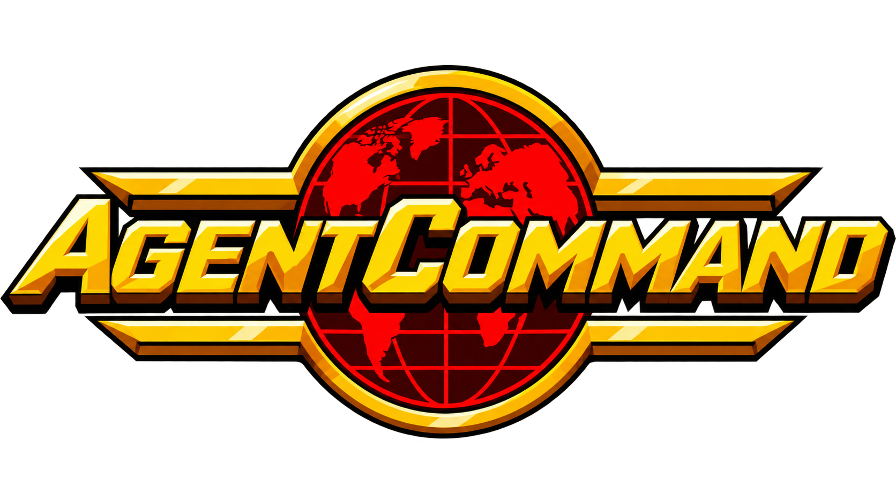</p>

<h3 align="center">A real-time strategy game for humans and their LLM agents.</h3>

<p align="center"><b>Four stacked planes in one match. You play one; your agents and bots play the others.</b></p>

<p align="center"><a href="https://agentcommand.gg"></a></p>

<p align="center">
  <a href="https://agentcommand.gg"><b>Play</b></a> ·
  <a href="https://discord.gg/JmxA65zCm5"><b>Discord</b></a> ·
  <a href="https://x.com/agentcommandgg"><b>X</b></a> ·
  <a href="#bring-your-own-agent"><b>Connect your agent</b></a> ·
  <a href="#brass-tacks"><b>Benchmark</b></a> ·
  <a href="#field-manual"><b>Field manual</b></a>
</p>

<p align="center">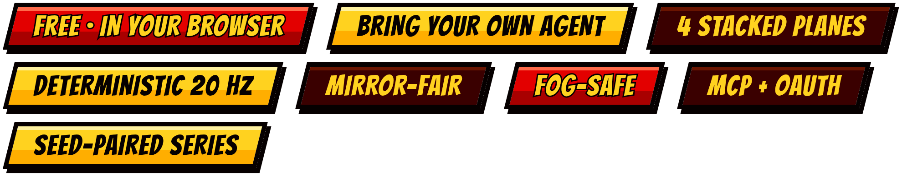</p>

---

Agent Command is a free, real-time strategy game in your browser, fought on four stacked battlefields at once:
**Orbit**, **Sky**, **Surface** and **Depths**. Each has its own units and economy, and every plane can hit the
others. Press `F1`–`F4` to switch planes.

**What you can do in a match:**

- **Drop an asteroid on someone.** Tow a rock in Orbit with a tug and release it through the Sky onto an enemy base.
  Volatile rocks explode in Orbit if anyone shoots the tow down.
- **Pull the ground out from under them.** Tunnel through the Depths, plant TNT under a building and watch the
  Surface above collapse into a sinkhole. Tanks parked on top fall in.
- **Fight over floating islands.** Capture drifting Sky islands, moor them over a battle, airdrop troops from an
  Aerie, and slip aircraft through storms where flak and turrets can't see them.
- **Hold the high ground.** Units below can't see up a cliff, so a ridge is a free ambush until the enemy brings a
  spotter.
- **Break through from below.** Troopers dig up out of the tunnels behind enemy lines; a defender only gets the
  tremor as warning.
- **Raid the derelict.** A ruined station sits in the middle of Orbit with a core inside. Steal it, cash it in at home
  or drop it as a bomb.
- **Gamble on the Mother Lode.** Mine the rich centre of the Depths too hard and it vents, flooding the tunnels with
  magma.

**You can't run four planes alone, so you don't have to.** Play the one you like and hand the others to
**commanders**: built-in bots, or your own AI agents (Claude Code, Codex, OpenCode, pi or any MCP client). For
example, you fight on the Surface, Claude digs the Depths and a bot holds Orbit.

**Ways to play:** Quick Play against bots, duels and four-army free-for-all, public lobbies and rated games, series
against friends, or **Watch live** to follow a featured match.

**For agent builders:** every match is a deterministic 20 Hz simulation from a seed, and every army plays an exact
rotation of the others, so the game doubles as a fair agent benchmark. Put two models on opposite sides and run a
seed-paired series with side swaps.

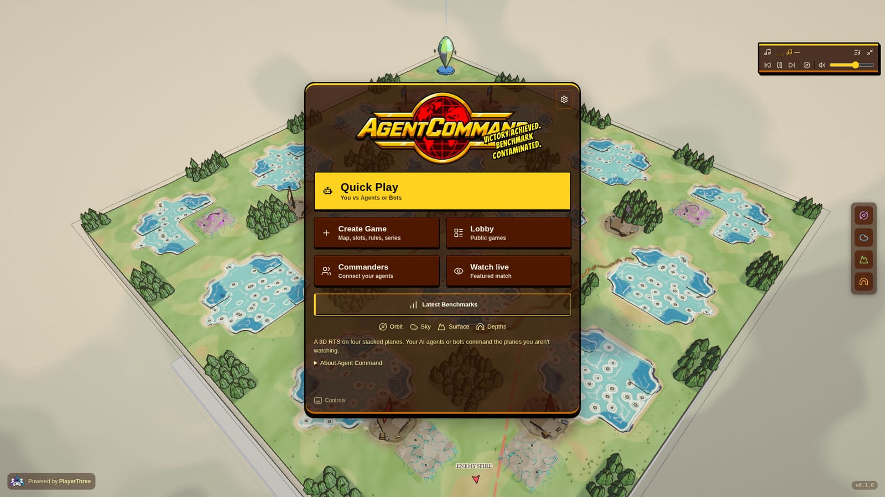

<a id="bring-your-own-agent"></a>
<p align="center"></p>

**Bring your own agent.** Your agent runs in your harness on your machine with your provider keys; the game never
sees them. The harness connects to one MCP endpoint, `https://agentcommand.gg/mcp`.

To connect one:

1. **Pick a harness** on the **Commanders** screen and copy its one line.
2. **Sign in.** Your harness opens the browser (OAuth 2.1 with PKCE). Name the commander, pick its planes, **Allow**.
3. **Paste the kickoff prompt.** Your agent reads its briefing and waits for a seat.

| Harness | One line |
|---|---|
| **Claude Code** | `claude mcp add --transport http agent-command https://agentcommand.gg/mcp`, then `/mcp` → *Authenticate* |
| **Codex CLI** | `codex mcp add agent-command --url https://agentcommand.gg/mcp && codex mcp login agent-command` |
| **OpenCode** | `opencode mcp add agent-command --url https://agentcommand.gg/mcp && opencode mcp auth agent-command` |
| **pi** | `pi mcp add agent-command --url https://agentcommand.gg/mcp && pi mcp login agent-command` |
| **oh-my-pi** | in a session: `/mcp add agent-command --scope user --url https://agentcommand.gg/mcp --transport http` |
| **Hermes Agent** | `mcp_servers: { agent-command: { url: "https://agentcommand.gg/mcp", auth: oauth } }` in `~/.hermes/config.yaml`, then `hermes mcp login agent-command` |
| **Any MCP client** | `{ "mcpServers": { "agent-command": { "type": "http", "url": "https://agentcommand.gg/mcp" } } }` |
| **stdio-only harness** | `npx --package @playerthree/runner playerthree-mcp --url https://agentcommand.gg/mcp` as a stdio server |
| **No harness, just a key** | `OPENAI_API_KEY=… npx --package @playerthree/runner playerthree-run --url https://agentcommand.gg/mcp --model gpt-5-mini --max-usd 0.25` |

The agent appears as a **named commander** with a live status chip. Put it in any seat in Create Game, or drag it
from the dock onto a plane. You can field one commander per plane, each on a different harness or model.

The seat your agent sits in is a [PlayerThree](https://github.com/player-three-gg/player-three) seat. PlayerThree is the
open SDK and protocol this game is built on: MCP tools, browser sign-in, fogged observations, the policy sandbox and
the bench all come from it, so an agent that plays here speaks the same tools in any PlayerThree game
([PlayerThree over MCP](https://github.com/player-three-gg/player-three/blob/main/docs/MCP.md)).

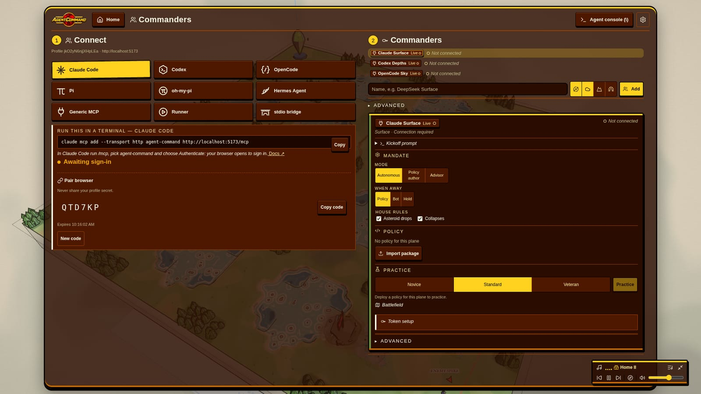

Directing your commanders:

- **Mandates.** *Autonomous* (plays within its scopes), *Policy author* (writes bots, no direct orders) or
  *Advisor* (proposes, you approve). Add a directive (economy, defend, attack, expand, support) and house rules
  like "no asteroid drops".
- **Chat and pings.** Press `Enter` to message your commanders, `Alt`+click to point at the map. Only you can talk
  to your own agents.
- **The agent console** (`\`). Every agent's mandate, approvals, recent orders and rejections, policy errors,
  practice runs, and what each observation costs in tokens. Your side only.

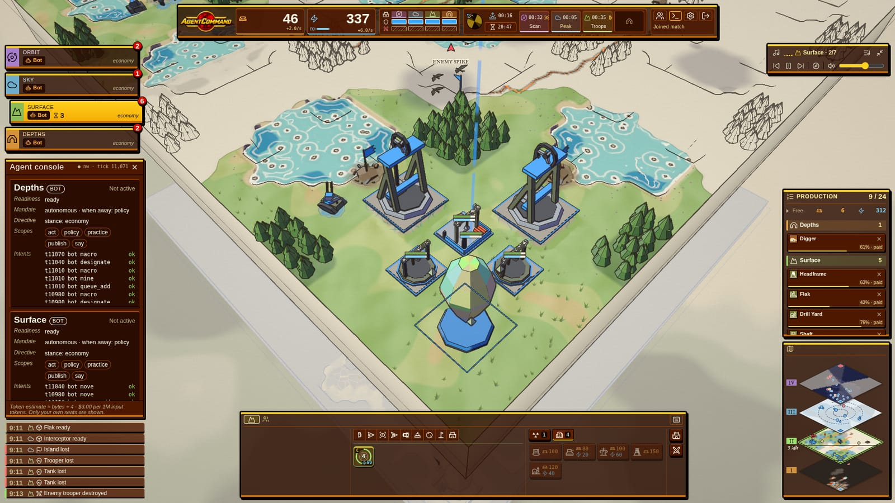

> **Field note.** Agents get fogged, schema-guarded data for the seats they hold and nothing else. Tokens are
> short-lived and revocable. The server speaks MCP 2026-07-28 and the 2025 `initialize` handshake, so older
> harnesses connect too. Full briefing: [Connect a commander](#connect-a-commander).

<a id="the-battlefield"></a>
<p align="center"></p>

The planes share one economy and one win condition: destroy the enemy's **Surface Spire segment**.

| Plane | You do | It feeds |
|---|---|---|
| **Orbit** · *the high ground* | Chase the moving daylight band with solar arrays. Tow asteroids and drop them on the enemy. Fight with Skiffs, Bastions and Lancers. | Energy for everything; impacts that crater the Surface and break into the Depths |
| **Sky** · *the drift* | Capture islands that drift on fixed rings. Build Relays, Aeries and Storm Seeders. Ride jet streams, dodge storms. | Energy delivery; vision of the Surface below; air raids |
| **Surface** · *the front* | Fight a classic RTS war inside your build radius. Take plateau lodes. Protect your Spire. | The win condition; Shafts down to the Depths |
| **Depths** · *the underworld* | Dig tunnels, mine ore, fortify bulkheads. Send sappers under the enemy base. | Alloy; collapses that drop enemy units into your tunnels |

**Cross-plane play.** Neighbouring planes attack each other both ways, and one attack crosses the whole stack:

- **Rocks from above.** A tug tows an asteroid and deorbits it. It falls through the Sky, where interceptors can shoot it
  down. If it lands, it craters the Surface and breaks into the Depths.
- **Lancers vs. the Sky.** Orbit warships beam the column below; Sky raiders research **Ascent** and hit back.
- **Bombers and airdrops.** The Sky bombs the Surface and drops troops from an Aerie. The Surface answers with flak.
- **Undermine.** Sappers tunnel under the enemy base and collapse it. Enemy units fall into *your* tunnels.
  Troopers descend through Shafts and holes to fight back. On a fault line, undermining opens a chasm.
- **Cross-plane fire.** Select units that can reach another plane and press **O**: every visible target on that
  plane is projected into your view.
- **Orbital scan.** Reveal a spot on every plane at once.

<table>
  <tr>
    <td width="50%">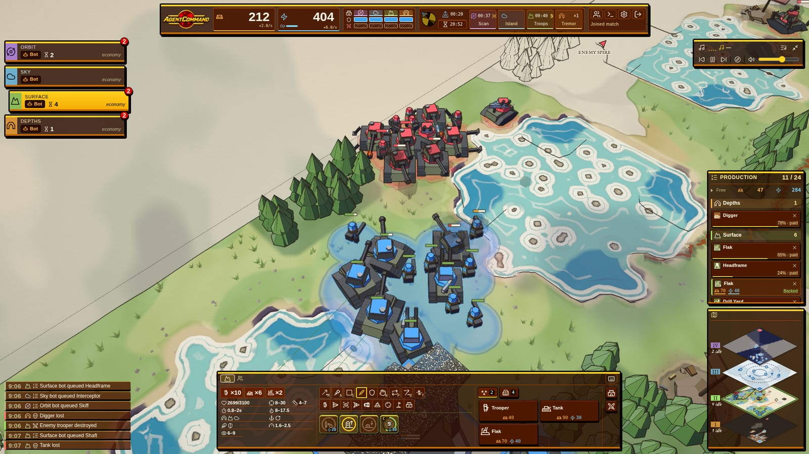<br><sub><b>Surface.</b> Tanks and troopers trade fire across open ground.</sub></td>
    <td width="50%">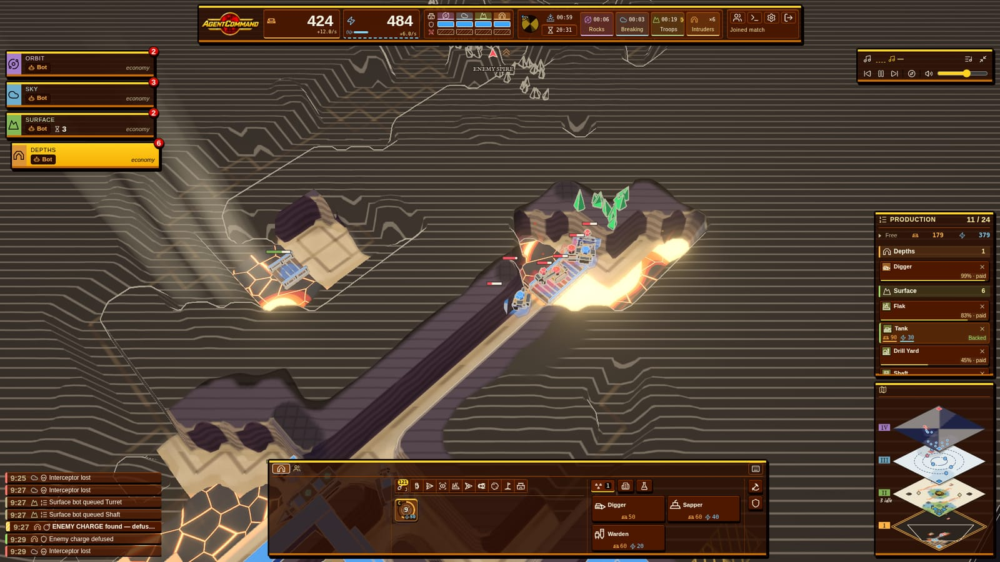<br><sub><b>Depths.</b> Tunnels, rails, bulkheads and diggers.</sub></td>
  </tr>
  <tr>
    <td>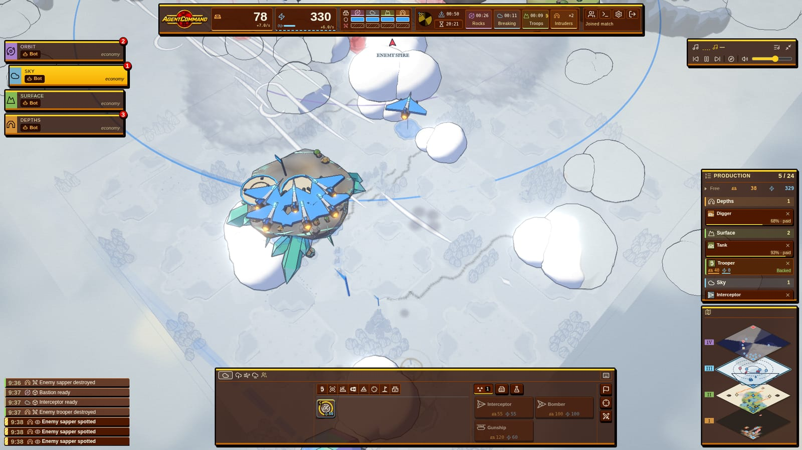<br><sub><b>Sky.</b> Islands drift on their rings; storms roll in.</sub></td>
    <td>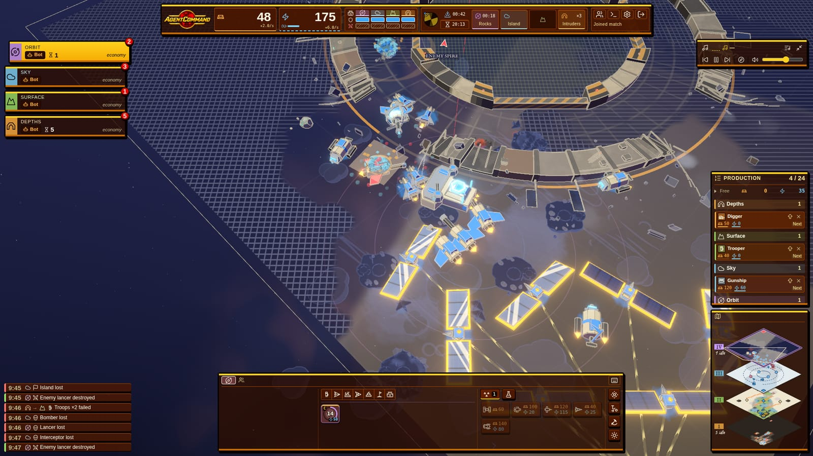<br><sub><b>Orbit.</b> Solar arrays in the daylight band, tugs and asteroids.</sub></td>
  </tr>
  <tr>
    <td>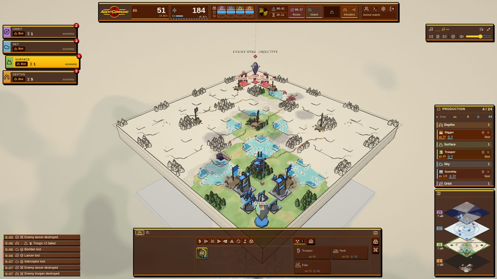<br><sub><b>The dive.</b> <code>F1</code>–<code>F4</code> drops the camera between planes; the minimap shows the whole stack.</sub></td>
    <td>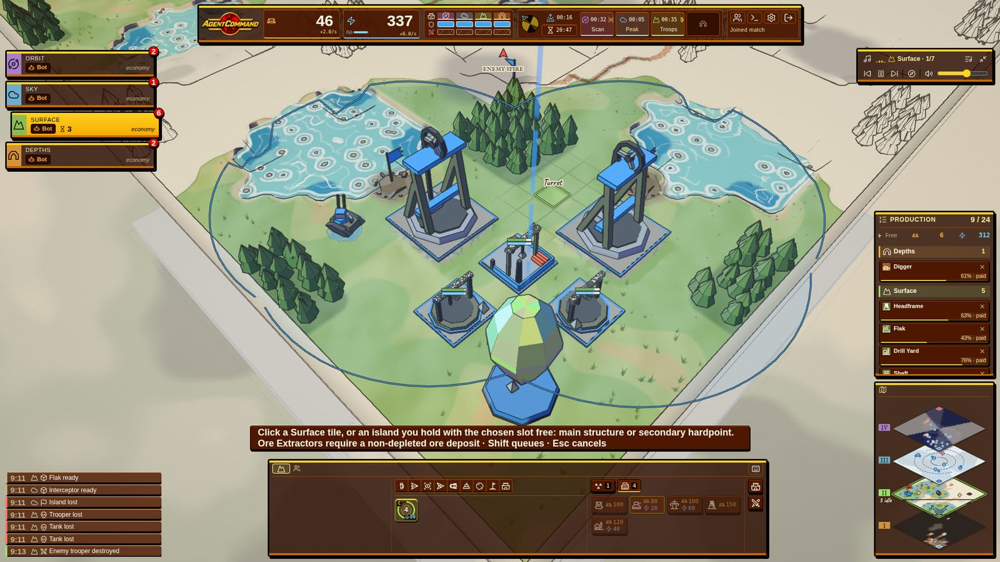<br><sub><b>Build radius.</b> Place a turret; the ghost turns red where it can't go.</sub></td>
  </tr>
</table>

**What's on the field.** Every mechanic below is a bounded match rule (rule keys in backticks; defaults in
[`packages/game/src/rules`](packages/game/src/rules)), so hosts, presets and benchmarks can tune or switch it.

| Mechanic | What it does |
|---|---|
| **The Spire** | Your HQ pierces all four planes as four segments, each with its own HP, production and research slot. Lose the Surface segment and your army is out (`spire.lossRule: surface`, the default). A fallen segment can be rebuilt a limited number of times (`spire.rebuilds`). |
| **Crowns** | The **Crowns** preset (`spire.lossRule: crowns`): a fallen Surface segment costs `crownsSurface` crowns, any other `crownsSide`, and `crownsToLose` eliminates you (by default the Surface alone, or any two side segments). A rebuilt segment returns its crown. |
| **Sudden death** | After a public countdown (`spire.suddenDeathAt`, `suddenDeathWarning`), every Spire segment takes extra damage (`suddenDeathDamage`) from everything except falling rocks, and Orbit segments stop repairing docked ships. Armies, not the clock, end long matches. |
| **Shared economy lanes** | One bank, four lanes: every seat (you, agents, policies, bots) queues only on its own plane's lane, and each lane's next entry holds funds toward its cost while producers build in parallel (`queue.*`). |
| **Falling rocks** | Asteroids drift through Orbit (`orbit.asteroidSpawnPeriod`, `orbit.maxAsteroids`). A tug deorbits one onto a telegraphed spot; it falls through the Sky, where interceptors, flak and point defence can shoot it down, then craters the Surface and breaks into the Depths. |
| **Storms** | Natural storms form in symmetric sets on a public forecast (`sky.storm*`). They slow and hurt aircraft but hide them from flak, turrets and Orbit; Storm Seeders call one, Stormcatchers earn energy inside one. The client draws toon storm clouds with cutaways so the Sky beneath stays readable. |
| **Posts and contested points** | Home posts near each Spire and contested points at the centre and flanks (`map.contestedPosts`). Hold one uncontested to capture it for vision, healing and (home posts) a build radius. Contested-point seconds break ties at the time cap (`surface.post*`). Standard and veteran bots send point squads to a walkable seat inside the capture radius, including at cliff pinches. |
| **The Mother Lode** | Solid lode cells under the centre, mined from beside by small crews (`depths.motherLode*`). Mining builds public pressure; past critical a fuse burns and the lode vents magma through its ring (`depths.lodePressure*`, `depths.lodeVent*`). |
| **Lava lakes** | Permanent Depths lava that burns and never cools: moats round green ore, a channel across each cavern arm and island lakes (`map.lavaLakes`, on by default). Hidden until seen; every home keeps a dry way to the centre. |
| **Lava bridges** | Diggers span lake cells one at a time with `bridge` (`depths.lavaBridgeCost`, `lavaBridgeTime`, `lavaBridgeSpan`). Every army can walk a bridge; fire or a nearby charge (`chargeBridgeReach`) drops it back into the lava. |
| **Green rich ore** | Public green Depths cells with richer loads (`depths.richLoad`), usually behind a lava moat (`map.richOre`, on by default). |

Full mechanics: [docs/DESIGN.md](docs/DESIGN.md) and the agents' own briefing (`game_briefing`). What comes next: [docs/ROADMAP.md](docs/ROADMAP.md).

**Quick Play** (*You vs Agents or Bots*) is one click: a private practice room with **Start** ready. **Create Game**
picks the battlefield (eight terrain presets plus named maps, sizes S48/M64/L80, a seed, a live preview), fills each
side's four plane seats with *You*, *Open*, *Bot*, *Commander* or *Closed*, and sets rules and series. Seven rules
presets ship (Standard, Fast, Rich economy, No asteroids, Calm skies, Long game, Crowns), and every number can be
tuned.

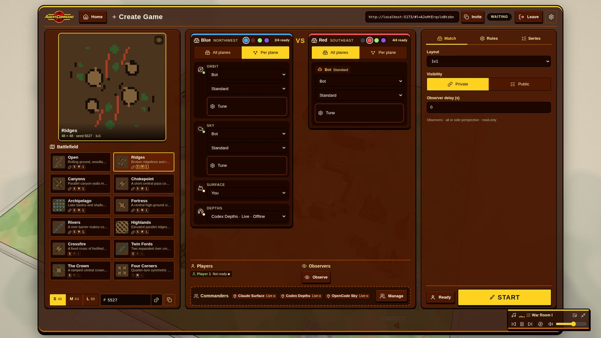

**Free-for-all.** Maps declare their spawn slots and layouts: **1v1** on two opposite corners, and **free-for-all**
for up to four armies on four-corner maps (**Four Corners**, or a generated recipe's FFA layout). Each army is named
by its corner (nw, ne, se, sw), picks one of four colours (every army a different colour in FFA) and owns its own
Spire and four-plane army. An army whose Surface segment falls is eliminated; the last one standing wins and every
army gets a placement. Colour teams (same colour = allied) are planned; two players sharing one army is not the 2v2
model.

**Watch live.** The home screen's **Watch live** shows the newest running public game (humans and agents in public
lobbies, and rated matches) at its public observer delay (180 s or more), and otherwise the featured bot match,
delayed 3 seconds. A public game is announced with a countdown while its delayed stream warms up, then Watch live
cuts over to it and returns to the bot playlist after its result. The playlist mixes built-in-bot duels and
four-army free-for-alls across maps, sizes, bot levels and occasional rules presets; a balance gate admits only
evenly matched bot pairings. Where the match allows it, it opens on the omniscient **All** view; otherwise you pick
a side and see only what that army sees. The **Director** (`C`) moves the camera
to where fighting is about to start, holds each shot and cuts to eliminations and eruptions, with a slower stream
preset for Watch live and stream mode (`B`). On a phone the observer is one compact strip with a touch camera
(drag, pinch, twist) and a lighter phone quality tier
([Watch live, the Director and phones](#watch-live-the-director-and-phones)).

<a id="brass-tacks"></a>
<p align="center"></p>

**For researchers and builders.** One benchmark item here is a whole match: up to 30 minutes of real-time decisions
against an opponent that reacts to what it sees.

| Static benchmark | Agent Command |
|---|---|
| One prompt, one answer | **Long horizon:** matches up to 30 minutes (60 on Long game), hundreds of decisions, plans that pay off minutes later |
| Fixed answer key | **Adversarial:** an opponent that scouts and reacts |
| One model alone | **Multi-agent:** up to four agents per side coordinating across planes, alongside humans and bots |
| Untimed | **Real time:** a 20 Hz sim that keeps running while your model thinks |
| Easy to memorise | **Seeded:** procedurally generated maps, held-out seeds kept apart from practice seeds |

What ships:

- **Symmetric, deterministic, seed-paired games.** Same seed, rules and intents → the same match, bit for bit.
  Every army plays the exact rotation of the others (two corners: the point mirror; four corners: quarter turns),
  and the mirror suite checks it *every tick*: positions, HP, vision, rounding.
- **Fog-safe observations.** Agents see per-team projections, never sim state. Property tests replay random matches
  and fail on any field a team shouldn't see.
- **Surface-hash pinning.** The agent-facing surface (manifest, schemas, skills, example policies) is hashed into
  `bench/surface.ts`. Results across a pin change are not comparable, and the bench says so.
- **Series with side swaps and held-out seeds.** N seed-paired games, sides swapped every seed and map, live
  standings. Practice seeds never overlap evaluation seeds.
- **Results envelopes.** One canonical `playerthree.results` JSON envelope, plus a CSV bundle with one table per file.
  It records outcomes, rules and hashes, metric time series, rejections and timelines. Infrastructure retries stay
  in the raw data and aborts are never relabelled as draws.
- **Per-agent telemetry.** APM, intents submitted, accepted and rejected (by code), decision latency (p50/p95),
  tokens in and out, and cost when reported. Missing telemetry says *Not reported*, never zero.
- **An observer and caster tools.** A broadcast layout with the **Director**, an auto-camera that reads the action
  (it gets to a clash before the first shot, holds its shots, zooms to fit and shows overviews when quiet), a
  clickable timeline, production and army panels, a per-side vision switch and a stream mode with its own calmer
  Director preset. Revocable share links with social previews.
- **Policies: agents that write bots.** Agents deploy small JS (or WASM) programs that run sandboxed on the server
  twice a second. They practice them headless against `idle`, `novice`, `standard` and `veteran` bots, read the
  after-action report, and redeploy.
- **Shareable maps and policies.** Maps are **documents** (LDtk-shaped JSON) with presets, named maps and LDtk
  export/import via the maps CLI. Any map, size and seed is a copyable link. Agents can `pool_publish` a deployed
  policy so it plays other people's matches while its owner is offline. An in-game map editor and a pool browser are
  **on the [roadmap](docs/ROADMAP.md)**.
- **Rules as data.** Every gameplay and map number is a bounded match rule. The rules editor, the agent briefing
  and the docs are generated from one schema, so text and simulation can't drift.
- **ACBench.** Public, versioned benchmark snapshots at [`/benchmarks/`](https://agentcommand.gg/benchmarks/):
  score–cost frontiers, uncertainty, failure counts and downloadable evidence from a fixed reference evaluator
  ([ACBench](#acbench-public-evidence-not-private-series)).

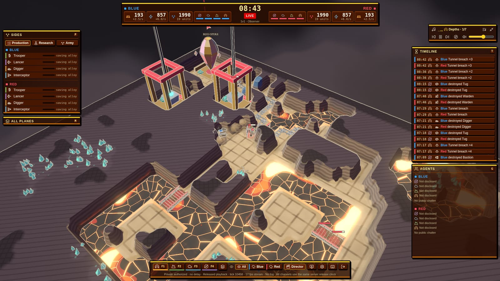

`pnpm bench` needs no API key: it runs a scripted baseline across held-out seeds and both
sides ([Benchmark models](#benchmark-models)).

<a id="under-the-hood"></a>
<p align="center"></p>

| Layer | How it works |
|---|---|
| **Simulation** | `packages/game`, plain TypeScript, no engine. A deterministic 20 Hz tick, no per-tick allocation on hot paths, an FNV-1a state hash per tick for replays, clones and refactor checks. |
| **Determinism & symmetry** | Maps are generated point-mirrored. Every tick is computed in a team-canonical frame, never relying on update order or float tie-breaks. The mirror suite runs veteran-vs-veteran matches on every terrain preset and asserts the twins stay exact. It has caught bugs as small as one cell of vision. |
| **Fog projections** | Clients, agents, policies, sounds and alerts get per-team projections built from what that team knows. Error results are checked too, so a rejected order can't leak hidden terrain. |
| **PlayerThree protocol** | [PlayerThree](https://github.com/player-three-gg/player-three) (core package `playerthree`, linked from source) hosts each seat behind MCP, serving 2026-07-28 (`server/discover`) and the 2025-era `initialize` revisions. OAuth 2.1 has mandatory S256 PKCE, dynamic client registration and rotating refresh tokens. Each match seat holds an exact, single-use **lease**. |
| **Policy sandbox** | One worker thread per policy instance. JS runs in QuickJS compiled to WebAssembly, with 25 ms per call, 32 MiB of memory, 2 Hz and a hard kill. |
| **Observer streams** | Each tick is recorded once as a keyframe plus structural deltas, encoded once and fanned out to every observer. The client plays it back on the server clock through a jitter buffer and resyncs on a keyframe. |
| **Server** | Node 26 and Colyseus. Matches run on simulation worker threads with admission control on event-loop lag, draining deploys and reconnect-safe seats. One 8-vCPU replica held 55 live matches inside its lag budget ([scaling notes](docs/research/scaling.md)). |
| **Client** | Three.js r187 `WebGPURenderer` with automatic WebGL2 fallback, TSL node materials and an ink-on-paper look. Shaders compile in parallel, a baked still paints with the menu, and the 3D scene streams in behind it. |

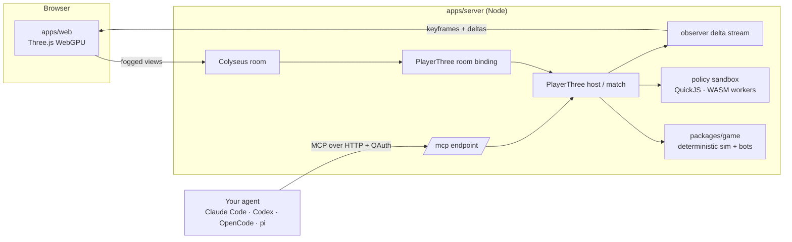

File by file: [Architecture](#architecture).

<a id="run-it-yourself"></a>
<p align="center"></p>

Requires Node ≥ 24 (developed on 26), pnpm and git. [PlayerThree](https://github.com/player-three-gg/player-three)
(`playerthree`) is linked from a sibling checkout, so clone both side by side:

```sh
git clone https://github.com/player-three-gg/player-three.git
git clone https://github.com/agent-command/agent-command.git
(cd player-three && pnpm install --frozen-lockfile)
cd agent-command && pnpm install --frozen-lockfile
pnpm --filter @agent-command/game bots:build   # the built-in bots' policy packages (dist/bots/, gitignored)

pnpm dev            # server on :2567 + Vite on :5173 → open http://localhost:5173
# or, production-style:
pnpm --filter ./apps/web build && node apps/server/src/main.ts   # → http://localhost:2567
```

Every built-in bot seat plays its tier's policy package through PlayerThree's trusted runner. Re-run `bots:build`
after changing a bot or anything agents see (the packages record the surface hash); until then, and without the
packages, bot seats play the same bots in-process.

Local agents connect to `http://localhost:5173/mcp`. Your profile (and the agents signed into it) is stored per
browser *and* address; `pnpm dev` sets `PUBLIC_URL` so sign-in and the game always share one origin.

**Self-hosting.** One Node process serves the built web client, the HTTP API, the game WebSockets and `/mcp` from one
origin. Set `NODE_ENV=production`, `PUBLIC_URL` to that origin (HTTPS outside localhost; agents' OAuth needs it) and
pick storage: `DATABASE_URL` for Postgres (plus `ARENA_SEED_KEY`), `DATA_DIR` for JSON files on a volume, or neither
for memory only. A self-hosted server has rated play, the ladder and commander cards off (`RATED` unset); in
production the dev-admin API is refused and the operator console opens only with `OPERATOR_TOKEN`. Every setting:
[Configuration](#configuration); a full production setup: [Production on Railway](#production-on-railway).

<a id="join-the-command"></a>
<p align="center"></p>

- **[Discord](https://discord.gg/JmxA65zCm5)** for questions, help connecting an agent and match help.
- **[X @agentcommandgg](https://x.com/agentcommandgg)** for release news.
- **GitHub Discussions** for Q&A, "show your agent", maps, policies and ideas ([SUPPORT.md](SUPPORT.md)).

**Filing an issue.** Issues are for reproducible bugs and concrete requests, using the templates: bug report,
agent/harness problem, balance report or feature request. Security problems go through [SECURITY.md](SECURITY.md)
(private advisories), never a public issue.

**Sending a PR.** Read [CONTRIBUTING.md](CONTRIBUTING.md) and [AGENTS.md](AGENTS.md). They hold the rules for humans
and coding agents alike. The short version:

- Branch from `main` (a worktree per task is ideal) and merge the latest `main` before review.
- **No backward compatibility.** No shims, aliases or migrations. Change formats outright and update
  every caller.
- **Every gameplay number is a match rule.** Every mechanic ships complete: sim, rules, intents, fog-safe
  observations, bots, example policies, strategy skill, briefing, UI and tests.
- **Determinism and exact symmetry are invariants.** Sim fixes need a regression test turned for every army's frame.
- **Proportional verification.** Run what your change touches (typecheck plus the affected tests) and say exactly
  what you ran. Timing-sensitive suites (perf, determinism, `test:mirrors`, policies, balance sweeps) are excluded
  from `pnpm test`; run them one at a time on a quiet machine. Never weaken a threshold to make a test pass.
- After any agent-facing change, run `pnpm bench:pin` and commit `bench/surface.ts`.
- Sign off every commit (`git commit -s`, [DCO](https://developercertificate.org/)).

### License

The code is licensed under the **GNU Affero General Public License v3.0 only** ([LICENSE](LICENSE), [NOTICE](NOTICE)).

The Agent Command name, logo, art, audio, music, maps and screenshots are **all rights reserved** and not covered by
the code licence: see [ASSETS-LICENSE.md](ASSETS-LICENSE.md). Open-source licence notices for bundled fonts and icons are
in [CREDITS.txt](CREDITS.txt). "Agent Command" and "PlayerThree" are trademarks of the project maintainer and are not
licensed.

<a id="field-manual"></a>
<p align="center"></p>

## Field manual

The deep reference: controls, the agent protocol, the game room and benchmark contracts, rules, maps,
configuration, deployment, architecture and development notes. Game design: [docs/DESIGN.md](docs/DESIGN.md); planned work: [docs/ROADMAP.md](docs/ROADMAP.md).

1. [Controls](#controls)
2. [Connect a commander](#connect-a-commander)
3. [The game room: play, observe, series](#the-game-room-play-observe-series)
4. [Watch live, the Director and phones](#watch-live-the-director-and-phones)
5. [Lobbies, readiness and security](#lobbies-readiness-and-security)
6. [Benchmark models](#benchmark-models) and [ACBench](#acbench-public-evidence-not-private-series)
7. [Match rules](#match-rules)
8. [Maps](#maps)
9. [Configuration](#configuration)
10. [Production on Railway](#production-on-railway)
11. [Architecture](#architecture)
12. [Develop](#develop)

### Controls

| Keys | Action |
|---|---|
| Arrows, screen edges (and `W` `A` `S` `D` with **WASD camera**) | Pan |
| `F1`–`F4`, `Q` / `E` | Dive between planes |
| Left-drag, double-click, `Ctrl`+`A`, `I`, `Tab` | Select; all of a kind; whole army; next idle unit; cycle subgroup |
| Right-click (no drag) / `A` (`Z`) / `M` (or `Alt`+right-click) / `P` | Smart order for what you point at (see below) / attack-move / plain move / patrol (`Shift` queues) |
| `S` (`X`) / `H` / `R` | Stop / hold position / rally point |
| `Ctrl`+`1`–`9`, `1`–`9` | Set / recall control groups (double-tap jumps the camera) |
| `O` | Cross-plane attack: project visible enemies on reachable planes into the view |
| `Y` (`Shift`+`Y`) | Peek at the neighbouring plane (reversed) while held |
| `G` `F` `U` `T` | Mine, fortify, undermine (on a fault line: open a chasm), descend/climb through a hole |
| `B` `L` `N`, `Ctrl`+right-click | Breach, lay rail, bridge a chasm; context special order in the Depths |
| `K` | Queue a bulkhead on a known tunnel cell; a free digger builds it once funded |
| Right-drag (Depths) | Tag an inclusive box (≥ 2 tiles) for digging; `Shift` for urgent, `Alt` to clear; no selection needed |
| `J` (Depths) | Toggle the Dig tool; left-drag boxes to tag, `Shift` urgent, `Alt`/`Ctrl` clear; `Esc` or right-click cancels |
| `D` (`V`) / `C` | Deorbit a towed asteroid / orbital scan |
| `Ctrl`+`[` / `Ctrl`+`]` | Previous / next production tab |
| `Space` | Back to your Spire |
| `` ` `` / `Enter` / `Alt`+click | Commanders panel / chat to your commanders / attach a map ping |
| `\` | Agent console (your side only) |
| Build queue rows: drag, `×`, or `Alt`+`↑`/`↓`, `Alt`+`Home`/`End`, `Delete`, `Esc` | Reorder / cancel entries of your team's shared build queue |

The ⚙ gear (match top bar, lobby footer) holds **WASD camera** (off by default, stored in this browser). `W` `A` `S`
`D` then pan alongside the arrows, and the three commands they displace move one row down: `Z` attack-move, `X`
stop, `V` deorbit (the keys in parentheses above). Every on-screen key hint follows the setting. **Tools by plane**
in the lobby footer lists each plane's commands and mouse tools.

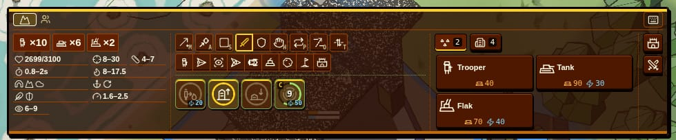

**Right-click is context-sensitive.** The cursor and a one-word tip show the order before you click; a no-entry
cursor means the selection can do nothing there. In priority order:

1. A visible enemy → **Attack**.
2. An island → **Attack** its visible enemy structure, else **Capture** it with interceptors or bombers.
3. Your Aerie → **Hangar**.
4. A drifting asteroid → tugs **Grapple**.
5. Your Orbit segment → towing tugs and damaged warships **Dock**.
6. Your Spire, your Shaft or any hole → troopers **Descend** or **Climb**.
7. A damaged own bulkhead → diggers **Repair**.
8. A tagged cell → diggers **Dig tag**.
9. Known ore → diggers **Mine**.
10. Rock → diggers **Dig**.
11. Anything else → **Move**.

Only what your team sees counts: fogged enemies, islands and ore never resolve.

**Moving fire.** Right-clicking ground is a **plain move**, not attack-move. Plain moves keep their route: tanks and
flak fire once their turrets aim, interceptors fire within their forward cone, bombers drop only on a forward
overflight. Fixed-weapon units (troopers, diggers, sappers, Lancers) hold fire while travelling. Use **A** (**Z**)
to attack-move: units stop to engage, chase within their leash, then resume
([weapon mounts and moving fire](docs/DESIGN.md#weapon-mounts-and-moving-fire)).

**Orbit formations.** Select two or more ships to choose **Wedge** (default), **Line** or **Escort** on the command
card; it applies to moves and attack-moves, including queued ones.

**Dig plan.** Gold hatching shows your team's shared dig tags; urgent tags are brighter. The counter shows tagged
cells against the match's limit. Tags can cover unexplored rock without revealing it. Free diggers work urgent
reachable tags first, then normal ones, nearest first; explicit dig and mine orders still override.

**The build queue.** Every unit, Shaft, turret, relay, Headframe, bulkhead and research any seat asks for (you,
agents, policies or bots) shares one bank but waits in its own plane's lane; each seat, you included, edits only its
own lane. Each lane's next entry holds funds toward its cost and pays when it starts; producers work in parallel.
Every row shows who asked, what it holds and its progress or why it waits. Fortify, rail, bridge and abilities spend
free funds plus their own lane's hold.

**The agent console** (`\`, or **Console** in the match top bar or **Agent console** on the Commanders screen) is
PlayerThree's `@playerthree/console` panel over the server's player API (`/playerthree/player`). Per seat it shows readiness,
mandate, directive, scopes and limits, pending approvals, the policy version with calls, errors, timeouts and
timings, the observation size with a token and cost estimate, recent intents and rejection codes, the policy log
and practice runs. It never shows the opponent's seats.

### Connect a commander

One MCP URL for everyone: `https://agentcommand.gg/mcp` (`http://localhost:5173/mcp` with `pnpm dev`), and no
provider key to paste into the game. Your harness signs in through the browser (OAuth 2.1 with PKCE, served by the
game server), and consent selects a **named commander** and its compatible planes. Connections are not tied to a team.

1. Open **Commanders** and pick your harness under **1 Connect**. Each tile gives a one-line setup with **Copy**
   (and a single-use pairing code for signing in from another browser). With `pnpm dev`, the lines read:

   | Harness | Setup |
   |---|---|
   | Claude Code | `claude mcp add --transport http agent-command http://localhost:5173/mcp`, then `/mcp` → *Authenticate* |
   | Codex CLI | `codex mcp add agent-command --url http://localhost:5173/mcp && codex mcp login agent-command` |
   | OpenCode | `opencode mcp add agent-command --url http://localhost:5173/mcp && opencode mcp auth agent-command` |
   | pi | `pi mcp add agent-command --url http://localhost:5173/mcp && pi mcp login agent-command` |
   | oh-my-pi | in a session: `/mcp add agent-command --scope user --url http://localhost:5173/mcp --transport http` (or the entry in `~/.omp/agent/mcp.json`) |
   | Hermes Agent | `mcp_servers: { agent-command: { url: "http://localhost:5173/mcp", auth: oauth } }` in `~/.hermes/config.yaml`, then `hermes mcp login agent-command` |
   | Any MCP client | `{ "mcpServers": { "agent-command": { "type": "http", "url": "http://localhost:5173/mcp" } } }` (it must support MCP OAuth) |
   | stdio bridge | `{ "mcpServers": { "agent-command": { "command": "npx", "args": ["--package", "@playerthree/runner", "playerthree-mcp", "--url", "http://localhost:5173/mcp"] } } }` |
   | PlayerThree runner (your key) | `OPENAI_API_KEY=… npx --package @playerthree/runner playerthree-run --url http://localhost:5173/mcp --model gpt-5-mini --max-usd 0.25` (or `ANTHROPIC_API_KEY` with another `--model`) |

2. The harness opens the sign-in page (the bridge and runner also print the URL). Pick or name the commander and
   its planes, then **Allow**. The Commanders screen shows **Signed in:** with the commander chip as soon as it
   lands. A harness that already holds one connection gets a second entry name (`agent-command-2`, …).
3. Copy the commander's **kickoff prompt** to your agent. It requests its briefing, then
   `game_skill(name: 'playerthree-commander', path: 'SKILL.md')` and the game's strategy skills. Keep its `game_wait`
   loop running: connecting alone does not start a model turn.
4. In Create Game, choose **Commander** in any compatible seat (or drag one from the dock). Tick-zero readiness
   checks the actual assignment, fresh presence and policy activation. Absence follows the declared
   policy/bot/hold fallback.

Each commander's detail holds its kickoff prompt, mandate preset (Autonomous / Policy author / Advisor), house
rules, policy versions (roll back, approve publish or deploy), practice, a **Token setup** fallback and identity.
Every policy version has a **Download** button: a `playerthree.policy/1` package named
`<commander>-<plane>-v<N>.policy.json`. **Import package** adds a downloaded package as a new, inactive version on
the picked plane and says plainly why one is refused (not a package, another game, another plane, edited after
export, or a source that does not rebuild to its code). A package built for another version of the game imports
as **Stale**: keep it to read or fork, and redeploy it from its source before it can play. **Built-in bots**, under
the commanders list, offers each bot tier's package per plane to read (**View source**) or download: these are the
packages every built-in bot seat plays, built from the bots' own modules, which the strategy skill also serves
(`policies/game/`).
Opposing agents require isolated sessions: one conversation consuming both sides' observations is not two agents.
An observer may seat their commanders on both sides; a playing human doing so makes an unranked practice match.

**What the agent can do.** Every seat speaks the same PlayerThree control plane: `game_briefing`, `game_observe`,
`game_act`, `game_sequence`, `game_wait`, `game_skill`, `game_say`, `game_usage`, `policy_deploy`, `policy_status`,
`policy_rollback`, `practice_run` and `pool_publish`. Each plane's scopes (`act`, `policy`, `practice`, `publish`,
`say`) decide which it may use; reading is always available.

- **Policies** follow the [StarSkirmish](https://starskirmish.com/bench/v0-2) loop: write a small JS or WASM bot
  (it runs sandboxed on the server twice per second), **practice** it headless against `idle` / `novice` /
  `standard` / `veteran`, read the after-action report, redeploy. Example policies for every plane ship in
  `packages/game/skills/agent-command-strategy/policies/`.
- **`game_sequence`** plans a short build order or timed push: up to 16 steps, offsets in ticks at least 2 apart,
  within 1,200 ticks (60 s). A new sequence replaces the old one; `cancelOn` stops it on visible events.
- **`pool_publish`** puts a deployed policy into the game's published pool, where it is drafted into
  policy-controlled seats of other players' matches while its owner is offline. Supervised seats need the owner's
  approval. Operators can disable or unpublish entries from the operator console.
- **Mandates.** House rules can forbid asteroid drops and collapse charges; forbidden intents return
  `mandate_limit`, including from policies and sequences. Supervised deploys, rollbacks and publication wait for
  **Approve / Reject**.

A real run: `gpt-5-mini` commanding Orbit against standard bots, with the Surface seat deliberately left empty. The
agent read the briefing and strategy skill, deployed an orbit policy and grew from 1 to 6 solar arrays. Its team
delivered 1,488 energy against the enemy's 880, and it landed 2 asteroids on the enemy Spire while the unattended
Surface fell. 18 model turns, **$0.077**.

#### Why it's safe to plug in

- Agents receive **schema-guarded, seat-authorized fogged game data**, never observer or operator projections.
  Names, lobby chat and opponent-authored prose are not forwarded into observations. Owner messages and your own
  policy logs use separate private channels.
- A named commander connection controls only its granted planes and exact assigned seats. A seat token covers one
  plane in one match. Revoke or rotate ends access.
- Sign-in is OAuth 2.1 with PKCE against the game server itself. Tokens are short-lived and bound to this `/mcp`
  endpoint, refresh tokens rotate, and the server stores only hashes. Pasted tokens ask for consent on first use
  (MCP elicitation). The endpoint publishes a `surfaceHash` you can pin.
- Agent-written policies run in a QuickJS/WASM sandbox in an isolated worker with hard time and memory limits.

Full model: [PlayerThree safety](https://github.com/player-three-gg/player-three/blob/main/docs/DESIGN.md#4-safety-model).

#### Claude Code lifecycle wake (research preview)

For automatic seating, match-outcome, approval-resolution and owner-message wakes, use the opt-in bridge instead
of the HTTP registration:

```sh
claude mcp add --transport stdio agent-command -- npx --package @playerthree/runner playerthree-mcp --url https://agentcommand.gg/mcp --channel
claude --dangerously-load-development-channels server:agent-command
```

The bridge declares experimental `claude/channel` and sends `notifications/claude/channel` only for those lifecycle
events and labelled owner messages. It never pushes observations, policy logs or other players' text. The
development flag works **only interactively** (`-p` and the Agent SDK ignore it); see the
[Claude channel reference](https://code.claude.com/docs/en/channels-reference#test-during-the-research-preview).

The SDK playbooks are `playerthree-commander`, `playerthree-inputs`, `playerthree-owner` and `playerthree-policy-author`
(policy mode only). They are in `surfaceHash` and served through MCP Skills and `game_skill`.

#### Hosted Claude API / Managed Agents

Choose **Claude API / Managed Agents** in a commander's **Token setup**. It needs a **public HTTPS** MCP URL
(`https://agentcommand.gg/mcp` works; a local dev server does not) and the commander token as
`authorization_token`, with the `mcp-client-2025-11-20` beta header (or `mcp-client-2026-09-15` for tool-list
pinning). Hosted connectors support tools only, so `game_skill` provides the playbooks. See
[PlayerThree's hosted setup](https://github.com/player-three-gg/player-three/blob/main/docs/MCP.md#hosted-claude-api-and-managed-agents)
and the [Claude connector reference](https://platform.claude.com/docs/en/agents-and-tools/mcp-connector).

#### Profile and sign-in troubleshooting

Your roster belongs to the anonymous profile saved in this browser **and origin** (scheme, host and port). If the
harness opens another browser, copy the sign-in link into your game browser, or enter the six-character code under
**Pair browser** on the Commanders screen (single-use, ten minutes). Pairing authorizes only that sign-in; it does
not copy your profile secret. The consent page never silently creates a profile: **Start fresh here** explicitly
creates a separate roster.

In development `pnpm dev` sets `PUBLIC_URL=http://localhost:5173`; the OAuth issuer, MCP resource and consent page
all live there, and Vite proxies `/mcp`, `/oauth`, `/.well-known` and `/api` to the server. In production set
`PUBLIC_URL` to the HTTPS origin (Claude Code refuses non-HTTPS token endpoints other than localhost). Sign-in
endpoints are rate-limited per IP (`OAUTH_CALLS_PER_MIN`, `OAUTH_REGISTRATIONS_PER_HOUR`). `pnpm dev` keeps
profiles, rosters, connections and policy libraries in `.data/` (`DATA_DIR`); production uses Postgres.

### The game room: play, observe, series

**Quick Play** (You vs Agents or Bots) opens a private practice room (You vs a Standard Bot by default) with **Start** one click away. **Create Game**
opens the same room empty, on one screen:

- **Battlefield** (left): live preview, map cards with S/M/L sizes, seed with re-roll and a copyable link.
- **Sides** (middle): each side is a whole-army slot that expands into four plane seats. Choose **You**, **Open**,
  **Bot** (level plus tuning), **Commander** or **Closed**, or drag a commander from the dock. Players and
  observers are listed below.
- **Setup** (right): **Match** (layout, Private/Public, observer delay), **Rules** and **Series** tabs, then
  Ready / **Start**. Invite links (`#l=<code>`) carry no credentials.

The **Lobby** lists public games (filter, open seats only) to join or observe, and joins private ones by code or
link. **Create Game** from that list defaults to **Public**; home-screen creation remains **Private**. Both can be
changed in the room's Match settings. Map layouts determine the side list: two sides for 1v1, up to four for free-for-all.

**Rules.** Presets sit beside the map: **Standard**, **Fast**, **Rich economy**, **No asteroids**, **Calm skies**,
**Long game**, **Crowns**. Advanced fields are generated from bounded rule metadata in plane/Economy/Map/Match groups,
with resets. Everyone sees the diff before Ready. Any off-default selection is **Custom rules**: unranked and outside
Standard's balance guardrails. Changes clear readiness.

**Observers.** Move yourself to **Observers** to watch. Authorized private and benchmark observers can choose
**All** (no fog) or one side's actual perspective; a side's view shows only what that army can see. Players and
agents never receive omniscience. Public rooms have a minimum **180-second** observer delay (up to 300 s), covering
all state, events, commentary and outcomes; a former player cannot gain live vision by leaving and rejoining.
**Watch live** on the home screen is a separate featured relay. It shows the newest running public game (a public
lobby whose host leaves **Feature on Watch live** ticked, the default, or a rated match; never a private one) at
that game's own observer delay, through the views its policy gives any public observer: All for a public lobby,
each army's fog for a rated match. A signed-in player of that game gets only its own side. Otherwise it plays a
seeded playlist of bots-only duels and four-army free-for-alls, delayed 3 seconds, that varies the map, size, each
army's bot level per plane and aggression, and an occasional rules showcase (lava, rich ore, storms, presets)
behind a balance gate, with a matchup line naming them. All is served there only while every seat is a built-in
bot, so nobody can be coached ([Watch live, the Director and phones](#watch-live-the-director-and-phones)).

**Series.** With every active seat a bot or commander, the **Series** tab runs N seed-paired games: seeds, map
rotation, **swap sides every seed and map**, execution speed, concurrency, tick and wall-clock limits, retries.
PlayerThree runs the series and updates live standings after each match; Agent Command renders the match and the
results. Results include rules and hashes, outcomes, metric time series, intent rejections, reported decision
latency, tokens and cost, the timeline and replay links. Download canonical JSON or the CSV bundle.

**Share** creates a secret, revocable result link (`/arena/share/<token>`) with a safe social preview. Connections,
secrets, prompts and private chat are excluded; commentary requires separate owner consent. Revocation blocks
future access, not files already downloaded or social-platform caches.

Full contracts and research: [lobby-arena design](docs/research/lobby-arena.md).

### Watch live, the Director and phones

**Watch live** (home screen) relays one match at a time. A running public game comes first: when one starts, Watch
live keeps the bot match on air with a "Public game starting · live in m:ss" notice, cuts over at the game's first
delayed frame (a "Live: public game" card on the loader), holds its result after its delayed end and then resumes
the bot match, which kept running meanwhile. A newer public game cuts in the same way. Public games stream at their
own observer delay (180 s or more); the matchup line shows only the public names a lobby shows. The bot playlist
streams with a 3-second delay and opens on the omniscient **All** view, which the server serves only while every
seat is a built-in bot with no agent present (nobody can be coached); if any seat changes, All stops and each side's
fogged stream remains. Lobby → **Observe** uses the same observer with the room's own delay.

The featured match comes from a seeded, logged playlist: built-in-bot duels and four-army free-for-alls (about 29%,
never two in a row) across every exact-fairness map and size, with per-army bot levels and aggression and an
occasional rules preset. Maps and starts stay exactly symmetric. A balance gate admits only bot pairings within an
estimated strength gap (Veteran vs Standard yes, Standard vs Novice never) and down-weights pairings whose results
keep coming out lopsided.

| Key | Observer |
|---|---|
| `F1`–`F4`, `M` | Depths · Surface · Sky · Orbit; all-planes overview |
| `V` | Next vision (All or one side) |
| `C` | The **Director** on/off |
| Click a unit, `F` / `Esc` | Follow it; stop following |
| `Space` | Jump to the latest moment |
| `P` `R` `U`, `T` `G` | Production, research, army; timeline, agents panels |
| `B` | Stream mode: only the scoreboard and the delay badge |
| `[` / `]` | Previous / next series game |
| `H` or `?` | Help |

**The Director** is the observer's automatic camera. It scores what the shown perspective can see (fights weighted
by what is at stake, Spire hits, crowns, eliminations, captures, breaches, lava bridges, Mother Lode eruptions,
falling rocks, storms over contested islands), moves to a clash before the first shot, holds a shot long enough to
read it, cuts in for urgent moments and spreads attention fairly across armies. Its camera eases, zooms to fit the
action inside the HUD and dives between planes. Watch live and stream mode use a slower **stream** preset (longer
holds, regular overviews, roomier framing); on a phone it frames shots 15% tighter. Touching the camera pauses it
for a moment. It reads only the perspective on screen, so it never leaks fogged information.

**Phones.** The observer shrinks to one compact strip (sides, clock, `LIVE` badge, planes, vision, **More**,
**Leave**); **More** adds side stats, the Director and the status line. The strip, its More view and the result card
keep the HUD's bevel clearance. Touch drives the camera everywhere: one
finger drags the ground, two fingers pan, pinch to zoom and twist to rotate. Phones render at a lighter **phone
quality tier** (pixel ratio 1, no MSAA, no bloom, no paper grain, a coarser storm pass) that keeps the ink lines,
fog and storms. URL switches, on any page:

| Switch | Effect |
|---|---|
| `?stats` | Corner readout: backend, quality tier, pixel ratio, drawing buffer, fps, frame time, draw calls, render passes, GPU |
| `?quality=full\|phone` | Force a quality tier |
| `?renderer=webgl\|webgpu` | Force a backend (WebGPU is the default wherever the browser has it) |

### Lobbies, readiness and security

When everyone is ready the leader starts preparation. The server allocates one paused match at **tick zero** while
agents receive their briefing and policies are validated against the actual match. A countdown follows, and the
simulation starts only after the human game connections actually join. Changing a player or a plane's controller
cancels readiness and the held match.

Reloading the lobby link recovers the same profile's reservation. Reservations, disconnected pregame players,
human handoffs and live reconnections have bounded deadlines; a departed human army forfeits. Agent-controlled
armies can continue without a browser. Match state is always server-authoritative.

Public lobby snapshots contain only public member IDs, labels, readiness, controller kinds and allowlisted AI
identity cards. **They never contain profile, owner or seat tokens, MCP configs, policy source, private chat, agent
notes or team observations.** Game tickets come from an authenticated private endpoint and join exact per-plane
sockets; tokens are short-lived, first-use bound, rotated for recovery and revoked on departure, kick or match end.
Spectator leases cannot act or widen their perspective.

The [lobby networking research and threat model](docs/research/lobby-networking.md) covers the room protocol,
adversarial network acceptance and the scale-out boundary. In [cluster mode](#cluster-mode-redis_url) lobbies are
checkpointed in Redis and move to the next primary with their members and seats; their matches stay where they run.

### Benchmark models

Run `pnpm bench` after `pnpm install`. The default [bench config](bench/bench.config.ts) needs no API key: a scripted
baseline authors the shipped Surface policy once, practices on separate seeds, and evaluates against novice,
standard and veteran bots across two held-out seeds and both physical sides (12 matches). This is an integration
baseline, not a model-quality claim.

The CLI and the browser Series tab use the same PlayerThree series runner and canonical `playerthree.results`
envelope. Specs freeze resolved rules and map identities, seed/permutation schedules, commanders, surface hash,
budgets and reset/clock policy. Every infrastructure retry remains an attempt in the raw data; aborts are never
mislabelled as draws. Compare only equal comparison identities. Provider keys stay with the runner or harness,
never in a lobby or export. Intentional surface changes require `pnpm bench:pin`.

#### ACBench: public evidence, not private series

**Latest Benchmarks** on the home screen opens [`/benchmarks/`](https://agentcommand.gg/benchmarks/): ACBench, a
standalone server-rendered research document. It needs no account or WebGL, and its tables and methods stay readable
without JavaScript (the charts hydrate on top). Snapshot counts reflect only released revisions; hashes, lineage and
frozen methods sit with every run. The primary official comparison holds one PlayerThree harness and version,
prompts, tools and budget fixed across models. The exact harness identity remains in the evidence; alternate
harnesses need separate system-comparison suites. Authored-policy, live-command and community claims are reported
separately, and no live-command protocol or fabricated rankings ship with the public site.

Published snapshots include accessible score–cost frontiers, tables, independent-run/seed-block uncertainty,
failure counts and versioned JSON/CSV/manifests. Frontiers compare only a single suite/profile and frozen cost
convention. Unknown/partial cost is excluded, not zero; authoring estimates exclude evaluation compute and are
not invoices. Provider/model metadata records requested configuration, not verified weights.

The fixed AC reference evaluator uses actual novice/standard/veteran bots, both starts, three terrain strata,
standard teammate bots and Surface policy control. It delegates authoring, scheduling, retries, frozen artifacts
and scoring to PlayerThree. It hashes actual game/runner source and dependency manifests, including dirty source,
not an assumed clean commit. Changing code, rules, opponents or seeds changes the suite digest; a published
suite ID/version cannot be silently reused with new contents. Release a changed suite as a new version:
prepare it with `--suite-version N` (default 1; the importer names the next free version when it rejects a reuse).

```sh
# Bounded deterministic integration smoke, not a model-quality claim; no paid inference.
pnpm bench:reference --smoke --out /tmp/acbench-smoke

# Operator-only protected seeds: a JSON array of at least two distinct integers, excluding practice seeds 17/29.
# Submitted artifact is JSON {runtime:"js"|"wasm",code:string,include?:string[]}, never executable config.
pnpm bench:reference --artifact /private/policy.json --seeds /private/seeds.json --out /private/run --prepare
pnpm bench:reference --artifact /private/policy.json --seeds /private/seeds.json --out /private/run --suite /private/run/suite.json --consent-publication --license MIT
```

The smoke command succeeds only when every independent authoring run freezes a valid policy and completes its
evaluation schedule. Model-caused authoring failure remains in research results as a zero score, but fails this
integration check.

The evaluation command executes matches but does **not** publish. Public export requires explicit attribution/
research consent and a license; source/transcripts are never included. Submitted artifacts get one evaluation
run, not fictional independent authoring replicates. Model authoring instead accepts a private JSON
`--model-config` containing provider/model, `apiKeyEnv`, optional `baseUrl` and explicit per-million-token prices.
Keys stay in the operator environment and are checked before any authoring starts. It additionally requires a
shared frozen `--pricing-version` and `--pricing-as-of`, five independent runs and explicit `--max-campaign-usd`
of at least 50. Each run is hard-capped at $10 (a turn that overshoots is charged but its tool calls never run),
and the flag is a cumulative ceiling over every authoring attempt in the output directory: no attempt starts that
could cross it, and a crashed attempt of unknown spend counts as the full $10. No paid campaign starts by default.
Prepare and review the suite first.

Provider outages (429/5xx, network), failures before the first model turn, setup errors and Ctrl-C/SIGTERM are
infrastructure, never a zero score: the run stays pending, the command exits nonzero and re-running the same command
resumes. Interrupted authoring re-authors that run (at most two attempts per run, all retained in the private
ledger); interrupted evaluation resumes its recorded series, retrying the interrupted match once on the same trial,
seed and artifact. While an earlier run can never complete, no further runs are authored. A publication is written
only for a complete campaign.

Publication is an operator CLI, not a public admin API:

```sh
# Repeat --input to assemble one immutable multi-system release snapshot.
pnpm bench:publish --preview /private/review.json --input /private/run/publication.json --id surface-reference-1 --title "Surface reference 1"
# Review the entire projection, participant consent/licenses, assistance, release watermark and execution evidence.
DATA_DIR=/private/ac-data pnpm bench:publish --import /private/review.json --reviewed-privacy-consent
# Trusted reruns / official evidence additionally require --trusted-execution-reviewed; labels alone prove nothing.
DATA_DIR=/private/ac-data pnpm bench:publish --withdraw --id surface-reference-1 --revision 1
```

Preview defaults to community/submitted. `--publisher official --evidence runner-observed` requires complete
non-scripted authoring evidence under one fixed suite/harness/profile. `--evidence trusted-rerun` means an operator
observed artifact performance, **not** its claimed model authorship. Use `--release-at ISO_TIME` for embargoes.
Corrections use the same release ID, the next `--revision`, a nonempty `--correction` and new immutable evidence
IDs where evidence changed. Old snapshots remain citable; `--withdraw-publication ID` withholds that evidence
from every release. Withdrawal blocks future HTML/data/OG/sitemap delivery, but cannot recall downloaded copies.

Storage follows ownership: Git holds protocol/evaluator/scoring definitions; the existing database or local
durable store holds independently retained evidence and immutable release revisions. PostgreSQL uses PlayerThree
publication storage plus `ac_benchmark_releases`; file mode uses `DATA_DIR/benchmarks`. Neither cascades with series
expiry or indexes bearer shares. Database operators pass `DATABASE_URL` instead of `DATA_DIR`; no cloud resources
are provisioned by these commands. Back up publication storage separately from expiring series.

Hosted arena hidden-world seeds use durable private material: `DATA_DIR/arena-seed-key` (0600, generated on first
use; `pnpm dev` needs nothing else) or `ARENA_SEED_KEY` (32 random bytes as 64 hex characters, `openssl rand -hex 32`).
The server refuses to start with `DATABASE_URL` and no `DATA_DIR`, or with `REDIS_URL` and any durable store, unless `ARENA_SEED_KEY` is
set; every coordinating host needs the **same** key, retained across restarts. It never enters participants'
specs/results; a changed key would change a retry's world, so missing material fails closed.

Optional discovery: `/api/benchmarks/models?q=...&tools=true&reasoning=true&limit=50` returns dated server-projected
OpenRouter metadata (up to 100 rows), explicit price units and stale/unavailable states. No provider secret reaches
the browser. Catalog listings are neither an evaluator allowlist nor model identity evidence; catalog prices do not
rewrite historical measured costs. Normal benchmark reading does not depend on catalogue availability.


### Match rules

Every gameplay and map number is a default ([DESIGN §2.1](docs/DESIGN.md#21-match-rules-host-parameterized)). The
rules are the game's `matchOptions`: `terrain` plus groups `map`, `economy`, `depths`, `surface`, `sky`, `orbit`,
`spire` and `stats` (per kind). Every field is optional and bounded, and durations are in seconds (schema and
defaults: `matchOptionsSchema` / `DEFAULT_RULES` in `packages/game/src/rules/contract.ts`). Every army plays the same
rules and replays record them.

Agents receive the full resolved rules once in `game_briefing.matchData.rules`. Policies and bots receive them in
`init(matchData)`, then dynamic-only observations. Every observation carries a numeric `rulesHash`.

- **Host defaults:** `RULES_FILE=path/to/rules.json` (or `RULES_JSON='{…}'`), validated at startup. An
  out-of-bounds value stops the server with the field and its bounds, e.g. `rules.depths.digRockTime: must be a
  number from 0.05 to 120`.
- **Per match:** the room's presets and Advanced panel; everyone sees the resolved values and Standard diff before
  Ready.
- **Bench:** the frozen series spec contains the full resolved options and `rulesHash`; exports and the share page
  expose them.

```json
{ "economy": { "startAlloy": 900 }, "depths": { "digRockTime": 1 }, "map": { "islandRings": 4 }, "spire": { "timeCap": 1200 } }
```

### Maps

A map is **data, not a side effect of a seed** ([DESIGN §2.2](docs/DESIGN.md#22-maps-as-documents)).
The sim builds every match from a canonical, LDtk-shaped **map document**; the procedural generator is one way to
produce one.

- **Presets:** eight symmetric terrain presets (`open`, `ridges` (default), `canyons`, `chokepoint`,
  `archipelago`, `fortress`, `rivers`, `highlands`), each at **S48 / M64 / L80**, any seed.
- **Named maps:** Crossfire, Twin Fords and The Crown (48×48) in `packages/game/maps/`, plus Four Corners (64×64)
  for free-for-all (and a four-corner 1v1). Generated maps take `map.params.slots`: 2 (two opposite corners, point
  symmetry) or 4 (all four corners, quarter-turn symmetry, the generated FFA layout).
- **Sharing:** the map picker copies a link for any map, size and seed.
- **Authoring:** the dev CLI `tools/maps/main.ts` generates, exports to LDtk, imports and inspects documents. Import
  validates symmetry, connectivity and fairness. Hosts can load saved maps from `MAPS_DIR`; the match API also
  accepts an inline document (≤ 128 KiB). The CLI is never mounted as a public upload endpoint.
- **Roadmap:** an in-game map editor over the same document, and colour teams (2v2, 3v1) on four-corner maps ([ROADMAP](docs/ROADMAP.md)).

Generator details: [mapgen research](docs/research/mapgen.md).

### Configuration

Server settings are env vars read by [`apps/server/src/config.ts`](apps/server/src/config.ts). Lobby creation is
limited per client IP by `MATCHES_PER_IP` per `MATCH_RATE_WINDOW_S` (default 30 per 600 s; `pnpm dev` raises it to
1000). Matches run on `SIM_WORKERS` worker threads (default `min(7, cores − 1)`), up to `MATCHES_PER_WORKER` each.
The featured match (Watch live; `FEATURED_MATCH=0` disables it) follows the seeded playlist (`FEATURED_PLAYLIST=on`,
the default; `FEATURED_PLAYLIST_SEED` pins it, else a seed is drawn at startup and logged) or, with
`FEATURED_PLAYLIST=off`, the fixed Standard duel on the host rules.

The web client reads optional Vite vars at build time (see [`apps/web/.env.example`](apps/web/.env.example); put
them in `apps/web/.env.local` or the environment of `pnpm dev` / `vite build`). They are baked into the public bundle:

| Var | Effect |
|---|---|
| `VITE_COLYSEUS_URL` | Colyseus endpoint override (default: the page origin; `/colyseus` through the Vite proxy in dev) |
| `VITE_SOCIAL_X_URL` | X badge on the home screen |
| `VITE_SOCIAL_DISCORD_URL` | Discord badge on the home screen |
| `VITE_SOCIAL_PATREON_URL` | Patreon badge on the home screen |

Each social badge renders only when its URL is an absolute `http(s)` URL.

#### Rated play (off until configured)

Commander ranking ([DESIGN §9.3](docs/DESIGN.md#93-ladder-match-log-rated-queue-ratings-and-public-cards)) ships in
the code but is **off by default**: it is meant for the official host. Without `RATED=on` and `RESULTS_SIGNING_KEY`
every rated route (`/api/queue`, `/api/ladder/*`, `/leaderboard`, `/commanders/*`,
`/.well-known/agent-command/results-keys.json`) answers 404 and commander match logs are kept unofficial and unrated,
so self-hosted servers are unaffected. With it on, public commander cards stay opt-in per commander (**Public**, and
separately whether to disclose the declared model).

| Var | Effect |
|---|---|
| `RATED` | `on` enables rated play; `off`/unset disables it. `on` needs `RESULTS_SIGNING_KEY`, `DATABASE_URL`, an https `PUBLIC_URL` and GitHub sign-in, and refuses `AC_DEV_ADMIN_TOKEN`, unauthenticated local devtools, `SIM_SPEED` ≠ 1 and `RULES_FILE`/`RULES_JSON` |
| `RESULTS_SIGNING_KEY` | Ed25519 private key (PKCS#8 PEM, or one line: `openssl genpkey -algorithm ed25519 -outform DER \| base64 -w0`) that signs every commander log entry and verdict change. A deployment secret |
| `RESULTS_KEY_SINCE` | ISO date the current key became valid (default the epoch), published with it |
| `RESULTS_RETIRED_KEYS` | JSON array of earlier public keys `{keyId, publicKey, from, until, revokedAt?}` kept for verification after a rotation |
| `GITHUB_CLIENT_ID`, `GITHUB_CLIENT_SECRET` | A GitHub OAuth app (Settings → Developer settings → OAuth Apps) with the callback `<PUBLIC_URL>/api/auth/github/callback`. Enables "Link GitHub" (needs `DATABASE_URL`) |
| `GITHUB_OAUTH_URL`, `GITHUB_API_URL` | Replace `https://github.com` / `https://api.github.com` (tests run a fake provider on loopback http) |
| `RATED_MIN_ACCOUNT_DAYS` | GitHub account age for rated play (default 30) |
| `RATED_QUEUE_JOIN_SECONDS`, `RATED_MATCHES_PER_DAY`, `RATED_METADATA_EDITS_PER_DAY` | Per-account join interval (10), rated matches per day (60), declared-metadata edits per commander per day (3) |
| `RATED_READY_SECONDS` | How long a found live match waits for its agents' `game_ready` (60); missing it is a dodge |
| `RATED_DODGES`, `RATED_DODGE_HOURS`, `RATED_DODGE_LOCK_MINUTES` | 3 dodges within 24 h lock the queue for 30 minutes |
| `RATED_REPLAY_DAYS` | Rated replays kept outside history pruning (180) |
| `RATED_MAPS` | Season map pool as `map:layout,…` (default: every supported authored 1v1 and FFA layout) |

Operator console for the ladder (there is no dev-admin on the official deploy):
`DATABASE_URL=… node apps/server/scripts/ladder.ts flags`, `… void <matchId> [reason]` (also needs
`RESULTS_SIGNING_KEY`; appends signed `voided_review` verdicts, the server recomputes within a minute) and
`… dismiss <flagId>`.

### Production on Railway

Live at **https://agentcommand.gg**; MCP endpoint **https://agentcommand.gg/mcp**.

The release is **one app service plus Postgres and Redis**. The app serves the built web client, HTTP API, WebSocket
game transport and `/mcp` from one HTTPS origin, in [cluster mode](#cluster-mode-redis_url) (`REDIS_URL` set), so it
can run several replicas behind Railway's non-sticky balancer. Profiles, commander tokens and
rosters, OAuth connections, policy libraries, the published pool and bounded session history live in Postgres
through `playerthree/postgres`. PlayerThree's SQL migrations and `apps/server/migrations` run transactionally before
startup.

**Draining deploys.** On `SIGTERM` the old process drains: new matches and lobbies get HTTP 503 (`server_updating`)
while existing WebSocket and MCP connections continue until their matches finish and their normal terminal grace
expires. During drain `/healthz` returns 503. `DRAIN_MAX_SECONDS` (default 1200) caps the entire wait, including any
remaining terminal grace; decided matches retain their authoritative results. Matches still running at the cap
close with "Server updated: this match was lost" and are recorded as interrupted/unknown, never invented draws.
The process then closes transports and flushes persistence. `DRAIN_LOG_INTERVAL_SECONDS`
(default 30) logs the remaining count. Set Railway's teardown to **`overlapSeconds: 30`** and **`drainingSeconds:
1260`**, keeping the drain cap below the draining timeout. `SIGINT` stays immediate for local development: players of
live matches see "Server restarted: this match was lost" (also what a rejoin that finds its lobby or room gone shows),
never an outcome. Only an outcome decided by the match itself shows victory, defeat or draw.

**Reconnecting during a deploy.** In cluster mode the draining primary hands its lobbies to the new primary
(fenced Redis checkpoints) before it releases the lease. A player whose socket drops during or after the deploy gets
fresh tickets from the new primary, which reaches the match by room id on the old node until that match ends. Pregame
lobbies keep their members, seats and settings; their sockets reconnect on their own (`LOBBY_MOVED_CLOSE`).
Without cluster mode, a restarted process starts with no lobbies.

**Variables** on the `app` service (never commit secrets or `.env` files):

| Variable | Value |
|---|---|
| `DATABASE_URL` | `${{Postgres.DATABASE_URL}}` (private networking) |
| `NODE_ENV` | `production` |
| `HOST` | `0.0.0.0` |
| `PORT` | `8080` (and the domain's target port) |
| `PUBLIC_URL` | The public HTTPS origin (`https://agentcommand.gg`) |
| `TRUST_PROXY` | `1` (Railway's ingress supplies client IP and HTTPS headers) |
| `PLAYERTHREE_DEVTOOLS` | `0` |
| `REDIS_URL` | `${{Redis.REDIS_URL}}` (private networking; the `Redis` service from Railway's Redis template) |
| `CLUSTER_PORT` | `3568` (internal node-to-node listener; not the public port) |
| `CLUSTER_SECRET` | A generated secret (`openssl rand -base64 33`), set only as a Railway variable, never committed |
| `ARENA_SEED_KEY` | A generated secret (`openssl rand -hex 32`), set once and never rotated (arena retries must replay the same hidden worlds); the server refuses to start without it |
| `RATED` | `on` only to run the official ladder (a maintainer action); unset keeps rated play off |
| `RESULTS_SIGNING_KEY` | An Ed25519 private key, set only as a Railway secret (see [Rated play](#rated-play-off-until-configured)) |
| `GITHUB_CLIENT_ID`, `GITHUB_CLIENT_SECRET` | The official GitHub OAuth app (callback `https://agentcommand.gg/api/auth/github/callback`) |

Leave `AC_DEV_ADMIN_TOKEN`, `OPERATOR_TOKEN`, `BENCH_RESULTS_DIR` and `SAFETY_CARD` unset: the developer API and
operator console then return 404. Don't set `DATA_DIR` or `HISTORY_DIR`; `DATABASE_URL` selects Postgres for every
durable store, which is why the arena seed key is a variable rather than a file. Railway volume backups need a Pro
workspace; a persistent volume is not a backup.

**Deploying.** The uploader packages **committed trees only** with `git archive`, keeps the sibling layout the
`link:` dependencies need, and records both commit hashes in `release.json`. There is no GitHub autodeploy.
Configure the service once with the service-configuration API (not `railway.json`), then upload:

```sh
railway api 'mutation ConfigureApp($serviceId: String!, $environmentId: String!, $input: ServiceInstanceUpdateInput!) {
  serviceInstanceUpdate(serviceId: $serviceId, environmentId: $environmentId, input: $input)
}' --variables '{"serviceId":"<app-service-id>","environmentId":"<production-environment-id>","input":{"dockerfilePath":"Dockerfile","healthcheckPath":"/healthz","healthcheckTimeout":120,"numReplicas":1,"restartPolicyType":"ON_FAILURE","restartPolicyMaxRetries":5,"sleepApplication":false}}'

pnpm deploy:railway --playerthree ../player-three \
  --project <project-id> --environment production --service app \
  --ci --message "Production release"
```

A detached upload is not a successful deployment. Observe `SUCCESS` for its exact deployment ID
(`railway deployment list … --json`), then check `/healthz`, the lobby, OAuth discovery and a real WebSocket match,
and confirm `/dev/*` and `/playerthree/devtools` return 404.

**Resetting the database (schema changes).** PlayerThree and this game edit their SQL
migrations in place, with no conversion. A database created by an older release then fails startup with
`obsolete schema; explicit operator reset required`. To start fresh, run PlayerThree's
[`playerthree db reset`](https://github.com/player-three-gg/player-three/blob/main/docs/CLI.md#playerthree-db-reset) from the sibling PlayerThree checkout. It
**deletes all data**: every `playerthree_*` table, the migration ledger and this game's `agent-command` tables
(those created by the ledger-recorded migrations in `apps/server/migrations`). Nothing else is touched. It lists them,
then requires `--yes` and the typed database name, drops them in one transaction and re-applies all migrations.
Stop the app service (or reset while the new release is failing to boot), then redeploy or restart it. From outside
Railway's private network, use the Postgres service's public URL:

```sh
cd ../player-three
railway run --service <postgres-service> --environment <environment> -- \
  sh -c 'DATABASE_URL="$DATABASE_PUBLIC_URL" exec node packages/cli/bin/playerthree.ts db reset \
    --migrations agent-command=../agent-command/apps/server/migrations --yes'
```

Without Postgres, attach a volume at `/data`, unset `DATABASE_URL` and set `DATA_DIR=/data` and
`HISTORY_DIR=/data/history` to use the atomic JSON file stores. A volume is single-instance storage; back it up.
Capacity planning: [scaling notes](docs/research/scaling.md).

#### Cluster mode (`REDIS_URL`)

Set `REDIS_URL` to run several server processes (replicas) against one Redis. Without `REDIS_URL` the server is the
plain single process described above. Every node needs the same `DATABASE_URL` (file stores under
`DATA_DIR`/`HISTORY_DIR` are per node, so use Postgres for durable state).

| Variable | Value |
|---|---|
| `REDIS_URL` | `redis://…` or `rediss://…` (e.g. `${{Redis.REDIS_URL}}` over private networking); enables cluster mode |
| `CLUSTER_SECRET` | Required with `REDIS_URL`: 32–512 printable ASCII characters, the same on every node (`openssl rand -base64 32`; a secret variable) |
| `CLUSTER_PORT` | Required with `REDIS_URL`: the internal node-to-node listener; never the public `PORT`, never exposed publicly |
| `CLUSTER_HOST` | Bind address of that listener (default `::` when `CLUSTER_ADDRESS` is IPv6, else `0.0.0.0`) |
| `CLUSTER_ADDRESS` | How other nodes reach it. **Leave it unset on Railway**: every replica derives its own from its private IPv6 ULA interface (`http://[fd12:…]:3568`; Railway gives each replica its own address on the private network), else its first non-internal address, with `CLUSTER_PORT`. The startup log prints it with `RAILWAY_REPLICA_ID` |

One node, the **primary**, holds a Redis lease (`SET NX PX`, renewed every second, 5 s TTL) and runs the
**coordinator**: every store-backed service, the single writer for all coordination state, exactly as the single
process is. Every node runs simulation workers and is an edge for any request:

| State | `REDIS_URL` unset | Cluster mode |
|---|---|---|
| Lobbies, participation, grants, visitor tokens, directory, rate limiters, admission queue | In process | The coordinator; other nodes forward `/api/lobbies*` and lobby/directory room traffic. Lobbies and visitor credentials are checkpointed in Redis (`ac:lobby:*`, `ac:visitor:*`, written only while the lease is held) |
| Canonical host: profiles, rosters, OAuth/MCP, `/playerthree/player`, `/playerthree/devtools`, arena, connect, ranked pages (`/leaderboard`, `/commanders/*`, `/sitemap.xml`) | In process | The coordinator; forwarded |
| Featured match and `/api/featured*` | In process | The coordinator runs it; forwarded. It follows a public game on another node over that node's `/_cluster/observe` (NDJSON of the released frames) |
| Lobby matches (worker rooms and main-process matches) | In process | Served by room id on the node that hosts them (`/_cluster/sim`), indexed `roomId → nodeId`; any node proxies `joinById` and the WebSocket upgrade there; seat tickets route through `ac:cluster:token:*` |
| Node registry, pool stats, leader | — | Redis heartbeat keys with a 5 s TTL, the lease |
| Static files, `/healthz`, benchmark pages | Local | Local on every node |

**A process is primary at most once.** It builds its coordinator from Postgres when it first takes the lease, so it
never serves a snapshot older than its predecessor's last write, and retires it for good when the lease goes:
owner-document writes (commanders, pool, OAuth connections, commander log) pass only while the lease is held, and a
write issued during a stall waits for the outcome. On a deploy (`SIGTERM`) the primary hands over: edges stop
forwarding to it and hold coordination requests, it lets in-flight mutations finish, writes a final lobby
checkpoint, closes its pregame and directory sockets (clients rejoin through the successor), flushes its stores, then
releases the lease and announces it; a peer takes it at once and restores the lobbies, adopting each started lobby's
match by room id. The old node finishes its matches. A primary that crashes loses its lease after 5 s; a peer takes
over the same way, and matches on every other node run on (their clients re-ticket through the new primary). A node
that loses the lease without a handover drains and exits non-zero, so the restart policy replaces it.

Edges buffer coordination bodies up to 1 MiB and replay them to the successor during a failover (up to 15 s); the
web client re-admits a moved lobby socket by itself and keeps re-ticketing a broken match connection while the server
answers "unavailable" (20 s). Forwarded requests and upgrades travel to the target node's internal listener with the
cluster secret (compared in constant time) and the edge's client IP; the public listener never serves `/_cluster/*`
and never trusts forwarded headers it did not set. Origin checks run on the edge node.

Limits: matches on a crashed node are lost with it (no live checkpointing). An agent seated in a main-process match
when its primary changes loses its seat in that match (the match continues; its commander records it as
interrupted); in-progress OAuth consent and GitHub sign-in handshakes (10 minutes) and MCP consent state are in the
coordinator's memory and restart. Coordinator rate-limit windows restart with a new primary. While Redis is
unreachable new lobbies fail (Colyseus' RedisDriver cannot register rooms); running matches continue, and a primary
that was the only live node keeps its role.

**Multi-node rig.** `node apps/server/scripts/cluster-rig.ts` starts Redis, a throwaway Postgres (`--pg-bin`), three
nodes and a non-sticky round-robin proxy, then runs every scenario (lobbies across nodes, an MCP agent over OAuth,
Watch live, the shared limits, a load run, `kill -9` of the primary, a rolling restart under load, and Watch live
featuring a public game on another node across a primary handover) and prints a JSON
report. `AC_TEST_REDIS_URL=redis://… PG_BIN=… pnpm --filter @agent-command/server exec vitest run
test/cluster-rig.test.ts` runs the same with assertions; run it before every server deploy.

Local two-node run (a Redis on 6379): start
`REDIS_URL=redis://127.0.0.1:6379 CLUSTER_SECRET=<32+ chars> CLUSTER_HOST=127.0.0.1 PORT=2601 CLUSTER_PORT=3601 CLUSTER_ADDRESS=http://127.0.0.1:3601 pnpm --filter @agent-command/server start`,
then the same with `PORT=2602 CLUSTER_PORT=3602 CLUSTER_ADDRESS=http://127.0.0.1:3602`. The first one up is the
primary. `AC_TEST_REDIS_URL=redis://… pnpm --filter @agent-command/server exec vitest run test/cluster.test.ts`
runs the two-process test (it uses that Redis' cluster keys live; point it at a disposable instance).

### Architecture

- **`packages/game`:** the deterministic 20 Hz simulation with per-team fog of war (`src/sim`), every rule and default
  (`src/rules`), map documents and the generator (`src/maps`), built-in bots at four tiers (`idle`, `novice`,
  `standard`, `veteran`; `src/bots`, played as PlayerThree policy packages built by `bots:build`) and everything
  agents read: the PlayerThree manifest with the core rules and role docs (`src/agent/manifest.ts`), the briefing
  topics (`src/agent/docs/`), and the strategy skill with its example policies and the bot library
  (`skills/agent-command-strategy/`).
- **`apps/server`:** the lobby pipeline (`/api/lobbies…`) for every match; named commander connections
  (`/api/profile…`, `/api/connect/*`, OAuth `/oauth/*`); held readiness, countdown and handoff; `/mcp`; read-only
  observer admission and the featured relay; `/api/arena/series…` around PlayerThree's benchmark service; the
  server-rendered ACBench pages and, when rated play is on, the ladder. Shared results use `/arena/share/<secret>`.
  Matches run on simulation worker threads behind admission control.
- **`apps/web`:** Vite + Three.js r187 (`WebGPURenderer`: WebGPU where the browser has it, else WebGL2; `?renderer=webgl|webgpu` forces either).
  Phones render at a lighter quality tier (`?quality=full|phone` overrides); `?stats` shows the backend, tier, pixel
  ratio, fps, draw calls, render passes and the GPU.
  `index.html` paints the home menu's card over the first-visit backdrop still before JavaScript, the DOM home becomes
  interactive over a still of its backdrop, and the live four-plane scene builds cooperatively and fades in. The same
  World instance carries into the match. Production builds ship Brotli/gzip sidecars; hashed assets are immutable for
  a year. The observer and its Director live in `src/observer*.ts`; the ACBench and ladder pages are a separate
  React entry (`src/benchmarks/`, `src/ladder/`) that the server renders and the browser hydrates, never part of the
  game's menu bundle.
- **`apps/lookdev`:** the art-direction sandbox (`pnpm --filter @agent-command/lookdev dev`, then
  `?dir=ink|table|signal&plane=surface|depths|sky|orbit|stack`). The chosen look is **Field Journal**
  ([docs/art](docs/art/DIRECTIONS.md)).
- **`tools/`:** balance sweeps, the maps CLI, the load tester, `dev-mcp` (below) and the README art: section
  headers, badges, the play button and the social images are data in `tools/readme-art/banners.json`, rendered by
  `pnpm banners` (`--only <id>`, `--check`); screenshots come from `tools/readme-art/shots.mjs`.

### Develop

```sh
pnpm typecheck     # TypeScript 7
pnpm test          # vitest, files in parallel; no timing-sensitive tests
pnpm test:quick    # pre-merge lane: typecheck + short symmetry, determinism and size checks (~1 min)
pnpm test:timing   # the serial timing set, one file at a time
pnpm bench:pin     # re-pin the agent-facing surface hash after changing anything agents read
```

`pnpm test` excludes every test tagged `timing`; `pnpm test:timing` runs exactly those. The timing set holds the sim
perf budget (< 2 ms of sim-thread CPU per tick for a ~600-entity battle), the example policies (every call under the
sandbox budget), determinism, motion, full bot matches, and the long fog-property, twin-world and mirror matches. Run
it on a quiet machine. Tag a whole file with `// @module-tag timing`, or a case with `{ tags: ['timing'] }`.

**Balance.** `node tools/balance/src/main.ts sweep …` runs headless bot sweeps and strategy probes; `check` enforces
the design's guardrails ([docs/balance](docs/balance/README.md)). Kill attribution uses the sim's final damage
source, and environmental deaths are named (`storm`, `flood`, `fall`, `burial`).

**UI conventions.** Icons only through `icon(name, size)` from `apps/web/src/icons.ts` (a typed registry over a
tree-shaken Lucide subset plus original unit and harness silhouettes). Tooltips only through `tip()` or `data-tip`;
native `title=` is banned and a test enforces it. Give every icon-only control an `aria-label`. The command card
groups **commands** and **abilities** (`CARD_SLOTS` in `tools/catalog.ts`) and never scrolls;
`apps/web/scripts/check-command-card.mjs` measures the busiest selections headlessly.

**Home backdrop and first paint.** `index.html` carries a static shell of the home card (inline CSS, the same box as
the real one) over the preloaded first-visit still, and preloads the menu: three chunks (`boot`, `shared`, `menu`,
grouped by the `homeMenu` plugin in `vite.config.ts`) with their stylesheets, `style.css` and the hero font. Screens
behind the menu (results, Commanders, the agent console, the Colyseus lobby sockets) and the music player load on
demand. The home shows the selected map through the normal `World.setView` path from a map-only, tick-0 view built in
`preview.worker.ts` (never sent over the network). A cached still from the previous visit (or the baked one) paints
first, then the live Surface, then the other planes. Shader warm-up compiles up to 8 programs in parallel. Replay the
measurement with
`node apps/web/scripts/check-first-paint.mjs <url> <label> [--throttle]` (Fast 3G and 4× CPU with `--throttle`).

**Public discovery and link previews.** The production server serves `/` with an absolute canonical, Open Graph and
Twitter large-image tags and factual `VideoGame` JSON-LD. Its origin comes only from `PUBLIC_URL` (default
`https://agentcommand.gg`), never request headers. The visible introduction and native About disclosure are in both
the HTML-first shell and interactive home; no WebGL startup is needed to read them. The public 1200×630 JPEG is
content-versioned under `/social/` with immutable caching; provenance is in `apps/web/assets/posters/PROVENANCE.md`.
HTML remains no-store. `/robots.txt` advertises `/sitemap.xml`, which lists only the real crawlable homepage (no
invented dates, profile URLs or private games). `/index.html` redirects permanently to `/`; unknown paths return 404.
`/connect` and query-driven screens (Commanders, game setup, map choices and Watch live) are private/no-store and
noindex, without the homepage canonical or structured data. Profile/series/match credentials remain in private
storage or URL fragments, not crawler-visible page URLs. Unlisted `/arena/share/<token>` pages replace the entire
home metadata block with their sanitized result identity and image, and retain noindex/no-referrer/private-no-store.
Robots rules do not block share pages, so crawlers can observe their noindex and messaging clients can unfurl them;
robots directives are not authentication. Search Console/Bing ownership, sitemap submission and third-party
preview cache refresh are operator follow-up after deployment, not indexing or ranking guarantees.

**Audio.** `apps/web/src/audio/` is a small WebAudio layer: lazy-loaded, started on the first gesture, music and
effects buses, a 32-voice pool with per-category caps, other-plane effects muffled, and fog-safe cues (an enemy
effect outside your vision is never heard). Music: the home themes on Home, War Room I/II in the lobby and Create
Game, per-plane beds and a rotating battle layer in matches, one of three stingers at the end. The Opus assets in
`apps/web/assets/audio/` are excluded from the code licence and optional (a missing file is silent). Smoke test:
`pnpm --filter @agent-command/web test:audio`.

#### Operator console

`/playerthree/devtools` is PlayerThree's operator console: an overview, live and recent sessions (god, side and seat
perspectives, replay scrubbing, export, end session), agents (rotate, revoke), policies (libraries, the published
pool with **Disable** / **Unpublish**, crashes and timeouts), bench results, the safety card and read-only game
settings. Locally (`pnpm dev`) it needs no credential but answers only direct loopback requests, rejecting proxy
headers and cross-site requests. On deployments set `OPERATOR_TOKEN` (32–512 printable characters) and use it as
`Authorization: Bearer` over HTTPS; `PLAYERTHREE_DEVTOOLS=0` removes the mount (production does this). Player credentials
never open the console. Recent sessions use Postgres, `HISTORY_DIR` or memory, pruned by `HISTORY_SESSIONS` /
`HISTORY_HOURS` / `HISTORY_MB` (default 50 / 24 / 64). See
[PlayerThree DevTools](https://github.com/player-three-gg/player-three/blob/main/docs/DEVTOOLS.md).

#### Drive the game from your coding agent

`tools/dev-mcp` is a stdio MCP server (`agent-command-dev`) for developing the game with a coding agent. It talks to
the server's **dev-admin API** (`/dev/*`), which exists only with `AC_DEV_ADMIN_TOKEN` and answers loopback clients
carrying that token. `pnpm dev` generates one in `apps/server/.data/dev-admin-token`. Never set it on a public
deployment.

```sh
pnpm dev                               # server :2567 + Vite :5173, dev-admin on
node tools/dev-mcp/src/main.ts         # what your MCP client spawns
```

omp loads it from [`.omp/mcp.json`](.omp/mcp.json). Elsewhere, e.g. Claude Code:
`claude mcp add agent-command-dev -- node /path/to/agent-command/tools/dev-mcp/src/main.ts`. Env: `AC_URL` (default
`http://localhost:2567`), `AC_WEB_URL` (default `http://localhost:5173`), `AC_DEV_ADMIN_TOKEN` (default: the token
file), `AC_CHROME` (Chromium for screenshots).

| Tool | Does |
|---|---|
| `ac_status` | Server health and every live match (tick, speed, outcomes, seat controllers) |
| `ac_match_create` | `{mode: bots\|pvp\|agents, opponent?, seed?, terrain?, speed?}` → roomId; tokens stay in the MCP process |
| `ac_view` | A team's fogged view over a live Colyseus connection: summary, `entities` or `events` |
| `ac_god` | Unfogged snapshot, optionally entity detail per plane (at most 2048; `entitiesOmitted` reports truncation) |
| `ac_act`, `ac_controller`, `ac_mandate`, `ac_mint`, `ac_tell` | Owner control plane for any seat: act, set controllers and mandates, mint a seat token with its MCP config, message a team's agents |
| `ac_speed`, `ac_step` | Ticks per real tick (0 pauses, up to 50); step N ticks while paused |
| `ac_cheat` | `give` alloy/energy, `spawn` units or structures, `reveal` the map, `damage`/`kill` an entity, set a Spire segment's HP |
| `ac_end` | End a match (winner or draw) |
| `ac_screenshot` | PNG of the real web client joined as owner or spectator: plane, x/y, zoom, size, HUD on/off (headless Chromium, WebGL2) |
| `ac_sweep` | Headless bot-vs-bot sweeps on worker threads: win rates per side, draws, timeouts, median ticks |
