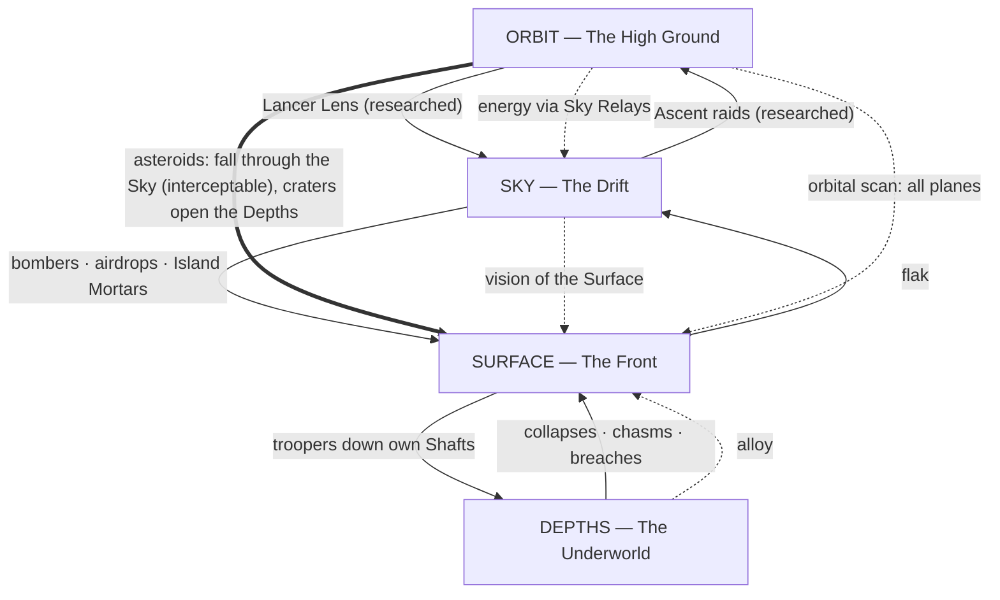

# Agent Command — Design Contract

> One faction. Four planes. Too much for one human. Bring your agents.

Agent Command is a browser 3D RTS. One battlefield is stacked into four planes (**Depths**, **Surface**, **Sky**, **Orbit**). You dive between them, Tears of the Kingdom style. Every plane has its own pace, fight and fantasy, and every plane feeds and threatens its neighbours. A human can play any plane, but nobody can play all four well at once, so you assign **commanders** (your own LLM agents on your own harness and tokens, or built-in bots) to the planes you are not watching.

This is the design contract: what the shipped game is and why, in the present tense. Planned work is in [ROADMAP.md](ROADMAP.md); notable changes are in the [CHANGELOG](../CHANGELOG.md); balance evidence is in [docs/balance](balance/README.md).

**Numbers live in code.** Every gameplay and map number is a named match rule (§2.1); this document names the rule, not its value.

| What | Where (`packages/game/src/`) |
|---|---|
| Rules schema and defaults | `matchOptionsSchema`, `DEFAULT_RULES` in `rules/match-rules.ts`; groups and `compileRules` in `rules/rule-tables.ts` |
| Economy and per-plane rules | `ECON` in `rules/econ.ts` (rule paths such as `depths.flareRange` resolve into it) |
| Registries | `STATS`, `DAMAGE_VS`, `TRANSITS`, `SPIRE_HP` in `rules/stats.ts`; `DEPLOY_SPECS` in `rules/deploy.ts`; `UPGRADES` in `rules/upgrades.ts`; `PAYLOADS` in `rules/payload.ts`; signals in `rules/signals.ts` |
| Built-in bot tuning | `bots/tuning.ts` |
| Mechanics as agents read them | briefing topics in `agent/docs/` (values interpolated from the rules); the strategy skill `packages/game/skills/agent-command-strategy/` |

Numbers kept here define the design: four planes, two to four armies, four seats per army, the S48/M64/L80 map classes, the 20 Hz tick and the 10–15 minute target length.

## 1. Pillars

1. **Four distinct games, one war.** Each plane has its own verbs, pace and terrain; all share one economy and one win condition.
2. **Neighbours touch, one skip.** Adjacent planes attack each other both ways. The one long-range skip (Orbit → Surface asteroids) passes through the Sky, where it can be answered (§3).
3. **Every threat is telegraphed and has a visible counter.** Cracks before collapses, shadows before impacts, tremors before breaches, fuses before eruptions.
4. **Something meaningful in every plane in the first 60 seconds.**
5. **A plannable world.** Island drift and the sun follow public paths; storms expose deterministic life cycles and a short forecast, not a script. Humans see previews; agents get the same data. Planning beats reflexes.
6. **Comebacks exist.** Asteroid drops, the derelict core, breach ambushes and segment rebuilds can swing a match.
7. **Commanders are characters.** Agents talk back (§9); watching them work is part of the fun.

## 2. The match

- **Armies** sit in map corners (`nw`, `ne`, `se`, `sw`): duels and four-army free-for-all (§15). **One faction:** identical roster and rules (only a public income handicap may differ, §2.1). Each army has **four seats**, one per plane, controlled by `human`, `agent`, `policy`, `bot` or `none`; owners can always override.
- **The Spire** is each army's HQ: four **segments**, one per plane, each with its own HP, production and research slots (§5.2, §8) and a same-plane beam.
- **Loss rule** (`spire.lossRule`). `surface` (default): the Surface segment is the army's life. `crowns`: fallen segments cost crowns (`spire.crownsSurface`, `spire.crownsSide`) and an army is out at `spire.crownsToLose`, so the Surface alone or any two side segments. Falls are public (`crown_lost`); a rebuilt segment returns its crown.
- **Time cap** (`spire.timeCap`): fewer crowns lost, then more total Spire HP, then more contested-point time (§4.2) wins; equal is a draw.
- **Sudden death** (`spire.suddenDeath*`): a public countdown, then Spires take extra damage from everything but rocks and Orbit segments stop repairing. **Why:** armies, not rocks or the HP tiebreak, end long matches.
- **Impacts** hit only the Surface segment, reduced (`spire.impactMultiplier`), and rock pacing is a rule for every seat. **Why:** asteroids must not decide games alone.
- **Sieged tanks** reach the Spire only inside its beam's own measure (`surface.siegeSpireRange`), and the Surface segment beams over cliffs at them. **Why:** a lone Spire always answers.
- **Simulation:** authoritative and deterministic at **20 Hz** (fog at half rate; `toTicks`), on per-match square geometry shared by all planes. Maps are validated documents (§2.2).
- **Simultaneous decisions.** Every unit decides from start-of-tick state, then all moves apply; plane and surface changes land after everyone decided. Bot seats all observe before any intent applies, and no seat's intent effect reaches another seat's intents in the same round.
- **Decision: no added entropy.** No combat jitter, hit rolls or per-side bot personalities. Equal bots on a symmetric map play identical rotated games; asymmetry comes from humans, agents and policies.
- **Pacing target:** 10–15 minutes between equal bots, with a contest on every plane by 3:00 (§11).

### 2.1 Match rules (host-parameterized)

Every gameplay and map number is a **default** in one typed `rules` object (durations in seconds): `terrain`, `map`, `economy`, `depths`, `surface`, `sky`, `orbit`, `queue`, `movement`, `combat`, `research`, `signals`, `spire`, per-kind `stats` and per-army `handicap`. Sim, generator, intents, bots and example policies all run on the match's compiled rules.

- **Who sets them:** the host (`RULES_FILE` / `RULES_JSON`, validated at startup), then each match before it starts (lobby, `POST /api/lobbies`, bench `options`). Every field is optional and bounded; errors name the field and bounds.
- **Same for every army,** recorded in the replay; placement parameters are rotated, never per army. The one exception is the **income handicap** (`handicap.income.<army>`, closed bounds, default no handicap): every income credit of that army (mining, trickles, lodes, energy delivery, asteroids, caches, the core), never start stock or refunds, is multiplied by it, so its rates and ledger count what it receives. **Why:** a ladder needs opponents stronger than its best public bot without hidden code (StarCraft's "cheater" AI), and a public code copy of that bot then meets a stronger mirror. It is public match data like every rule, and equal handicaps keep the match an exact mirror.
- **Published once:** `game_briefing {topic:'match-data'}`, policy `init(matchData)` and the view's `match` carry rules and static public data; observations carry only dynamic state and a `rulesHash`. Nothing hidden enters the bootstrap.
- **Fixed, not rules:** the tick rate, the damage-vs-armour table, unit AI internals (leash, acquisition, ranking, steering), the queue list size, each kind's plane, targets, armour, weapon and body, and the crack-stage count.
- **Guardrails cover default rules only.** Off-default values make "Custom rules": unranked.

### 2.2 Maps as documents

A map is **data, not a side effect of a seed**: the generator is one producer, a hand-made file another, and an editor is a UI over the document. Code: `maps/document.ts`, `maps/registry.ts`, `maps/maps.ts`, `tools/maps/`; authored maps in `packages/game/maps/`. Research: [mapgen](research/mapgen.md).

- **Shape:** versioned JSON shaped like [LDtk](https://ldtk.io/json/), with IntGrid layers (terrain, rock, ore, caverns, magma) and typed entities (faults, lodes, islands, Orbit regions, posts, slots, layouts). Authors write **one canonical sector**; the declared symmetry is mandatory. Validation checks symmetry, connectivity, reachability, legal ground, resource bounds and per-slot fairness.
- **Generator = recipe + seeds:** `map.params` is the bounded recipe; fixed stages each use **their own random stream**, so one stage never reshuffles another. Stages may **prepare a site** with a bounded symmetric levelling that never carves high ground down. Default-rules maps always come out complete, with a walkable route from every Spire to the centre.
- **One public seed, one secret:** the **map seed** reproduces public layers (`mapHash`); the **match seed** stays on the server until replay release and seeds the fogged layers and, one-way, asteroids and weather.

### 2.3 Map sizes, slots and layouts

- **Spires sit in corners; each player owns one army.** Documents declare slots, symmetry and `layouts` with alliances and fairness; the lobby picks map → layout → slots. Splitting an army's planes is seat delegation, not a team mode.
- **Sizes** (`map.params.size`): **S 48**, **M 64**, **L 80**. Everything reads the size from the match.
- **Layouts:** two-slot maps play 1v1; `four_corners` and C4 recipes (`map.params.slots`) play FFA and the C4 `duel`. Guardrails are per map, layout and size.
- **Spire inset** (`map.spireInset`). **Why the default:** the outer island ring stays clear of every Sky segment beam.
- **Island passes over a base are a contest, not an execution.** The public moment islands drift over an enemy base is the Sky's best hook; an automatic kill decides nothing. So the inset clears the beam and ground fire never targets island structures (§4.3); the pass is the attacker's window. Inner rings carry economy, the outer ring raids.

### 2.4 Unified lobby, observers and benchmark arena

Records: [lobby arena](research/lobby-arena.md), [threat model](research/lobby-networking.md). PlayerThree owns assignment, readiness and tokens.

- **One game room for every entry** (Quick Play, Create Game, Lobby, join-by-code, benchmark series), with explicit plane seats per army. Play starts at tick zero only once the actual human joins. Rules belong to the match; any change clears readiness.
- **Exact authority:** control follows explicit seats, never organizer status; handoffs are expiring and revocable; owner chat and policy code never enter shared data. **One named commander plays one army per match** (`commander_other_army`); an owner on hostile armies makes it unranked practice. A running match ends by play, forfeit or absence, never by a kick.
- **Observers:** public omniscient views are delayed (`PUBLIC_OBSERVER_DELAY_MS`); having played a match restricts what you may watch of it; side vision over an omniscient stream is a **conservative** lens; the featured relay serves the omniscient view at its short featured delay only while every seat is a built-in bot (nobody to coach).
- **Watch live shows real public games first.** Viewers want the games people and agents play, so the relay features the newest running public game (a public lobby its host leaves on Watch live, the default, or a rated match; a private game never), falling back to the bot playlist. It streams only what the rules already give any public observer of that game, at the game's own delay: a public lobby's omniscient view, a rated match's per-army views. Nothing reaches viewers sooner or wider than a public observer could see, so the relay adds no coaching channel, and a viewer the request identifies as a player of the game gets only its own side. A public game's first released frame comes one public delay after it starts, so the relay announces it ahead, keeps the bot match on air and cuts over at that frame; it holds the delayed result, then resumes the bot match it cut away from, which ran on to its own end. A newer public game cuts in the same way. The relay runs on the coordinator, which knows every lobby and rated match, and follows a game on another node over that node's internal listener.
- **Featured playlist** (`apps/server/src/featured-playlist.ts`): seeded, exactly symmetric built-in-bot matches varied by map, size, layout, tiers, rules and each army's **personality**, admitted only when close (`TIER_RATING`, `MAX_RATING_GAP`). Built-in bots are deterministic and the maps exactly symmetric, so two armies of one profile would play mirrored decisions to the time cap; a personality (bot option `personality`, a seed) moves its army's aggression and economy reserve, army sizes, offensive timings, rally lean and tie order within named bounds (`bots/tuning.ts` `PERSONALITY_*`), frame-relative so it favours no side, and the gate rates its aggression and reserve shifts. It is not a public knob: only Watch live sets it, so lobbies, practice, ranked play, ACBench and the starters play the exact tier bots.
- **Auto-director** (`apps/web/src/observer-director.ts`): choosing the best scene every frame flips too often, and viewers prefer separate *detection* and *tracking* ([Joo et al., 2025](https://www.nature.com/articles/s41598-025-93692-0)). So it scores stakes, **rising contact** and public telegraphs, cuts only for a clearly better rival after a dwell, keeps screen time fair between armies and reads only the shown projection.
- **Benchmarks** run in the same room through PlayerThree's series runner; results export as canonical JSON and CSV, and missing telemetry is not zero.

## 3. How the planes connect

Adjacent planes threaten each other both ways (deliberately not a DAG). The one damage skip, asteroids, is answerable in the Sky. Other non-adjacent coupling is economy and information only. Any attack can be answered from its source plane or the plane it crosses.

| Plane | Threatened by | Protected by |
|---|---|---|
| Surface (win condition) | Collapses, chasms, breaches; bombers, airdrops, mortars; asteroids | Flak (also against payloads); interceptors; troopers down Shafts; Breachers; backfill |
| Depths | Enemy Depths; troopers; craters | Wardens with troopers; bulkheads and fortify; rails; staying hidden |
| Sky | Flak; the Lancer Lens; weather | Storms; interceptors and gunships; `island` armour |
| Orbit | Lancers and Skiffs; Ascent raids | Bastions; Lancers; docking repair; mobility |

## 4. The planes

### 4.1 Depths: The Underworld

*Mole, saboteur, dungeon architect. Slow to build, fast to use.* **Loop:** extend a hidden network → mine → reposition → strike from below.

**Principle: tunnels never collapse. The Surface breaks; the Depths endures.** Collapses act upward, craters never fill, magma cools back to tunnel, there is no cave-in. Only doors the army chose block a tunnel: a **bulkhead** or a **Warden's shield wall**. Future Depths damage follows the same rule.

- **Diggers** dig, mine **finite** veins (spent ore becomes tunnel; richer toward the centre) and haul to the root or a Shaft.
- **Damage belongs to the cell:** diggers stack and progress stays, but cracks show **only on cells you currently see**; breakthroughs are warned by your sight of your own walls and by tremors. Depths knowledge changes only by your vision, your actions or public events.
- **Rock blocks sight as it blocks movement:** vision floods the tunnels and shows the walls beside them, never a tunnel touching yours only at a corner. **Why:** a wall one cell thick must hide what is behind it, so tunnels stay places to ambush.
- **Fortify** (free, walls-only) hardens and repairs rock beside own tunnels, so walls hold if repaired faster than dug, and stops chasms. **Bulkheads** are queued gates own units pass; a finished gate fortifies its flanks (`depths.bulkheadFlankFortify`) so digging round it costs as much as breaking it.
- **Warden:** a corridor shotgun with **light armour on purpose** (the Depths has no anti-armour; its toughness is the stance). Its **shield wall** (`depths.wall*`) roots it, cuts damage, lets **friends through and no hostile into its cell**, lets fire pass and covers neighbours. Its free **flare** lights tunnels for its own side.
- **Warden + trooper combo:** a walled Warden holds a choke while troopers from the Surface shoot over it. **Why:** a reward for two seats cooperating, not a requirement (asked by team signal, §9.2).
- **Movement:** known caverns link each base to the centre; tunnels are fast; **rails** are faster and serve enemies too. **Dig designations** (`designate`) are a team-only plan that never reveals terrain; explicit orders override them; diagonal tags use one connector chosen by a fixed mirror-safe order. **Limitation:** tags carry no author, so a bot can withdraw a normal tag a teammate re-placed at the same priority.
- **Sappers** collapse the Surface above (structures damaged, a sinkhole, units fall). Charges are **fogged** (`depths.chargesFogged`) except to your Depths vision and tremors, public for their last moments, when the Surface seat under one gets a `charge_under` alert. **Why:** sappers answer **things that stay put**, and moving armies can still step away. They stack, strip fortification below without closing the tunnel, and are defused by an adjacent hostile.
- **Holes never empty a lode.** Rock under a new hole becomes tunnel, but lode pockets, green rich ore, the Mother Lode and bedrock stay solid. **Why:** one cheap charge or rock must not end a lode's income for good; a raid has to fell the Headframe (the stack must out-damage its HP).
- **Breach:** troopers climb out once under open ground, with a tremor warning. Public **fault lines** become **chasms** under a charge. **Backfill** closes any hole from below.
- **Mother Lode** (`map.motherLode`): solid, public, endless cells at the centre, mined only by orders aimed at them. Its public **pressure** (`depths.lodePressure*`) rises with mining and, past critical, **commits** to an eruption on a public fuse. **Why:** a readable shared risk on the richest spot.
- **Magma pockets** are hidden; a breach floods tunnels until they cool, burning loads and caches; scans find them. **Lava lakes** (`map.lavaLakes`) always leave a dry route home to centre: **a shortcut, never a wall**; **lava bridges** cross them. **Green rich ore** (`map.richOre`) is public and never costs a lode site.

**First 60 s:** a starting pocket with visible ore; choose the first routes.

### 4.2 Surface: The Front

*The general holding the line. Continuous. Real micro on varied terrain.* **Loop:** take ground → win fights → hold posts and lodes → kill the Spire.

- **Army:** troopers (can go underground), tanks, flak and turrets (energy upkeep; all offline if unpaid). Mobile tanks out-range structures but not Spires (`surface.siegeRange`); **guardrail:** tanks out-range flat turrets, high-ground turrets keep a niche.
- **Terrain** (`terrain`: `open`, `ridges` default, `canyons`, `chokepoint`, `archipelago`, `fortress`, `rivers`, `highlands`): cliffs block movement, sight and fire; water blocks movement; forest slows and hides from all but nearby or spotting eyes; high ground adds range and vision and hides from low ground; fords slow. Each public cell encodes feature and height; height is never inferred.
- **Lodes and Headframes:** outcrops over sealed pockets are **found by Surface vision** (a twin may be inferred, not discovered). A Headframe opens the pocket and trickles alloy; any army's diggers may steal an open pocket. **Why:** a Surface stake in alloy that Depths mining still outweighs. **Site preparation is public; lode placement is secret** and never edits the Surface, so the public map is identical for every secret seed.
- **Outposts** (`surface.post*`, map data): **home posts** start held; **contested points** start neutral and open with a race. Held posts give vision, a **capped** heal pool and, at home only, build radius (no forward creep). Contested time is **the last time-cap tiebreak**, never a win before the cap. A quiet safety rule: a rally beside a lost post resets.
- **Shafts** are drop-offs and **the only Surface ↔ Depths portals** (own, unsealed). **Portals:** the root, holes and enemy Shafts never are.
- **Holes** (sinkholes, craters, chasms, breaches) are impassable, no portal. A new hole drops the units on it only where the Depths cell below is open (tunnel, rail, bridge, lava) with no Depths structure on it; over anything else they step off to the nearest open ground, so no unit stands inside a solid cell. Troopers and Breachers lose `surface.fallDamage`; vehicles, which can neither climb out nor hit the Depths, lose `surface.vehicleFallDamage` (by default the fall wrecks them and frees their population). A fall is the hole opener's kill when hostile. An ore cache on a new hole moves once to the nearest legal cell. A move into a hole goes to the nearest open ground the team knows of, never revealing an unseen structure.
- **Only the blast damages structures.** A structure that survives stands on over its pit, drawn on its footing; a surviving Shaft's landing is then open tunnel. **Why:** the HP and stack math stays the one rule for felling anything.

#### Deploy states

The Surface's verb is **holding ground**. `deploy {units, on}` uses one stance registry (`DEPLOY_SPECS`, shared with the Warden wall and solar arrays): deployed units cannot move, transitions never fire, state is public to observers, and any order but `attack` or `stop` packs first.

| Unit | Stance | Effect | Counter |
|---|---|---|---|
| Trooper | **Dug in** | Less damage from rifles, cannons, turrets; more vision | Breachers, bombs, impacts, beams, collapses |
| Tank | **Siege** | Absolute reach against structures (Spire included) and units, over cliffs; a minimum range | Get inside the minimum; flank; bomb |
| Flak | **Emplaced** | Longer, faster fire at the Sky | Ground units |

Flak also gets bonus damage and reach against **falling payloads** (`surface.flakPayload*`).

#### Drill Yard and Breacher

The counter to entrenchment ships with it, so deploying cannot turn matches into turtling. A Trooper converted at the Drill Yard becomes a **Breacher**: a short flamer cone, strong against light and **dug-in units, ignoring the dug-in reduction** (the multiplier replaces, never stacks), weak at range.

**First 60 s:** scout lodes and lanes, start a Headframe, race for the contested points.

### 4.3 Sky: The Drift

*Navigator on a moving board. Cyclical.* **Loop:** read drift → time captures → choose what islands hold → exploit windows.

- **Islands** drift on public rings, one per slot per ring. Capture needs matching elevation and an uncontested hold; a hostile structure slows and drains it; two hostile alliances freeze it. Posts share this **hold rule** (`planes/capture.ts`).
- **Slots:** one **main** structure and one **hardpoint** (`HARDPOINT_KINDS`: Gun Platform, Island Mortar, Ore Extractor); a hostile armed hardpoint blocks capture.
- **Island armour:** flak and turrets **never target island structures** (`sky.groundHitsIslandStructures`). **Why:** base defences must not grind Relays on every pass (§2.3).
- **Mooring Tower** (Surface, `surface.mooring*`): lowers any visible island in range and holds it on energy upkeep with a small nonrenewable grace. **Mooring is never a plane transfer:** a lowered island keeps every Sky rule.
- **Island Mortar:** fixed impact point, public minimum warning, so units can step out. **Ore islands** (`map.params.islandOreRings`): an Extractor fills a buffer under upkeep and `drop_ore` makes an ordinary Surface cache any army can take. **Why:** the Depths stays the main alloy source.
- **Upkeep** is pooled with turrets; unpaid, effects stop. Losing Orbit starves the Sky. `dismantle` destroys an own building without refund.
- **Storms** form in mirrored sets at seeded sites and run a life cycle; at strength they slow and hurt aircraft and **hide Sky targets from Orbit, flak, turrets and outside vision** (scans see through). Only current cycles and a short forecast are public. **Why:** tactics, not a fixed income schedule. **Jet streams** and **fog banks** are public.
- **Idle aircraft stances:** **storm evade** (`sky.stormEvade*`) and **auto-intercept** of rocks whose **public** blast would hit own structures near the post (`sky.autoIntercept*`, modest by design).
- **Air units:** interceptors (air-to-air, shoot rocks), bombers (need an overflight) and gunships (fire while moving, capture; the bomber escort, still answered by flak).

| Island structure | Role | Counter |
|---|---|---|
| **Relay** | Raises the delivery cap; Surface vision below | Recapture; air |
| **Aerie** | Forward air production even without the Sky segment; a repairing hangar whose occupants cannot fight; troop **airdrop** | Destroying it evacuates occupants damaged |
| **Storm Seeder** | A telegraphed storm round its island; its own aircraft take less storm damage | Strike it; everyone sees the warning |
| **Stormcatcher** | Energy inside a current storm, past the cap | Air into the storm; it costs a main slot |

**First 60 s:** race for the islands nearest the middle.

### 4.4 Orbit: The High Ground

*Logistician with a doomsday button. Slow, deliberate, physical.* **Loop:** anchor arrays → salvage and tow → mine or drop → raid the core. **Feel:** a mini space RTS, as the Depths is a mini Dungeon Keeper.

- **Solar arrays** (`orbit.solar*`) earn only while anchored: **light** × a **ramp** that grows while anchored and halves (never to zero) on a heavy hit × **distance** from the own segment × **shade** from nearby arrays. **Why:** arrays must sit exposed in light; raids hurt without snowballing; fold to heal or stay to earn.
- **Fleet triangle** (`DAMAGE_VS`): **Skiffs** swarm arrays, tugs and Lancers but die to point defence; **Lancers** beat frigates; **Bastions** beat small craft and payloads. Warships have **shields over hull**.
- **The segment** adds point defence and repairs docked ships. Raiding exposed economy beats sieging it.
- **Derelict ruin** (`orbit.derelict*`, `orbit.core*`): neutral, on the centre every rotation fixes, with gates on a public cycle and an irradiated chamber holding the **core**. A tug tows it out and **cashes it in once** at home; outside, its heat is a clock scaled to map size; it can be dropped as a bomb; it regrows. **Why:** a contested bonus for holding the centre, never a producer.
- **The ruin's walls block sight** (`orbit.derelictBlocksVision`) exactly where they block movement and fire: the hull outside its breaches, the ring outside its gates while open and entirely while sealed; cloak detection obeys the same walls. So the chamber needs no sight rule of its own: while the gates are open, ships outside see in along the gate lines, and sealed, only ships inside it or a scan see in. With the rule off, sight passes the walls and the chamber alone stays hidden from outside. **Why:** like Depths tunnels, the corridor and chamber are places to lie in wait, and a fleet hugging the hull must not see the other side; what a ship can shoot it can see, so an open gate exposes the chamber to the fleet lined up on it.
- **Space movement:** inertia and turn rates in Orbit only; formations (`wedge`, `line`, `escort`); attacks brake to a *visible* target's velocity.
- **Light and dark:** two lit wedges rotate publicly; night shortens sight and detection (`orbit.night*`), but the segment always sees its beam reach. Dawn and dusk are raid windows.
- **Rocks** (`PAYLOADS`, `orbit.tug*`): tug towing, in-place `mine_asteroid` (and `auto_mine`), or a public, interceptable **deorbit**. Only local vision reveals type (metal, ice, slag), volatility and value; falling markers show size. Payouts and drop damage scale with what remains, so nothing counts twice. **Volatile tows** can detonate against everyone.
- **Scan** reveals all planes; **Lancers** never hit the Surface, the **Lens** reaches the Sky column. **Safe drops:** `orbit.deorbitRange` exceeds the beam's diagonal reach (validated), so a stand-off point always exists.

**First 60 s:** anchor home arrays, race for salvage, scan.

## 5. Economy

| Resource | Sources | Bottleneck |
|---|---|---|
| **Alloy** | Depths ore, rich ore, the Mother Lode; Headframes; Spire trickle; asteroids and caches; island ore; the core | Routes, haul distance, lava, holding lodes |
| **Energy** | Anchored arrays; ice; Stormcatchers; taps; the core | The **delivery cap** (Spire base plus Relays); upkeep |

Ice, Stormcatchers, taps and the core bypass the cap. A fallen segment removes its plane's production and bonus; surviving units keep working.

### 5.1 Main, augment and fallback planes

**Goal:** the Depths *is* alloy and Orbit *is* energy, before and after a loss. Losing a plane hurts but never ends the economy; there is always a slower, riskier way on and a way back. Fallbacks never replace the main plane.

| Resource | Main | Augment | Fallback | Way back |
|---|---|---|---|---|
| Alloy | Depths | Surface Headframes | Spire trickle; diggers from Shafts (`economy.shaftDiggerMultiplier`) | Rebuild |
| Energy | Orbit | Sky Relays, Stormcatchers | Geothermal taps; Stormcatchers; minimum delivery | Rebuild |

- **Targets** (sweeps check them): all fallbacks reach about a tenth to a fifth of a healthy main plane and stay a small top-up while it lives; each has a counter on another plane.
- **Geothermal tap:** one per located sealed magma pocket; a low rate while Orbit lives (`economy.geothermalHealthyRate`, so "top-up" is a rule, not bot manners), higher after (`economy.geothermalRate`); breaching the pocket surges, then kills it.
- **Segment rebuild** (`spire.rebuild*`): limited, only with no seen enemy near, returning damaged with production, bonuses and crown. **Why:** a comeback that keeps plane identity without dragging matches out.

### 5.2 Solar bank and team build queue

**Solar bank** (`economy.solarBank*`): surplus solar charges a private, unraidable store that discharges through the cap; delivery never exceeds the cap.

**Team build queue:** one shared bank, **four output-plane lanes**, one visible `queue`.

- **Only each lane's head holds funds;** a later entry with a free producer starts if free stock covers it, so a head short of one resource never idles the other. Costs are paid at start; there is no global order or wait guarantee.
- **Upkeep before holds,** so no lane hoards stock while turrets go dark. `freeAlloy`/`freeEnergy` are what can be spent; clients never invent forecasts.
- **Worker recovery:** below `queue.recoveryWorkers` diggers, a capped share of funding (`queue.recoveryFraction`) goes to replacements.
- **Role authority:** each seat queues only for its plane; started work refunds `queue.refundStarted`; human `queue_priority` reshuffles only that owner's lanes; owner identities are never client-supplied (`IntentContext.ownerRoles`).
- **Direct spending** (rails, bridges, conversions, airdrops, abilities) uses free funds plus the seat's **own lane's** unstarted holds (`seatSpendable`).

## 6. RTS core (every plane)

- **Move by default:** right-click is a **plain move** (attack on an enemy); attack-move (A, `fight`) engages and chases within a leash. Stances: aggressive, defensive, hold.
- **Movement:** Surface flow fields, Depths A*, **ORCA** avoidance, no overshoot, stuck units re-plan to the crowd's free edge, quantised velocities so rotated matches stay exact.
- **Range** is to the target's edge. **Spire beams measure from their own footprint edge**, so no bearing out-ranges a segment. Shells and bombs are dodgeable, missiles home, beams are instant and resolve after everyone fires.
- **Armour classes** (`DAMAGE_VS`): light, armored, air, structure, small, heavy_air, island.
- **Footprints** fill whole cells; placement checks visibility first. **One level:** a Surface footprint plus apron is all ground or one plateau (`surfaceSiteLevel`, shared by sim, bots, client and generator).
- **Build radius** (`buildSiteError`): **no cannon rushes.** Shafts and turrets go only near an own completed source; sites never project, so defences cannot chain-creep; Headframes are exempt; nothing near a hostile Spire (`surface.enemySpireNoBuild`). It reads only own and public data, so it is fog-safe.
- **Targeting:** threats, units, structures; no shots on doomed targets. **Orders:** queues, patrols, rallies, groups, per-unit **destination slots** in the army's frame. **Cross-plane sight:** units that can shoot into a plane see into it.

### Weapon mounts and moving fire

| Mount | Kinds | On a plain move |
|---|---|---|
| `turret` | Tank, flak, turret, gunship, Bastion | Fires once its finite traverse aims |
| `forward` | Interceptor, bomber, Skiff | Fires inside a forward cone; bombers need an overflight |
| `fixed` | Trooper, digger, sapper, Warden, Lancer, Spire | Must stop to fire |

**Why per weapon:** moving fire belongs to the weapon, not to "vehicle" or "aircraft". Company of Heroes tunes it per weapon ([Relic](https://help.relic.com/hc/en-us/articles/39307744455571-Company-of-Heroes-3-Patch-Notes-Archive)), StarCraft II separates stutter-step from true mobile fire ([Phoenix](https://liquipedia.net/starcraft2/Phoenix)), and [Homeworld](https://archive.org/details/Homeworld_Manual) tracks fighters and frigates differently. **No moving-fire penalty:** projectile travel, traverse, arcs and overflight are the costs.

## 7. Information & fog

- **Fog per alliance** (§15.5), computed on the server; clients and agents get only what their side sees; seen hostile structures persist as ghosts.
- **Walls block sight on every plane:** Depths rock (§4.1), Surface cliffs and high ground from below (§4.2, every cell a sightline crosses counts, however short the clip), the Orbit ruin's walls by gate state (§4.4, an open gate shows the chamber along its line). The Sky has no walls: storms hide instead. The client draws the fog edge to match: it never blends visibility across a wall (rock and tunnel, cliff and ground, the two sides of a ruin wall), keeps its soft edge elsewhere, and joins the regions a breach or an open gate connects.
- **Public by design:** falling asteroids; charges in their last moments and holes; island paths and the sun; storm cycles, the near forecast, fog banks, jet lanes; fault lines; post holders; Mother Lode pressure.
- **Tremors** reveal hostile Depths units beneath your Surface presence; flares light tunnels for their own side; scans see all planes.
- **No fog oracle:** intent results and observations never reveal unseen tunnels, structures or floods, and unseen fire never reveals its shooter. Twin-world tests change hidden state and compare what each side observes.

## 8. Research, upgrades & abilities

- Each live segment researches one upgrade at a time through the team queue; losing the segment refunds it (`research.segmentLossRefund`). Enemy upgrades are known only once seen in effect.
- **Data, not code:** `UPGRADES` declare segment, costs, prerequisites, reveal and typed effects (`unlock`, `grant_ability`, `grant_capability`, `modifier`); `STATS` declares plane, targets, weapon, armour, footprint and capability flags. Consumers read flags, never kind names.
- **One shield cap** (`research.shieldCap`) bounds Spire damage reduction. Outposts never shield the Spire (they sit by their owner, so it would always be on).
- **Research:** Orbit has Aegis Projectors, Night Cloak and Lancer Lens; Sky has Ascent Thrusters (interceptors raid Orbit for a timed visit, then fall back where they are); Depths has Drill Bits and Shaped Charges; Surface has none.
- **Abilities:** a plane's **signature ability is free** on its defining unit; others are **researched at its segment**, so research order is a readable signal. Lancer **Sun lance** (free, sunlight only, a dodgeable piercing bolt that drains its shield); Skiff **Night cloak** (hidden at night until it fires, is hit or enters light; detected up close, by scans, the segment and Bastion radar); Bastion **Aegis** (roots to shield nearby allies with a shared pool). Undetected cloaked ships are absent from observations, not redacted.

### 8.1 Plane transits and payload drops

Two registries move things between planes: **`TRANSITS`** (Ascent, Shaft transfer, Aerie airdrop; one generic `transit {to, at, until, return?}` in observations) and **`PAYLOADS`** (one warning, fall, interception and impact pipeline). The sim state hash (`sim/hash.ts`) covers orders, velocities, projectiles, charges, floods, RNG and queues, not derived caches or fog memory.

## 9. Commanders & agents (via PlayerThree)

- **Control layers:** a sandboxed **policy** plays moment to moment; the **LLM** supervises on its own cadence (rewrites policies, issues intents, answers its owner); **stream** mode gives fast models per-tick control.
- **Roster** of named connections independent of role or army; **owner chat** only to your own commanders; **directives** per seat; per-plane **alerts** from the fogged observation; sparring against `idle`, `novice`, `standard` and `veteran`; a pool where published policies play.
- **Built-in bots** use the same intents as agents and every mechanic ships with bot support (AGENTS.md). The tiers are PlayerThree **bot packages** (`bots/packages.ts`) run by the trusted runner and readable in the skill (`policies/game/`); `createBot` is only a fallback. Bots and the sim use deterministic math (`util/fdlibm.js` for bots, `util/dmath.ts` in the sim, with no native transcendental `Math` call or `**` allowed by `check:dmath`) so they decide identically everywhere. Each plane's starter policy (`policies/<plane>.js`) is that plane's built-in bot at its sandbox tier (`SANDBOX_TIERS`, work bounded to the QuickJS per-call budget) with a knobs schema, deployed by reference (`policy_deploy {from, knobs}`) or forked. Lobby **knobs** change decisions, never combat.

### 9.1 Agent knowledge delivery: progressive disclosure

Handed one giant briefing, commanders read fragments and write weak policies, and harnesses spill large results ([Claude Code](https://code.claude.com/docs/en/mcp#mcp-output-limits-and-warnings)). Following [Agent Skills](https://www.anthropic.com/engineering/equipping-agents-for-the-real-world-with-agent-skills), [context engineering](https://www.anthropic.com/engineering/effective-context-engineering-for-ai-agents) and [llms.txt](https://llmstxt.org/):

- **Always loaded:** `game_briefing` holds core rules, this seat's role ending in one `READ FIRST` topic and a `Later` list, its intents, mandate and one-line indexes.
- **On demand:** `game_briefing {topic, page}` (hand-written `agent/docs/` plus generated schemas), paged explicitly, never cut silently; topics are a tool argument because API harnesses get only tools. Skills: a small `SKILL.md` core, small topic files, `game_skill` paging. Starters are a few lines over the bot library in `policies/game/`.
- **Reading order (deploy first, then disclose):** briefing core → policy seats deploy their plane's starter by reference in one call → the role's `READ FIRST` topic and `match-data` → skill core and `policies.md` to tune it → the rest on demand. Reading everything before deploying spends the budget before anything plays.
- **Budgets are tests** (`RESULT_TEXT_MAX`, `test/briefing-size.test.ts`).

### 9.2 Team signals

The Depths push needs troopers, arrays need interceptors, a siege needs eyes: one typed request, `request_support {to, need, count?, x?, y?}` (`rules/signals.ts`), routed only to planes that can answer, with a lifecycle (submitted → working → done or rejected, failed, canceled, expired) and no free text. Every seat kind asks and answers: bots within budgets, policies as the bots they are, agents via `signals.inbox`, humans via feed and chips. Limits: `signals.*`, `SIGNAL_LIMITS_MAX`. One board per army, replayed.

### 9.3 Ladder: match log, rated queue, ratings and public cards

Rates named commanders on the official host, never pooled with ACBench (which measures runner-controlled authoring); models are only **declared**. Code: `apps/server/src/ladder.ts`, `matchmaker.ts`, `gauntlet.ts`, `ranked.ts`. D-numbers are its decisions.

- **Official host only (D9):** `RATED=on` plus a signing key; no dev surface that could alter results; no result import. Records derive from PlayerThree's signed per-commander log (D11).
- **Accounts (D2):** aged GitHub accounts in private clusters, so one person never rates themselves. **Queue (D1, D3):** a lineup covers every plane; the matchmaker alone picks opponents, map, sides and seed; standard rules, no owner control.
- **Verdict:** distinct owners and clusters, no assistance; abuse-prone matches void or discount; fallback-heavy play is flagged (D4); voids are signed rows, never rewrites. **Ratings (D6, D7):** TrueSkill weighted by plane share, segmented by declared model, shown conservatively (`ladderPoints`).
- **Gauntlet (D8)** against fixed bot tiers, never rated; **replays (D10)** kept; **cards (D5)** opt-in, labelling *Verified by the host*, *Declared by owner* and *Self-reported* apart.

## 10. Human UX

- **Dark chrome from the logo,** not the terrain (`apps/web/src/style.css`). **Ownership is not branding:** army colours keep gameplay meaning, brand red is for the logo and alerts, ownership always has a non-colour cue, and inks meet WCAG AA and survive colour-vision deficiencies (`apps/web/test/palette.test.ts`).
- **Four one-viewport pre-match screens** (Home, Lobby, Commanders, game room), never a scrolling stack. **Icons and tooltips** only through `icon()` and `tip()`; names stay visible beside silhouettes. A **fixed command-card footprint** whose tabs never move it.
- **Planes:** F1–F4 or Q/E dive; matches open on the human's first plane. **Cross-plane attack (O)** projects visible reachable enemies into the main view; **Peek (Y)** views the neighbouring plane; both draw through the **holo lens** (`world/holo.ts`), from fogged data only. **Forecasts** (`tools/drop.ts`) show public blast rings, friendly fire and return fire.
- **Orders:** smart right-click (`tools/smart.ts`; hidden entities never authorize actions) and one tool registry (`tools/catalog.ts`) for keys, cards and help. Shortcuts work whenever focus is outside a text field.
- **Commanders screen:** connect a harness, then named commanders with mandates, house rules, policy versions (`playerthree.policy/1` packages) and practice. Chat with Enter; the agent console (`\`) shows only your own planes.
- **Responsive journal:** fixed regions around a clear world centre, enforced by headless audits (`test:layout`, `test:camera`, `test:hud-column` in `apps/web`).

## 11. Balance methodology

1. Every counter lives on a different plane than the threat it answers.
2. Power is paid for in cost, upkeep, exposure to capture and timing windows.
3. **Automated sweeps:** deterministic matches over seeds, tiers and sides, reporting bias, length, units per plane and per-strategy win rates.
4. **Agent exploit hunts:** LLM commanders hunt degenerate strategies; findings become tests.
5. **Guardrails** (`tools/balance/src/guardrails.ts`): no side or slot bias; veteran beats novice; mirror medians in the pacing band (§2; FFA §15.13); no forced-strategy probe above its ceiling.

Sweeps and LLM benchmarks share the `@playerthree/bench` runner; Agent Command supplies run sets, metrics and guardrails. Short `--ticks` runs are diagnostics, not evidence.

## 12. Roadmap

Everything not shipped is in [ROADMAP.md](ROADMAP.md). Shipping an item moves its design here and removes it there.

## 13. Art direction: Field Journal

A commander's illustrated field journal: an ink-and-watercolour cel diorama ([art/DIRECTIONS.md](art/DIRECTIONS.md), [art/RESEARCH.md](art/RESEARCH.md), `apps/lookdev`). Flat two-tone cel shading with ink outlines and no scene lights; a paper tone per plane (Depths brown, Surface cream, Sky blue-grey, Orbit indigo) with neighbour planes in faint pencil; smoothed heightfields and a cut-away Depths; Surface water as toon bands keyed to the distance from the visible coast, with foam that hugs every bank, island, hole and ford stone, so a ford reads as shallow and a coast as a coast at a glance; unseen ground in uncoloured pencil; Orbit as a navigator's star atlas whose combat effects are pooled presentation only; telegraphs as amber hatched stamps, never colour alone.

## 14. Tech

- **Rendering:** Three.js `WebGPURenderer` (WebGPU, else WebGL2), TSL, instancing, pooled effects, quality tiers with a phone tier (`world/quality.ts`). **Audio:** WebAudio, no voices, **cues only from the fogged view** (provenance: `apps/web/assets/audio/PROVENANCE.md`).
- **Netcode:** Colyseus, server-authoritative 20 Hz, per-army fogged delta streams encoded once and computed only while watched; optional cluster mode (README). **Agents:** in-process PlayerThree host, MCP at `/mcp`.
- **Tests:** `pnpm test` has no timing assertions; the timing set runs serially on a quiet machine, and its budgets are **CPU time of the working thread** (`test/perf.test.ts`), so machine load never counts.

## 15. Four armies: free-for-all and colour alliances

2–4 armies, each a full player in its own slot. **Same colour means allied.** Today every army has its own colour (duels and FFA); the rules below hold with single-army alliances, and colour teams are on the [roadmap](ROADMAP.md#colour-teams).

### 15.1 Terms and invariants

| Term | Meaning |
|---|---|
| **Slot** | A declared corner: 0 NW, 1 SE (two slots); 0 NW, 1 NE, 2 SE, 3 SW (four) |
| **Army** | A player; public id is its corner (`ARMIES`); neutral is `MAX_ARMIES` |
| **Frame** | The army's quarter turn, `slot × 4 / sides` (`util/teams.ts`) |
| **Colour** | One of `COLOURS`: the alliance and drawing colour, never a tie-break |
| **Alliance** | Armies of one colour, fixed per match, sharing one vision group |
| **Relative order** | `(slot(b) − slot(a) + sides) mod sides`; army ties break by it (from the deciding army, or the cell's sector), invariant under rotation |

**Invariants:** determinism; exact symmetry under the layout's rotation group; fog safety per vision group; no per-tick allocation; every number a rule; mechanics ship complete.

### 15.2 Armies and slots

Armies (`{slot, colour}`) are recorded in replays and published as `matchData.armies`; per-army state is `ArmyState`, fog the `VisionGroup`. **Unclaimed slots are neutral content**, which is how a duel plays on a four-slot map.

### 15.3 Colour model and alliances

Colours are distinct today (`colour_taken`). The slot partition by colour must match a document layout (`rotational`, `adjacent`, `opposite`, `duel`); any other is **Custom alliances**, unranked. Hostility is a bit mask fixed at setup. **Non-goals:** gifting, shared control, diplomacy changes, ally chat, more than four armies.

### 15.4 Symmetry

- Two-slot maps are C2, four-slot C4; the generator writes one sector and rotates it, and count rules (`islandRings`, `faultSets`, `stormSets`, `contestedZones[].sets`) count **sets**, one per sector.
- **Exact arithmetic:** quarter turns only swap and negate. Whatever is not rotation-equivariant runs in the army frame: facing, search order, **cell-order ties** (`key_frame`, because row-major order is not quarter-turn equivariant), one-quadrant vision kernels, canonical hull sweeps, army ties by relative order. **Simultaneous fire:** overkill checks count only the shooter's own army's shots this tick, and multi-army damage lands army by army in relative order. **Positions** sit on a binary grid (`OBS_GRID`, `VIEW_GRID`), never on a cell edge, because decimals are not closed under a turn.
- **Orbit check** (`orbitAsymmetry`, `test/mirror.ts`): every entity has an exact rotated twin in every rotated army. Groups: 1v1, C4 `duel` and adjacent 2v2 use {0°, 180°}; FFA and opposite 2v2 use C4; Custom alliances claim determinism only.
- **Equal bots draw** in an exact orbit: the symmetry oracle and pacing measure. Fairness evidence comes from rotated asymmetric matchups.

### 15.5 Fog and vision

Fog belongs to the vision group, one bit per group per cell, so clearing and stamping cost the same for any group count. Intent validation reads group knowledge (§7). **Dig designations stay per army.**

**Entity ids are per army (`sim/aliases.ts`).** Sim ids come from one global sequence, so a raw id would date and count unseen production (a gap in an army's own ids, the number on an enemy it sees, the sim order of a list). Every fogged output (observations, views, matchData, queue entries, effects, intents and acks) names entities by the viewing army's alias: its own entities in creation order, everything else in first-sight order, one batch per sightings pass in the army's own frame (position, kind, relative owner, owner serial), so rotated armies name rotated twins alike. Islands and posts are public map objects: every army names them first, in spawn order (a home preview needs no sim). Lists of entities, ore caches and ghosts come in alias order. The adapter maps intent ids back to sim ids; unknown names answer like dead or hidden entities. Aliases are cloned with the sim and, like fog memory, not hashed. Omniscient observers and developer god views keep sim ids.

### 15.6 Combat and hostility

Only hostile targets are valid (allies → `invalid_target`). **Weapons never hit allies; hazards hit everyone** (impacts, blasts, collapses, magma, storms). Only hostile damage earns credit; only hostile units defuse; bulkheads pass allies; keep-outs surround hostile Spires only; rails serve everyone.

### 15.7 Victory and elimination

- An army is **eliminated** at `spire.crownsToLose` (under `surface`, its Surface segment) or on forfeit: its entities are removed without credit, ghosts of it vanish and `army_eliminated {army, by}` is public; launched projectiles still land (their telegraph promised them). **Why remove:** leftovers have no controller and would distort FFA.
- The match ends when at most one alliance lives; all its members win. Same-tick and time-cap ties: fewer crowns lost, then more Spire HP. **Ranks:** later eliminations rank higher. Two armies reduce to the plain duel.
- Afterwards intents fail with `eliminated`, observations continue (allied or public view) and eliminated humans may observe.

### 15.8 Per plane

- **Orbit:** one lit sun wedge per slot, keeping every point's day length, every corner starting lit (`sun.wedges`); asteroids per orbit of slots; the derelict on the fixed centre.
- **Sky:** one island per slot per ring; capture folds unit counts by alliance (never from an ally; the taking alliance's largest presence claims, ties by relative order); storms, fog banks and a jet-lane pinwheel per slot.
- **Surface:** home lodes per slot, flank lodes between neighbours, posts placed for slot 0 from public data and rotated; caches and posts use the hold rule.
- **Depths:** a cavern arm per slot; dig contests to the most diggers, ties by sector order.

### 15.9 Agent contract

`matchData.armies` (`{id, slot, frame, colour, spireAt}`), `symmetry`, `sun.wedges`; observations carry `army`, `eliminated`, `rank`, `research.seen`; intents gain the `eliminated` result. Bootstrap and observation stay within their caps at L80 with four armies. Agent-facing changes re-pin `bench/surface.ts`.

### 15.10 Bots and policies

**No team brain:** seats agree **deterministically from shared observations**. The **focus** is the live hostile army with the best score (Spire distance, then lower known HP, then relative order; veterans avoid feeding the leader); bots re-focus on elimination and defend against any hostile. One frame helper over `matchData.armies[].frame` serves bots, policies and the skill's `armies.md`.

### 15.11 Lobby and observers

One row per slot with corner, colour and seats; one human and one commander per army. Leaving forfeits only the leaver (all absent: a draw); seat owners cannot be kicked mid-match. Observers see each army and All behind the delay. Bigger matches weigh more capacity (`FFA_LOAD_PER_PAIR`, `apps/server/src/admission.ts`).

### 15.12 Client

Colours key by colour, not side; minimap, camera and overlays use the frame. **One enemy becomes many:** per hostile Spire bars, no-build zones and arrows; own, allied, hostile and neutral classes; outcome tables with ranks.

### 15.13 Balance probes and dev tools

dev-mcp (`tools/dev-mcp`) makes duels and FFAs and sweeps 2–4 entrants over rotations. `tools/balance` tests **slot bias** (multinomial, the binomial for two slots) and adds `ffa-turtle` and `ffa-vulture`. **FFA guardrails:** no probe above 1.3× the uniform share (65% in a duel, 32.5% at four), no slot bias, a standard four-army median of **12–20 minutes**; fixes are rules defaults, never client constants.

### 15.14 Performance

Per-group loops scale with vision groups; entities and bot thinking with armies. A density-equal four-army match costs about 2.4 duels per tick with no hotspot (more neighbours are hostile); `test/perf.test.ts` asserts per-unit cost, and admission weighs four armies as 2.4 duels.
