# Art directions — Agent Command

Three art directions for the four-plane RTS, each built in a sandbox (`apps/lookdev`) and shot on the same scene.
The recommendation and a migration plan for `apps/web` are in §5–§6. Sources, techniques and the r187 API checks are
in [`RESEARCH.md`](RESEARCH.md). Links below go to entries cited there.

**Why the pre-migration look read naive**: every cell was a box with an edge-darkened top, so the
48×48 simulation grid *was* the art. Materials were noise-tinted `MeshStandardNodeMaterial` under one sun and one
hemisphere light, so planes differed only in colour. Fog was a darker, colder tint of the same image. No layer of the
picture told you what you knew versus what you saw. Current live-game captures are in [`../media/`](../media/).

**What every direction must do** (DESIGN §1, §4, §7):

- make the four planes distinct but plainly one world;
- read at RTS zoom: unit class from silhouette, team from colour plus a second cue;
- show fog, remembered ghosts and threat telegraphs, which are public and must never be hidden by fog;
- keep the grid legible for play without drawing it as boxes;
- run on `WebGPURenderer` with the WebGL2 fallback (every look-defining effect is a fragment or MRT pass, never
  compute-only).

### GUI: the logo's command console

The **3D world remains Field Journal**. Browser chrome instead follows the existing Agent Command logo and is **dark-themed**: near-black and deep maroon-brown panel faces (the logo's globe and letter shadows), a thick black keyline, gold bevel trims, cream text and compact squared corners, like a classic RTS sidebar. This is a GUI-only palette; do not recolour terrain, units, fog, plane washes or gameplay telegraphs to match it.

`apps/web/src/style.css` owns the custom-property contract. Every value is sampled from `logo.png`: `--brand-gold` (`#ffd21f`), `--brand-amber` (`#f5a800`), `--brand-shade` (`#c66a00`) and `--brand-bronze` (`#9c4200`, letter-shadow brown) are action/highlight/bevel colours. `--brand-red` (`#e30000`) and `--brand-maroon` (`#3a0000`) belong to the logo and explicit alert surfaces, **never ownership indicators**. `--chrome-black` (`#060000`, outline) / `--chrome-white` (`#fcfbe7`, highlight cream) define keylines and text. The semantic interface used by every panel, tooltip, feed, rail, map frame and console:

| Token | Value | Role |
| --- | --- | --- |
| `--paper` | `#2a0c00` | panel face (sheets, cards, rail, topbar) |
| `--paper-hi` | `#4e1800` | raised controls: buttons, slips, chips |
| `--paper-shade` / `--paper-deep` | `#1e0600` / `#120600` | recessed wells, inner rows, bevel shadow |
| `--paper-on` | `#621f02` | selected control face, always with the gold `--on-ring` keyline |
| `--chrome-hover` | `#5a1e00` | hover face |
| `--ink` / `--ink-soft` / `--muted` | `#fcfbe7` / `#f9ec9c` / `#bfb789` | text on dark faces |
| `--on-gold` | `--chrome-black` | text and icons on gold/amber faces (primary buttons, active tabs, active plane) |
| `--rule` / `--rule-soft` | black / bronze | keylines / dividers |
| `--sheet-shadow` | black keyline, gold top bevel, shade-orange bottom bevel, black drop | panels |
| `--slip-shadow` | bronze top bevel, deep-brown bottom, black drop | small controls |

**Team meaning wins over branding:** `--blue` (`#3aa8ff`) / `--red` (`#ff4f5e`) remain the gameplay swatches; `--blue-ink` (`#7cc4ff`) / `--red-ink` (`#ff8a94`) are their contrast-safe text variants on dark faces. Ownership chips, Spire health, team toggles and enemy events use these team tokens, with labels/icons as the non-colour cue. Gold means selected/actionable, not allied; brand red never means a neutral selected tab or a friendly owner. Text uses cream ink on dark faces and black on gold, with at least WCAG AA 4.5:1 for normal text (`palette.test.ts`). Bevel shine is decoration, not the sole focus or state indicator.

Pre-match screens use the logo as the hero and icons plus short action labels; explanatory copy lives in the global keyboard/hover/touch tooltip layer. Strong borders are drawn inward where necessary to preserve the HUD's audited geometry. Focus rings remain distinct and motion respects reduced-motion preferences.

---

## 0. The lookdev sandbox

`apps/lookdev` is a standalone Vite page (`@agent-command/lookdev`) that uses no game code. It renders a 16×16 slice of
each plane, using the game's cell codes:

- **Surface:** ground, plateau, cliffs, forests, a ford river, a fault that has opened a 4-cell chasm.
- **Depths:** rock, ore, bedrock, tunnels, a rail line, a magma pocket.
- **Sky:** two islands, one owned and one neutral in fog, a cloud deck, a storm cell and drift arcs.
- **Orbit:** the original comparison slice has a sun wedge, a towed asteroid, debris, solar arrays and lancers.
  The expanded **navigator's star atlas** fleet study is `?dir=atlas&plane=orbit` (see §8).

Blue and red units stand on each plane. Fog covers about half the scene, using the game's own bilinear 16² texture
approach. A red turret is a remembered ghost. There are two telegraphs: an asteroid impact at 62 % (Surface) and a
sapper charge (Depths). Orbit also shows a drop marker around the asteroid.

```
pnpm --filter @agent-command/lookdev dev        # http://localhost:5190/?dir=ink&plane=surface
pnpm --filter @agent-command/lookdev shots      # all 15 PNGs → docs/art/shots/ (WebGL2, frozen clock)
```

URL parameters:

- `dir=ink|table|signal|atlas` (`atlas` always focuses Orbit)
- `plane=surface|depths|sky|orbit|stack`
- `t=<seconds>` freezes the clock
- `renderer=webgl`
- `hud=0`
- Atlas only: `zoom=normal|wide|close` selects distances 30 / 52 / 18; `labels=0` hides its editorial legend.

As in the game, the plane you view is focused, the plane below shows through as a ghost, and planes above are hidden.

Shared building blocks, which are the parts worth porting:

- `world.ts` · `buildField()`: a level-set smoothed heightfield. For each height level, the cell mask is blurred and
  re-thresholded, so outlines get rounded corners in plan view (like marching squares) and walls stay steep and
  bevelled. It also bakes per-vertex sun visibility (a soft shadow march), cavity AO and blurred class masks
  (forest / cliff / ford / chasm).
- `kit.ts`: scene assembly, the fog sampler `vis(plane)` with a noisy edge, and the telegraph pattern (ring, 12
  ticks, countdown pie, cross).
- `dirs/shared.ts`: the cel ramp, anti-aliased world-space line/hatch masks, and `edges()`, a depth-Laplacian plus
  normal-discontinuity edge detector over an MRT pass.

All screenshots were taken on WebGL2 (ANGLE/GL in WSL). WebGPU-only paths were not shot.

---

## 1. Direction A — "Field Journal" (ink & watercolour cel diorama)

> The war as the commander's illustrated field journal: a watercolour-and-ink diorama on paper, where the parts you
> can't see are still drawn, but have not been painted in.

| Surface | Depths | Sky | Orbit | Stack |
|---|---|---|---|---|
| 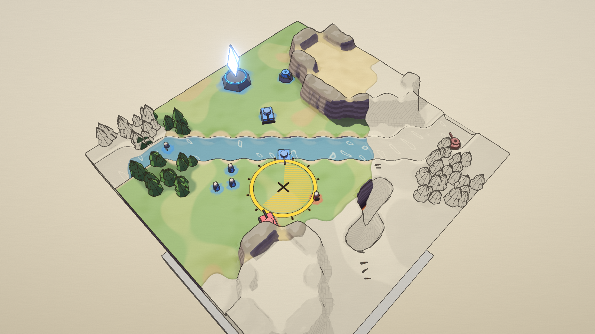 | 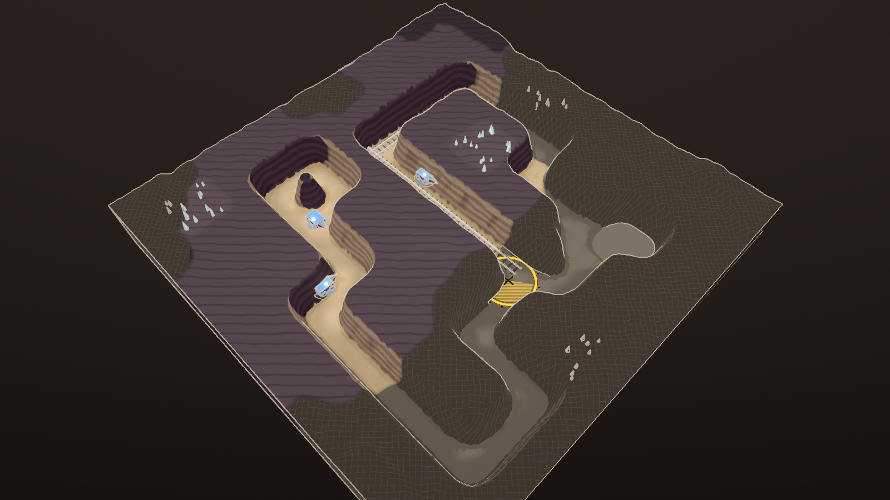 | 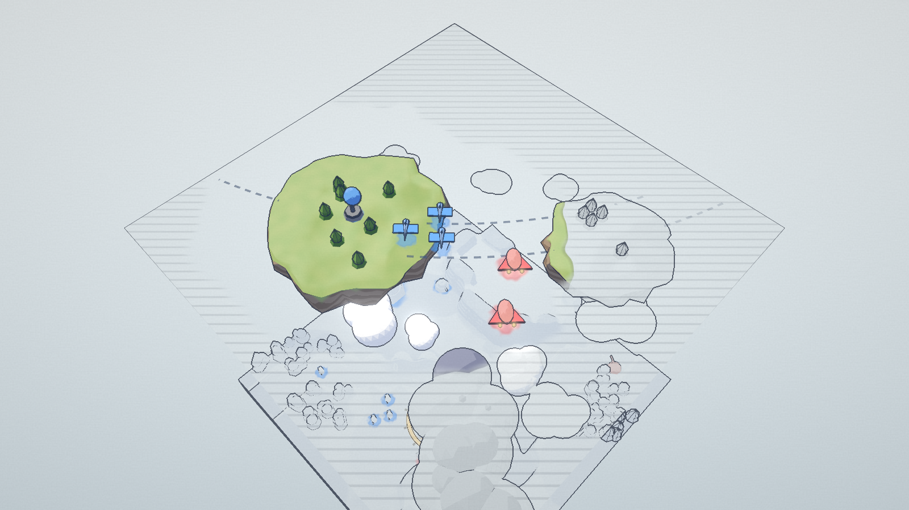 | 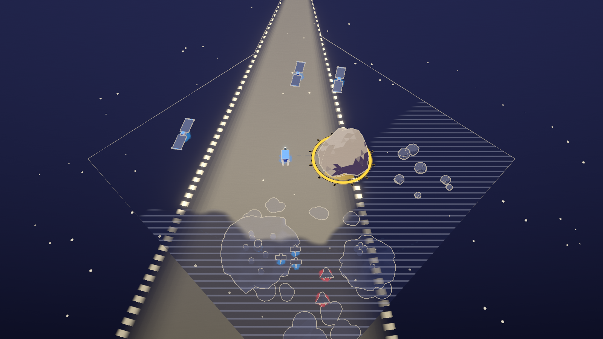 | 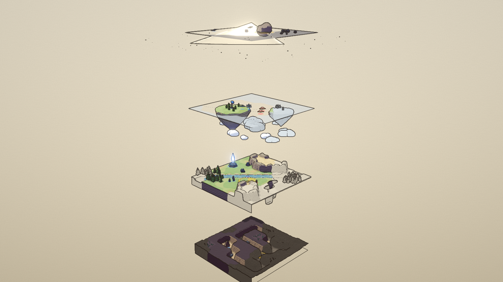 |

**Mood board**

- Sable's line art and its layer order: flat colour, then shadows, then fog, then lines
  ([Game Developer](https://www.gamedeveloper.com/marketing/how-shedworks-refined-the-art-of-sable-in-pursuit-of-readability),
  [Cook & Becker](https://www.cookandbecker.com/en/article/170/sable-exploration-through-line-art.html)).
- Moebius-style post-processing ([Heckel](https://blog.maximeheckel.com/posts/moebius-style-post-processing)).
- TF2 warm-to-cool shadows ([NPAR 2007](https://cdn.cloudflare.steamstatic.com/apps/valve/2007/NPAR07_IllustrativeRenderingInTeamFortress2.pdf)).
- Civ VI's hand-drawn unexplored map ([IGN](https://in.ign.com/civilization-6/93881/civilization-6s-new-game-changer-features)).
- Bad North / Townscaper corner-driven terrain
  ([Game Developer](https://www.gamedeveloper.com/game-platforms/how-townscaper-works-a-story-four-games-in-the-making)).
- Obra Dinn's world-anchored pattern trick ([dukope](https://dukope.com/devlogs/obra-dinn/tig-32)).

**Palette per plane.** Each plane is a different paper. Team and threat colours are unchanged from the game.

| Plane | Paper | Ink lines | Shadow tint (×) | Key colours |
|---|---|---|---|---|
| Surface | `#efe6d0` cream | `#2b2019` sepia | `#8a86b8` violet | grass `#9ab86a`/`#b5c178`, dry `#cdb77c`, plateau `#dcc791`, rock `#a9978a`, ford `#7fb2c2`, chasm glow `#ff8a3a` |
| Depths | `#2b241f` umber card | `#e9dcc4` chalk | `#6a5a8a` | rock section fill `#5a4a52` + hatch, walls `#9a7f68`, tunnel floor `#c7a77a`, ore `#5fc9b8`, magma `#ff5a1a→#ffd27a` |
| Sky | `#e4ecef` blue-grey | `#22304a` | `#9fb0d6` | island grass `#a6c477`, rock `#b39c84→#7d6f8a`, cloud `#fff`/`#c3cde3`, storm `#8a8fab`, drift arcs `#3d5a80` |
| Orbit | `#1e2245` indigo | `#e9dcc4` chalk | `#6a5c9e` | warm additive daylight wash with soft dawn/dusk gradients and a faint ink boundary, asteroid `#b3a395` + craters |

Team colours are blue `#3aa8ff` and red `#ff4f5e`; the threat colour is amber `#ffd23f`.

**Lighting model.** Unlit `MeshBasicNodeMaterial` with a TSL two-tone cel ramp:

- a `smoothstep` terminator on N·L, and a hue-shifted shadow (base × plane shadow tint, never black);
- a thin highlight band and stepped AO;
- terrain also multiplies in the **baked sun visibility**, so cliffs cast crisp cel shadows without any shadow map.
- **Sky islands cast a soft shadow on the Surface** (`island-shadows.ts`): a feathered wash in each island's own
  top-down silhouette (built once from its model), the Surface shadow tint taken down in value at 40 % opacity (it
  must read on painted grass, not just paper), draped over the terrain and leaning 1.2 tiles away from the sun. It
  follows the interpolated island every frame, ignores fog (island paths are public), shows while the Surface is
  focused and eases out through a dive (0 from any other plane); the field map's Surface page shows the same spots
  faintly. Cost: one instanced draw (≤ 32), two small byte textures, no shadow map or extra pass.

There are no scene lights at all, so this is cheaper than today's standard material.

**Outlines / edges.** One MRT scene pass writes colour and view normals. A composite pass then runs:

- a depth Laplacian, relative to distance, which works at every zoom level and finds silhouettes;
- a normal-difference test, which finds creases;
- a slight noise wobble on the sample offsets, for a hand-inked line.

The line colour comes from the viewed plane: sepia on light papers, chalk on dark ones. On top of that sit paper
grain, fibres and a soft vignette, plus a 1.0-threshold bloom so only emissives glow (magma, glows, the Spire).

**Plane transitions** (`world/dive.ts`, drawn by the ink composite). Choosing a plane (player keys and chips, observer
planes, minimap and feed jumps, the auto-director's cuts) is a 450 ms dive with an anime-ink punch: radial speed
lines in the page's line colour, re-picked on every beat like frames drawn on twos, whose dashes travel outward when
falling into a lower plane and inward when pulling up to a higher one; a radial zoom smear of the scene colour (the
ink lines stay crisp on top, like a cel's line art); a red/blue split at the peak; swelling paper grain; and a ragged
wash of the destination's plane accent spreading from where the camera is headed (the centre falling in, the edges
pulling out). The field of view widens through the fall and kicks narrower on landing. Choosing the same plane again
mid-dive lands at once; input is never blocked. The home tour glides for 1.15 s with faint lines only; following a
unit that changed plane glides with no ink (timed visits have their own return visuals). `prefers-reduced-motion`
keeps the camera still and crossfades through the destination's page; Settings → "Dive effects" off keeps the plain
camera dive. Cost: one uniform-gated branch in the existing composite (five extra colour taps, a few noise and hash
lookups) only while the ink is on screen; idle frames take no extra taps. The reduced-motion wash is one lerp.

**Terrain representation.** The grid disappears into a smoothed heightfield (`buildField`):

- plateaus get rounded mesa outlines with strata bands on the walls;
- fords and lakes become toon water: flat colour bands stepping from shallow to deep with distance from the coast, a
  foam rim and outward-pulsing foam rings hugging every bank, island, hole and ford stone, drifting hard-edged wave
  crests and sun glints (one shore-distance texture baked from the heightfield);
- the chasm is a real pit with a hot bottom;
- cell centres keep their exact height, so a cell still reads as a footprint.

Where play needs the grid (build placement, the cell under the cursor, telegraph cells), draw it as an ink decal from
`fract(positionWorld.xz)` near the cursor. It is not shown everywhere.

In the Depths, the rock top is drawn as a **section cut**, the way engineering drawings mark solid material: a flat
fill with diagonal section lines. Carved tunnel walls and lit floors read as negative space.

**Unit readability.**

- Class reads from silhouette: an upright pill for troopers, a low wedge for tanks, darts and flying wings in the Sky,
  needles and panels in Orbit.
- All units get ink outlines from the edge pass.
- Team reads twice: from the accent paint, and from a **team-coloured watercolour dab** under every unit, which keeps
  ownership readable even when a model is a few pixels tall.
- Remembered enemy structures are drawn in **red pencil**: a sketch with no paint.
- **Spires:** the same octahedral crystal proportions and visual scale on all four planes, coloured with the
  canonical chapter accents (Depths amber, Surface green, Sky cyan, Orbit violet), not army paint. Ownership
  stays on the low plinth and connector; only the functional Depths ore landing has a narrower base.
  Cut-gem toon reflection after the solar glass: the key light (plus two horizon keys turned 120°, since tall facets
  mirror the horizon from the RTS pitch) reflected about each flat facet normal. Facets sit on staggered toon steps
  and flash whole as the camera or spin crosses their mirror angle, with a faint thin-film spectrum over the plane
  colour; damage darkens whole facets. No stripes or streaks across faces, no clock. One crystal material per plane,
  shared by every army (per-object segment uniforms). Each army shares a 0.07-unit bob and 0.14-rad/s spin,
  independent of camera/plane transitions; reduced motion freezes the current pose without jumping or catching up.
  The Depths landing retains its ore heap and side rails; `world/spires.ts` owns the sole live crystal.
  Surface bases follow the terrain support instead of the zero-height plane; adjacent connector endpoints,
  muzzle/death anchors and picking use that same support, so elevated sites do not bury the lower crystal.
  Static ink seams deepen with observed damage; a short, reduced-motion-aware hit tint needs continuous sight.
  Death removes the core and leaves a low cold casing; only received, deduplicated death FX emit the existing
  Combat particle pool's eight fragments and ink ring. Public elimination extinguishes every link without
  inventing unseen explosions. A fog absence is not a death; known health stays frozen, unknown cores stay matte.
  Cross-plane links are two crossed 0.12-unit dashed strokes per gap, never a cylindrical camera enclosure.
  Fragment opacity fades continuously over 2–7 units of camera depth and 0.7–2.2 units of camera distance.
  They keep ordinary depth tests, no depth writes, single-pass double-sided blending and no MRT ink contribution.
  This follows Three's [material depth/single-pass contract](https://threejs.org/docs/pages/Material.html);
  [soft particles](https://threejs.org/docs/pages/module-SoftParticles.html) were considered but rejected here:
  a depth-texture sample/pass is unnecessary for these thin, feather-ended strokes. Opaque alpha-hashed plane
  fades and existing cel/ink shading preserve AC's palette and accessible army-colour references.
  Storage is fixed at 44 meshes for four armies (32 body/core draws and 12 links before plane/presence culling),
  with one shared four-triangle link geometry, no per-frame geometry rebuild, new particle pool or offscreen pass.
  Explicit templates warm hidden segment variants; reset reuses draws and clears health/sight/hit history.
  `apps/web/scripts/check-spires.mjs` prepares normal/wide/close, connector crossing, plane transition,
  damage/death, elimination/reset, fog and reduced-motion screenshots with the real renderer on both backends.
  Run only in an allocated resource slot; its CPU update/submission timings are not GPU timings. No performance
  improvement is claimed without captures and measurement.
- **Selected toon contours:** a padded union of nearby selected mobile-unit footprints replaces their separate
  dabs, using the same army wash, pigment pooling and exterior ink. This is not a convex hull or a density field:
  distant groups remain separate and crowds cannot inflate opacity or radius. Padding grows to 1.65× dab scale
  over 150 ms with a complementary normal-dab fade; source positions are never eased or delayed. Reduced motion
  uses the final contour immediately. Deselection, lost vision, death and cloak remove the source immediately,
  rather than fading a ghost. Own selected loops crossfade with the old dab so their coincident rims cannot
  obscure the group exterior; hover and non-own cues, waypoints, structures, islands and asteroids stay unchanged.
  Surface patches borrow the **drawn** terrain position/index buffers, including partially uploaded bake bands;
  they never independently triangulate a newer worker height field. Real bridge/ford support is applied to those
  samples. Coplanar geometry uses slope-scaled raster depth bias, depth testing, no depth writes and no ink-normal
  output—not arbitrary world-Y lift. No source-height cutoff clips ordinary slopes. Actual cliff/hole cells and
  low/high support regions separate contours; army, plane and raised-deck bands never union. Every tile on a raised
  deck uses one current deck height, not its first arriving source.
  The exact material is an entity shader template, compiled as a detached startup draw without displaying a
  selection. The omitted template in the earlier prototype is a plausible first-select hitch contributor, not
  a measured explanation of the user's reported jerk.
  One instanced scene draw, two retained RGBA32F textures, no offscreen pass/readback, no CPU contour extraction
  and no pairwise unit search. Each source bins into at most 36 local 2×2 patches; the fragment checks only its
  patch's records. For visible-entity capacity P (power of two, minimum 1024), C=36P and H=nextPow2(2C),
  typed CPU storage is 100C+4H+16(4S+1)²+10752 bytes; GPU payload is 64C+16(4S+1)²+10752 bytes.
  This excludes bounded O(selected entities + deck groups) JS bookkeeping and driver overhead. No selection
  entries are truncated; capacity changes at snapshot boundaries. Idle/no-selection frames do no bin fill or
  texture upload. These are structural bounds, not GPU measurements.
  Research: [Supreme Commander's PIX study](https://www.adriancourreges.com/blog/2015/06/23/supreme-commander-graphics-study/)
  documents terrain-aligned decals, and [0 A.D.'s overlay API](https://docs.wildfiregames.com/pyrogenesis/structSOverlayTexturedLine.html)
  derives overlay Y from terrain. The [merged-circle technical discussion](https://gamedev.stackexchange.com/questions/81686/how-to-make-unit-selection-circles-merge)
  describes union/masking approaches. None establishes that those commercial games use metaballs; the local
  padded-distance union is AC's design choice. `apps/web/scripts/check-selection-contours.mjs` is the constrained
  cold/warm-first-select, moving/disjoint pairs, ordinary/elevated Spire occlusion and slope/cliff boundaries at
  multiple camera distances, using the actual World/Entities/ink renderer. It owns and closes a temporary
  HMR-disabled Vite instance, serving real HTTP so browser address-space checks remain intact and unrelated edits
  cannot reload the fixture. Update/submission CPU timings are not GPU measurements.

**Fog of war: "unpainted".** Fogged terrain is the pencil underdrawing:

- three graphite values (posterised tone), with world-anchored hatching only in the darkest value;
- ink lines are kept, so shapes, cliffs and chasms stay fully readable (SC2's remembered tier), but with no colour;
- where vision ends, the wash stops with **watercolour edge-darkening**, a darker pigment rim, which is the vision
  boundary;
- enemy units in fog are not drawn (server fog).

Sky and Orbit, which have no ground, get a hatched paper veil. Ghosted planes become faint blue construction pencil
on the viewed plane's paper.

**Telegraph / effects language.** An amber **stamp**: a ring with an ink rim, 12 ink ticks, a centre glyph, and a
*hatched* countdown pie. The hatch is the pattern cue, so threat never depends on amber versus red, which collapse
under deuteranopia (RESEARCH §2.11). Stamps draw above fog and stay visible on ghosted planes. A planted charge's stamp
on the Surface is a faint dashed ring on the collapse edge around a dynamite glyph, at full strength in its public
window; in the Depths the charge itself is drawn: an inked bundle of dynamite tied with a team-colour band, a burning
fuse whose spark blinks faster toward detonation, and a small countdown dial.

Effects are ink splats, brush streaks and pigment blooms. Faults are a charred ink crack with a pulsing hot core.

### Unit model kit (`apps/web/src/world/models.ts`)

Every unit and structure is built from one small kit, so a new kind looks like it belongs and reads at RTS zoom.

- **Silhouette first.** Each kind is identifiable by its outline alone, at gameplay zoom and as a 10–15 px blob
  zoomed out: one dominant mass plus at most two signature protrusions. Signatures: digger = crawler with a drill
  nose; sapper = flat beetle carrying a fused charge; trooper = upright pill with a side rifle; warden = broad
  plated torso on long boots behind a tall riot shield carried angled on the left arm; breacher = squared,
  broad-shouldered trooper with twin orange fuel tanks on its back and a chunky hip flamer; tank = low wedge with
  a long barrel; flak = tracked mount with twin raised barrels and a radar; turret = octagonal plinth with a gun
  house; shaft = pit ring under an A-frame headframe with a sheave; drill yard = fenced concrete pad under a gantry,
  with fuel tanks, crates and a chimney; interceptor = dart on delta wings; bomber =
  chevron flying wing with twin jets; relay = mast with a dish and a beacon; solar = bus with two glass panel wings
  in iron frames; tug = stubby hull with side engines and a stern grapple.
- **Primitive kit.** `block` (box whose top is tapered/sheared: chamfered hulls, wedges, glacis), `pod`
  (hexagonal prism: tracks, skids, nacelles), `cyl`/`cone` with 6–8 sides (10 for big rings). Reusable parts:
  hull, turret, barrel (+ muzzle collar), track/skid, leg, rotor/fin, antenna, panel. No spheres or tori: round
  things are 6–10-sided prisms, so faceting matches the cel ramp and the ink creases.
- **Proportions per plane.** Depths: stubby and heavy (low centre, wide stance, big tool). Surface: grounded (tracks
  or legs, flat roofs). Sky: light and winged (span ≥ 1.3 × length, thin wings, pointed nose). Orbit: panelled and
  angular (octagonal buses, flat panels, booms, no wheels).
- **Scale ladder** (footprint length in model units, before `UNIT_SCALE`): light 0.5–0.75 (digger, sapper,
  trooper, interceptor, solar bus) < armored 0.9–1.2 (tank, flak, bomber, tug) < structure ≥ 1.0 wide or ≥ 1.4 tall
  (turret, shaft, relay) < Spire crystals (separate meshes, largest). Flyers keep the extra ×1.35 in `entities.ts`.
- **One team-accent rule.** `accent` is 0 or 1 (no partial tints) on exactly two places: the **cap** (the topmost
  broad plate the RTS camera sees: turret roof, helmet, deck, wing panels, bus lid) and the **band** (one stripe
  around the hull, mount, mast or fuselage seen from the side; on flyers the tail fin or the wingtip panels).
  Together ≈ 20–35 % of the top-down area (wings may exceed it on the small interceptor). Never on barrels, running
  gear or glow parts. The team dab (below) is the second, model-independent cue.
- **Palette.** `UNIT_PAINT` in `palette.ts`: one body colour per plane (Depths ochre, Surface field olive, Sky
  chalk-blue, Orbit cream) plus two neutrals, `steel` (light: housings, drills) and `iron` (dark: barrels, tracks,
  engines). At most three paint values per model, plus team and one glow pigment.
- **Glow is functional only:** optics/sensors (cyan), engines (amber), ore (teal), fuses (orange), a solar array's
  edge trim and collector light (its ramp gauge, below). Hulls never glow, and neither does solar glass.
- **Solar glass reflects; its frame reports.** Each wing is one sheet of deep-blue photovoltaic glass (`cell`) in a
  slightly larger iron frame (`SOLAR_PART.trim`) with a collector light (`SOLAR_PART.node`) on the bus lid. The glass
  is never emissive: its three cells per wing are ink seams with faint silver busbars (antialiased `lines`, fading
  out when denser than a pixel), it lifts toward a pale sky blue as the view's reflection turns toward the key light,
  and two parallel toon highlight streaks slide along the wing as the panel rolls or the camera moves (a stylised
  band, not PBR noise; gated to the sunlit side, and fading to a faint gleam at night). Output reads on the frame:
  once anchored the trim fills root → tip to the ramp multiplier (`solarRampStart` → 1, so half a gauge when just
  anchored), brightening with it, and the collector light shows the same level; gold by day, a cooler, dimmer blue
  at night; below 60 % HP (where the HP bar leaves its healthy band) both stutter. A lit gauge is a lamp: it skips
  the cel shadow, so a panel rolled away from the key light does not grey it. Folded, unfolding or packing, both
  stay dark iron. The rest of an anchored gauge keeps a faint tint so its length reads, and each array's frame is its
  own ring, so arrays in tight farm rows stay separate lights.
- **Facing.** Models face +X. The barrel, nose or drill is the forward-most point and a rear mass (engine,
  backpack, hopper, radar) makes the facing readable even without the weapon.
- **Poly budget** (triangles): light ≤ 160, armored ≤ 260, structure ≤ 320 (its footprint foundation included); the
  island and asteroid (terrain props) are exempt. Heavy infantry (the Warden 252, the Breacher 256) take the armored
  tier: a fuel rig, hose, pauldrons and rebreather don't fit in 160. No LOD: dropping collars, antennae and hatches
  saved only ≈ 5 % of unit triangles (≈ 5.6 k of 110 k for 600 mixed Surface units), well inside the timing noise,
  so one geometry per kind stays. Deploy-stance kits ride on top of their tier, hidden (degenerate) until deployed:
  the tank is 316 with its siege legs, pads and dust, the trooper 218 with its foxhole (both no more than the plain
  kits they replaced, ±2); kit boxes drop the faces nobody sees (sandbag undersides, strut ends).
- **Deploy stances.** Each follows its deploy progress both ways (packing runs it back), never a pop; the Warden's
  wall is the reference. **Tank siege** (StarCraft's siege tank as the reference; anchors `TANK_SIEGE`): outrigger
  legs show folded up against the hull sides, swing down and out beyond the tracks and plant their pads; the hull
  settles onto them; the turret swings round while the barrel runs out to 1.35× into a long, slightly raised
  artillery barrel; then the hull locks down with a thud it dips into and dust bursting from the four pads. Sieged,
  the barrel kicks back 1.8× as far and each shot adds a flash bloom, a fan of muzzle smoke and a dust ring blown off
  the ground (`combat.ts`); the muzzle mirror follows the long barrel. At mid zoom the planted legs, lowered hull and
  long barrel read as deployed and immobile. **Trooper dig-in** (`FOXHOLE`): a dark scrape opens round the trooper,
  who crouches and sinks into it; the ring course of sandbags rises out of the ground (`rise`), then a two-bag
  parapet in front, so the helmet, shoulders and rifle show over the lip; dirt kicks up beside the hole while digging
  in or out. **Trench lines** (`trenches.ts`): dug-in troopers of one army within 1.7 tiles on level ground link to
  their two nearest dug-in neighbours, and each link draws a trench segment (a scrape floor between two low sandbag
  walls) from foxhole lip to foxhole lip, as wide as the lesser dig-in progress, so a squad reads as one line. Only
  troopers in the view link; one instanced draw; no allocation per frame.
- **Ink must read.** Anything seen edge-on is ≥ 0.06 model units thick (about one ink line at gameplay zoom); parts
  never share coplanar faces (offset ≥ 0.01 or different radii); gaps narrower than 0.04 exist only where an ink
  line is wanted.
- **Muzzles.** `WEAPON_VISUALS.forward/height/lateral` = barrel tip × `UNIT_SCALE` (× 1.35 more for flyers). Moving
  a barrel means updating its weapon visual and the projectile test in the same change. Kinds whose muzzle is
  mirrored on the CPU share named anchors with their model (`GUNSHIP`, `BASTION_PD`, `TURRET`, `BREACHER`, `WARDEN`
  in `models.ts`), so the model, the rig and the firing point can't drift apart.

### Unit animation kit (`apps/web/src/world/rig.ts`)

Animation is **pivot-painted rigid parts** (the idea of Epic's
[Pivot Painter 2](https://dev.epicgames.com/documentation/en-us/unreal-engine/pivot-painter-tool-2.0-in-unreal-engine)):
every vertex carries a `part` id (body, top, barrel, rotor, left, right, panel, flame, tool, cargo), each kind's material
compiles its pivots and motions in as constants, and a compact per-instance state drives them in the vertex stage.
Alternatives considered: [vertex animation textures](https://mightyprofessionalgaming.com/tutorials/vertex-animation-textures.html)
suit baked, deforming (skinned) crowds, but our parts are rigid and our motion is state-driven (speed, turn, shot,
hit), so baking clips would add textures, a fetch per vertex and clip blending for nothing; skeletal rigs need a
bone palette per instance; compute/storage-buffer animation is WebGPU-only (the WebGL2 fallback has no compute);
impostors save little on ≤ 300-triangle models and would lose ink outlines and team caps. A far-zoom LOD was tried
and dropped (see the poly budget above).

- **Instancing.** One `Mesh` + `InstancedBufferGeometry` per kind (one draw), sharing the cached model attributes.
  Per-instance state is one interleaved 20-float record (one vertex buffer, so WebGPU stays within 8 vertex buffers):
  `a` world xyz + yaw, `b` scale, build height, bank, pitch, `c` team rgb + fade, `d` plane look, fire time, hit
  time, gait odometer, `e` drive (speed), work, constant phase and fill (idle cycles never retime with travel). The vertex
  stage builds the transform (no `Matrix4` per instance on the CPU) and the matching animated normal, which feeds
  both the cel ramp and the MRT normal, so the ink pass outlines the animated pose with no extra pass.
- **Uploads.** Values are quantised and compared in place; only changed records are uploaded, as coalesced
  `updateRanges` (whole buffer past 16 runs). Idle units cost no upload. No allocation per frame.
- **Culling.** Each kind's bounding sphere is rebuilt per frame from instance extents plus the model radius and an
  animation margin, so `frustumCulled` is on and correct.
- **Timing comes from render data only.** Fire time = the shot's on-screen tick (`entities.tickTime`, the same
  clock that launches the `combat.ts` muzzle); hit time = the snapshot whose HP dropped; gait = distance travelled
  (stride locked to the ground); drive = interpolated speed; bank = smoothed turn rate; pitch = speed plus
  acceleration smoothed over 0.4 s with a 1 tile/s² deadband (wire-rounded positions alone differentiate to about
  that much); islands, asteroids and structures never tilt; work = entity state (digging, mining, towing …) or, for
  solar arrays, the panel roll toward the sun bearing. Nothing feeds back into gameplay.
- **Declarative state visuals.** `STATE_VISUALS` beside `RIG` maps view data to normalized `work`/`fill` channels,
  then channels to tagged-part behaviour. Sources are `carry` (alloy divided by the match capacity), `state`
  (listed activity states), `deploy` (a stance's transition progress: 0 → 1 while deploying, 1 deployed, back to 0
  while packing), `linked` (observed link present), normalized `progress`, and delivery intensity/cycle.
  Part operations are uniform growth, axis stretch, a rise out of the ground (`rise`: height × the channel; the
  foxhole's sandbag courses), translation, rotation about a pivot (`turn`), channel-window visibility, symmetric
  pulsing pinch, a fading upward cable ride, and a looping puff (`drift`: each cycle it swells, rises, grows and
  shrinks away while on, hidden while off; a size envelope, not a dithered fade, so its ink outline stays clean; the
  Drill Yard's chimney, the digging trooper's dirt). An entry can take its channel through a window instead of its raw value:
  `range` (on inside it), `ease` (0 → 1 smoothstep across it) or `bump` (a hump, 0 at both ends), so one table
  sequences a motion in steps along a progress channel; entries apply in table order. The Warden's wall is the worked
  example: with the deploy progress its riot shield turns square from its carry angle, slides across the front,
  drops to plant while the body dips with the thud, then widens into the wall, and packing runs it back (a `state`
  source had snapped it into place). Knowledge-derived `presentation` channels also support passage poses.
  Time-driven part motions live in `RIG` instead: `swing` rocks the `tool` part about a pivot while working (the
  Drill Yard's hoist) and `pilot` flickers a `flame` part in size, flares it when firing and carries it with the
  barrel's recoil (the Breacher's pilot light). All are vertex-stage constants: no CPU work or allocation per frame.
  Add a table entry and a model part tag, not a kind-specific branch in `Entities.frame` or `unitRig`. Solar arrays
  are the documented exception: `work` carries the panel roll and `fill` a packed status (`packSolar`, decoded on the
  GPU by `solarStatus`): fold (deploy progress), ramp gauge (0 until anchored), daylight (the sim's lit test on the
  smoothed sun bearing, eased over 0.03 rad at a wedge edge) and damage, as integers so the float stays exact.
  `fill` uses the formerly unused slot 19 (`unitDrive.w`), so the record stays 20 floats / one buffer.
  Values are quantized and compared in place; unchanged cargo causes no instance upload.
- **Carry and hauling cues.** A digger's dark hopper is empty at zero carry and grows a heaped teal ore crystal as
  it fills (the model remains 160 triangles). Capacity comes from `diggerCarryMax(match.rules)`, using the client's
  retained first/snapshot `view.match`; the same helper (`rules.economy.diggerLoads` × `oreLoad`) lives in `packages/game/src/rules/economy.ts` and is used by the sim. No repeated
  per-entity capacity field or duplicated formula. Tug claws now pinch through the table when their observed link
  exists; the geometric tether still joins the two observed bodies. Fog-filtered `deliver` FX drive Headframe/Shaft
  skips: recent arrivals increase the rate, buckets ride up the cable and fade into the ceiling, then park after
  the last trip. Their wheel follows the same integrated cycle, not absolute time. Reduced motion runs at 8% speed.
  This indicates delivery activity, not an invented ore inventory.
- **Depths drop-offs.** Headframes and Shafts have timber-and-iron lower landings, a team cap and band, a loose ore
  heap on the floor and a rising skip. The Spire root retains its large crystal on a matching timber loading apron,
  with a larger ore heap beside it.
  Each counterpart is one instanced kit model, derived only from a structure in `view.entities` or `view.memory`;
  no lode, hole or hidden simulation state creates one. Own landings ignore underground fog; enemy landings
  (live or remembered) additionally require a known landing cell in `view.depths`. Surface sight/memory alone
  cannot reveal a landing in unexplored Depths. Remembered enemies remain static red-pencil instances.
  Construction sites have no lower landing until completed; the root stays landed while its segment produces a unit
  (the view reports a producing segment as `constructing`). Surface fading does not hide the Depths counterpart.
  Kit counts are 284 triangles (Headframe landing), 296 (Shaft landing) and 176 (root).
  The isolated WSL WebGL2 fixture (1440×960, 604 Depths units, three live + three remembered landings; measured with
  the earlier hopper kit, 100 fewer triangles per landing) measured
  32 draws / 172,573 triangles, versus 26 / 171,661 with only the landing renderer disabled. Median CPU frame
  submission was 5.8 ms versus 4.5 ms (43/34 samples); p95 was 9.0/15.3 ms. This is a component ablation,
  not a historical-revision comparison. The draw/triangle budgets pass; software-backend throughput was only
  0.95–2.37 FPS, so the target-hardware FPS budget remains unverified. WebGPU exposed no adapter.
  Evidence: `/tmp/ac-visuals/depths-dropoff-*.png`, with measurements and fixture metadata in adjacent JSON files.
- **Stored and dropped ore.** Landing stock and asteroid-drop caches (Surface and their Depths share) are one ore
  heap (`oreHeap`, 120 triangles): a low, wide, irregular teal rubble mound under faceted ore lumps and pale glowing
  crystal tips. Mineral pigments only (`ORE_HEAP_PAINT`), never iron, body or team paint, and wider than tall, so
  it can't read as a digger (a narrow tracked iron box carrying one crystal). Caches draw one heap a tile across
  per share and follow the units' zoom enlargement so they stay legible far out; landing heaps keep their
  structure's footprint scale.
- **Structures scale as one rigid whole.** Every structure, armed ones included, keeps its footprint fit at every
  zoom; only units take the zoom readability enlargement. A turret's head and barrel never grow apart from its
  plinth (they used to, and zooming out sank the base under the head). The fit is to the **hull**: every part but a
  barrel (`hullExtent`), so the turret's plinth fills its cell and its gun reaches past it (never beyond the cell's
  corners). Fitting the barrel inside the cell had shrunk the whole turret to a head about half a near-zoom tank
  turret's; now its gun house matches a tank's (0.60 vs 0.59 tiles long) on a plinth 1.5× wider, at scale 0.885
  (was 0.613). Far out, tanks still take the ×2.2 readability enlargement and the turret does not.
- **Motion language** (small amplitudes; read as a pen sketch, not a simulation):

| Kind | Idle | Move | Fire | Work / special |
|---|---|---|---|---|
| digger | engine shudder | track bob, nose bounce | drill jab | drill spins and jabs while digging/mining |
| sapper | fuse flicker, breathing | quick skid scurry, body wiggle | — | squats to plant while laying/undermining |
| trooper | breathing | leg stride, torso bob, lean | rifle kick, shoulder jolt | dig-in (deploy progress): scrape opens, crouch and sink, ring course then parapet rise, dirt kicks up while digging; packing reverses; trenches join neighbours |
| warden | breathing | heavy leg stride: long boots step out past the torso, torso bob, lean | shotgun kick, shoulder jolt | walling (deploy progress): the shield swings round from the arm, slides across, plants with a thud dip and widens into the wall; packing reverses |
| breacher | breathing, pilot light flicker | heavier leg stride, torso bob, lean | flamer kick (the pilot light rides it and flares), shoulder jolt; coherent pooled flame jet following the animated nozzle and match cone | — |
| tank | engine shudder | track bob, squat on accel, lean | barrel recoil (1.8× and a muzzle blast when sieged), turret/hull rock | siege (deploy progress): legs unfold and plant, hull settles, turret swings, barrel runs out long, thud and dust on lock-down; packing reverses |
| flak | engine shudder, radar sweep | track bob, squat on accel, lean | barrel recoil, turret/hull rock | emplaced: pads and a sandbag berm grow round the tracks |
| turret | sensor sweep | — | barrel recoil, house rock | — |
| drill yard | still, beacon dark | — | — | converting: the gantry hoist swings, the beacon paddle spins with its lamp lit, the chimney puffs |
| shaft, headframe | parked skip and wheel | — | — | observed deliveries drive upward, ceiling-fading skips; more arrivals increase rate |
| interceptor, bomber | hover bob | bank into turns, nose dips with acceleration, exhaust stretches | pylon/bay kick | — |
| relay | dish sweep, hover bob | — | — | — |
| solar | hover bob | — | — | panels roll toward the sun; anchoring unfolds each wing from a thick stack at its root along its span with the deploy progress, packing folds it back; the trim gauge and collector light (above) light only once anchored |
| tug | hover bob | engine flames stretch with speed, bank | — | grapple claw pulses while towing |

All kinds flinch sideways for 0.25 s when their HP drops. Deaths are animated from the view's death records (below,
**Deaths**): the model stays for its death stage, then leaves.

**Measured** (isolated harness, real `Entities` + ink pipeline, 600 moving Surface units, 1200×420, WSL ANGLE/GL
WebGL2; three runs each, not a controlled benchmark): draw calls 23 → 23; triangles 64 k → 110 k; `Entities.frame`
CPU median 0.66 → 0.65 ms; GPU timestamp of the whole frame 81–201 ms before vs 93–179 ms after (noise-dominated).
WebGPU only ran on a software (SwiftShader) adapter, one run each: 385 → 930 ms for the whole frame, where vertex
work runs on the CPU; hardware WebGPU timing is unverified.

**Underground visual completion.** Headframes now have a dedicated tall winding tower, shaft collar
and spoked wheel (216 triangles); the wheel uses the existing rigid-part rotor and turns in the active work state.
Bulkheads are banded portcullises with a team cap and lock plate (288 triangles, including junction leaves).
Their pose comes from open cardinal neighbours in Depths knowledge: transverse in straight tunnels, widened and
diagonal across bends/staircases, and framed on all four sides at junctions. The layout is re-derived with each view.
An own unit heading into the cell within 0.7 tile raises the leaves; they stay raised while it occupies/passes the
cell, then close. Reduced motion snaps directly between open/shut. Enemy and remembered gates remain shut.
`STATE_VISUALS` maps openness/layout to tagged-part translation, stretch and visibility using the existing record;
remembered structures now use the same frozen instanced rig, not a separate unrigged geometry path. The existing
snapshot-timed hit flinch remains. Both structures retain shared cel paint, MRT ink outlines and team dabs.
Bulkhead layout evidence: `/tmp/ac-visuals/bulkhead-{straight,corner,staircase,junction}-{closed,open}.png`,
plus enemy-shut, remembered-staircase and reduced-motion-open captures. These use controlled fogged-view fixtures
in the real WebGL2 client on isolated ports 2889/5489; no hidden simulation state drives the renderer.
Discovered Surface lodes are embedded, teal-veined terrain mounds with sealed/open and rich variants. Depths damage uses
four cumulative branching chalk-ink decals, instanced only from the fogged view's known solid cells; no client
inference about unseen digging. These replace the `LODE` and `CRACK` overlay labels. Queue rows use original 24px
SVG silhouettes in the harness glyph style rather than two-letter badges: a second GPU context/async model atlas
would add startup and resource-lifetime work for tiny monochrome HUD drawings.

Evidence: `/tmp/ac-visuals/{before,after}-*.png`, a matched baseline build and the visual change, isolated
server port 2679 and client ports 5280/5279. Headframe/Bulkhead were staged with dev-admin cheats; crack stages,
queue rows and the 600 additional mixed Surface units were supplied as presentation-only snapshots in the real
joined client. No sim rules changed. At 1440×960 on WSL ANGLE/GL WebGL2, the matched busy scene measured:

| Counter | Before | After |
|---|---:|---:|
| Draw calls (full frame) | 39 | 46 |
| Triangles (visible planes) | 275,759 | 276,059 |
| CPU `World.frame` median | 5.00 ms | 4.40 ms |
| CPU `World.frame` p95 | 12.60 ms | 13.30 ms |
| Samples over 18 seconds | 27 | 26 |

Both geometry counts remain within §6's 250-call / 450k-triangle limits, and the new models remain below 320
triangles. CPU results are contended single-run observations, not a claimed speedup. The software-backed full
render ran only about 1.4 fps both before and after: **the 30-fps fallback target is not certified here**.
WebGPU was unavailable (`navigator.gpu.requestAdapter()` returned `null`); no WebGPU timing or parity claim.
The web typecheck, 16 test files / 99 tests (including facing/projectile/field), and production build passed.

**Embedded lode follow-up.** `terrain.ts` now raises and roughens the listed lodes' footprint in the Surface
heightfield, with a low apron and the existing rock class mask blending the mound into the meadow. Veins are painted
in the terrain material itself; rich deposits add brighter secondary seams and a third small glint. Opening a lode
lowers its centre and exposes an ink-lined bored collar. Detail instances are seated after the field bake completes.
The former free-standing outcrop models are removed. Only `view.lodes` contribute terrain or details, and the shared
Surface fog finish now gives visible deposits paint and remembered deposits pencil, with no glow through fog.

Matched before/after captures at normal and wide zoom, visible and remembered, plus rich/open variants are under
`/tmp/ac-visuals/lodes2-*.png` (isolated ports 2679/5279/5280, matched baseline build). Visibility and lode variants were
staged as render snapshots. The same 600-additional-unit busy presentation at 1440×960 WebGL2 measured **38 → 38
draw calls**, **275,407 → 275,383 triangles**, CPU median **5.8 → 6.6 ms**, p95 **11.3 → 11.5 ms** (25/21 frames,
18 seconds each). These counts stay within the art budgets; the contended software renderer remained approximately
1.3–1.5 fps, not a target-hardware frame-rate certification. WebGPU again returned no adapter. Final web typecheck,
16 test files / 100 tests, and production build passed, including field, facing and projectile coverage.

**State-channel and mineral-colour evidence.** `/tmp/ac-visuals/state-digger-empty-half-full-{normal,wide}.png`
shows 0/20/40-alloy diggers together at camera distances 30/48; `state-digger-comparison-close.png` adds a close
inspection. Render snapshots were staged in a real joined client on isolated ports 2679/5279. The diggers are
ordered empty → half → full along increasing tile x (screen lower-right → upper-left for blue's camera).
Rich lodes now use orchid `#cf50d6` in their crystals, vein paint and minimap marks; ordinary ore remains teal
`#5fc9b8`. Rich deposits retain denser veins, three glints and a doubled minimap diamond as non-colour cues.
`state-lodes-ordinary-rich-{normal,wide}.png` and their `-deuteranopia.png` derivatives show the comparison; the
derivatives use the same full-severity Machado matrix in **linear RGB** as the telegraph check below. Rich ore
remains blue-violet versus near-neutral ordinary ore in that simulation, rather than collapsing to one pigment.
This is a visual simulation, not accessibility user testing. WebGL2 captures only; no WebGPU parity claim.
Game typecheck and the 8 rules tests passed; web typecheck, 17 files / 104 tests and build passed. New tests cover
channel normalization, custom economy capacity, tagged-part bindings, and one-record-only uploads on a carry change.

### Projectile visual contract

`apps/web/src/world/combat.ts` owns the exhaustive, frozen `WEAPON_VISUALS: Record<Weapon, ProjectileVisual>`.
The contract's actual armed-unit mapping—not a separate list of imaginary weapons—drives these families:

| Shooter | Weapon | Non-colour identity |
|---|---|---|
| Trooper | rifle | Thin, instant full-chord brush flick and compact muzzle flash |
| Tank | cannon | Tangent-aligned heavy shell, arcing segmented ink tail, smoky recoil puff and compact impact ring |
| Flak truck | flak | Short cross-barred dart, straight cross-plane rise and radial airburst spokes |
| Interceptor | missile | Long finned dart, shallow arc and restrained, spaced watercolour exhaust |
| Bomber | bomb | Broad finned pod, linear horizontal drift and accelerating vertical fall, ember fuse and heavy bloom |
| Spire | beam | Immediate full-length pigment sleeve with a fine paper core; fades rather than growing toward its target |
| Turret | turret | Three separated pulse dashes and a compact pointed head |
| Breacher | flamer | Overlapping orange lobes around a short pale-hot core, attached to the moving/recoiling nozzle for the burst; outer edges follow the match's splash cone and stop at the shot's target distance. Sparse embers and light smoke, not an artillery impact puff. Reduced motion removes ripple, embers and smoke and halves emission frequency |
| Digger | pick | Contact-only chip fan; no invented travelling projectile |

The flight head is the focus; trails and smoke are quieter secondary marks. Plane-specific ink/chalk keys the
silhouette on cream and dark cards. No new damage, velocity, collision, homing, or physics simulation is introduced.
Visible launches use nominal scaled model muzzle offsets, terrain at the source, and the **actual target plane**.
Sky aircraft centres are 2.5 tiles above their plane reference, not on the island deck. Spire launches use the
separate crystal mesh height. The event has no target entity identity, so the target is its public aim point at
nominal body height; tiny per-entity bob/zoom exaggeration and subsequent server missile homing are not reconstructed.
Fog-filtered target-only events use a short anonymous incoming stroke and never disclose a hidden muzzle.

**Shots between planes** (`aim.ts`). A shot that leaves its own plane, or hits a falling rock, ends at the
target's real 3D position: a unit at its body on its own plane (its live track height when the view has it), a
falling rock where it is drawn (`asteroidPosition`) when the shot arrives, not the logical Sky-plane spot under it.
One resolver feeds both the tracer and the mount that fired it, so a barrel points where its tracer goes:
turret-mount kinds with `RIG.elevate` (the Surface turret, flak, the Bastion's PD blisters, the Gunship's chin turret)
pitch their barrels about a trunnion toward that point, within per-kind limits, while the aim holds (the shot plus 2.5
cooldowns, ≥ 1 s), following the engaged rock or unit as drawn; a rock also sets the bearing. The elevation is packed
above the mount yaw in the record's `fill` slot (`packMount`, 1/256 rad steps), and `orbitMuzzle` mirrors it, so
muzzle flashes and launches sit on the raised barrel. A tracer to a rock keeps its shooter's plane fade, because the
rock is drawn whenever an upper plane shows. A Bastion's or a Gunship's shots at a payload fly as projectiles from
both of its barrels (the Bastion's weapon lock can't follow a rock). Same-plane shots at ordinary targets keep their
nominal ends and level barrels; the tank, which never fires off its plane, has no elevation.

**Extending a weapon:** add its gameplay weapon/mapping in the contract, then supply one `ProjectileVisual` entry.
Choose an existing shape (`streak`, `shell`, `flak`, `missile`, `bomb`, `beam`, `contact`, `pulse`) and trajectory
(`linear`, `arc`, `fall`), plus pigment, world-tile width/body/tail lengths, arc apex, muzzle offsets/style, trail
and impact. `hold` is only the millisecond readability persistence of an instantaneous stroke; it is **not flight
time**. An actually new silhouette may add one bounded render branch and trajectory tests, not a plugin registry
or a second weapon dispatch. Scan, portal and fault strokes use `EFFECT_VISUALS` with no damaging impact style.

**Clock and pool invariants:** all flights use the existing interpolated event clock and exact `arrive`, including
zero-time hits and flights shorter than 70 ms. Impacts fire once at that boundary; only fresh feedback (≤120 ms
late) is admitted. Muzzles wait for launch and are skipped beyond 80 ms lateness. Old event windows, tab hitches
and plane switches cannot replay retired shots. Trails sample absolute 35 ms buckets, with no backlog catch-up.
The dense 512-flight SoA pool shares immutable profiles and uses Float64 timestamps; it emits at most five stroke
instances and one body per slot, with existing capped particle pools. Overflow drops new cosmetics without
evicting a live flight or generating its hit. Reset clears pending shots and instance counts. Per-frame trajectory,
orientation and rendering use caller-owned scratch arrays and no new objects.

**Primary references:** Riot lead VFX artist Oli McDonald's
[areas of focus](https://realtimevfx.com/t/anatomy-of-a-league-of-legends-missile-part-1-creating-areas-of-focus/11614)
and [gameplay identity / visual hierarchy](https://realtimevfx.com/t/anatomy-of-a-league-of-legends-missile-part-2-what-are-we-communicating-with-our-vfx/13062)
motivate head-first contrast, unique silhouettes, and quieter secondary trails. We adapt those principles to
small RTS marks and two shared instanced meshes rather than importing an effect graph or physics framework.
The projectile shaders use Three's raw `positionGeometry`, not the already-instanced `positionLocal`, for their
tail-to-head pigment ramp. This keeps the same stroke at negative and positive world coordinates; see the
[r187 position-node contract](https://github.com/mrdoob/three.js/blob/r187/src/nodes/accessors/Position.js).

**Isolated source-browser recipe:** `node apps/lookdev/scripts/projectiles.mjs /tmp/ac-projectiles` starts a
dedicated Vite server on 127.0.0.1:5198, generates real server fire events in ephemeral in-memory games, and passes
only serialized fog-filtered views to the real client materials/pools/ink pipeline. It captures flight and impact
for all eight weapons plus a dark-card rifle, at normal gameplay camera distance (wider for cross-plane shots).
`CHROME=/path/to/chromium` overrides the existing lookdev Chromium default. PNGs and `evidence.json` stay outside
the repository; no live match, account, server process or `.data` file is touched. The recipe uses WebGL2; WebGPU
still needs separate hardware coverage. `apps/web/test/projectile.test.ts` covers path endpoints, fall drift,
vertical/degenerate transforms, first-frame hitscan, precise short flights, late snapshots, swap-removal colour,
pool saturation/reset, bounded trails, cross-plane anchors and hidden-plane retirement.

Observed source-browser evidence: `/tmp/ac-projectiles-ink/` contains 18 WebGL2 PNGs and `evidence.json`,
with no browser page/console errors. The fixed-position Spire capture exercises the pigment ramp away from
world Z=0; the Depths rifle exercises dark-card contrast. These are isolated presentation captures, not a
claim of multiplayer soak coverage or WebGPU verification.

**UI tone.** Field-journal chrome:

- paper panels with sepia ink rules and a stamped section header per plane ("II · THE FRONT");
- handwritten-style numerals for timers;
- commander chat as margin notes.

The existing plane accent colours become ink-wash tabs.

**Performance (lookdev).**

- Draws and triangles for the 16² slice, with the plane below ghosted: Surface 52 draws / 76 k tris, Depths 25 / 38 k,
  Sky 75 / 73 k, Orbit 131 / 37 k (Orbit is high only because the sandbox draws stars as individual meshes).
- Passes: scene MRT (colour + normal), one composite, and bloom. No shadow-map pass, no lights.
- Edge kernel: 5 depth and 5 normal taps per pixel.
- Field build, measured in Node: about 30 ms per 16² slice at 4 samples per tile, so about 250 ms for the full 48² map
  **[extrapolated]**. That is fine once per match for the Surface. The Depths need windowed rebuilds (§6).

**Risks.**

- Screen-space lines have a constant pixel width, so far terrain gets busy. Fade lines with distance, as Sable does.
- Hatching aliases into moiré on noisy normals; this was hit in lookdev and fixed by banding tone from the *un-hatched*
  lit colour. Keep hatching sparse and world-anchored.
- Dark papers (Depths, Orbit) need inverted chalk lines.
- Team blue against green grass is fine. Team red against dry ochre needs the dab.
- Bloom on paper must stay emissive-only (threshold ≥ 1.0).

---

## 2. Direction B — "War Table" (lamp-lit tabletop miniatures)

> A 3-D chess war table in a dark study: four carved, painted boards on brass posts, glossy miniatures on team-colour
> bases, and a desk lamp that lights only what your army can see.

Lookdev captures of this rejected direction live in the private archive.

**Mood board**

- Tiny Glade's tilt-shift diorama ([GPC 2024](https://graphicsprogrammingconference.com/archive/2024)).
- Dorfromantik's palette-mapped tiles ([80.lv](https://80.lv/articles/how-dorfromantik-expands-its-cozy-world-through-minimalist-design)).
- Deep Rock Galactic's faceted rock under point lights ([RPS](https://www.rockpapershotgun.com/how-deep-rock-galactic-mines-fun-from-absolute-darkess)).
- Kingdom Two Crowns' diegetic "1:1" state ([Game Developer](https://www.gamedeveloper.com/design/-i-kingdom-two-crowns-i-and-the-practical-intersection-of-pixel-art-and-roguelike-design)).
- Highfleet's touchable instrument UI ([Game Developer](https://www.gamedeveloper.com/design/designing-i-highfleet-i-a-strategy-game-with-heavy-machinery-and-twirling-knobs)).

**Palette per plane**

| Plane | Board | Key colours |
|---|---|---|
| Surface | carved wood edge `#6e4426/#94623a` | flocked felt grass `#5f9a3e/#7cb24c`, plateau `#d8b874`, painted stone `#b6ada0`, resin water `#2f8aa6`, chasm glow `#ff7a2a` |
| Depths | slate `#50535c` | plank tunnel floors `#a27445`, stone walls `#a39484`, lanterns `#ffb56a`, ore `#5ee0cc`, resin magma `#ff4a12` |
| Sky | frosted acrylic `#d8e6ee` (α 0.1), brass frame `#c9a24e` | cork islands `#a8794a` + flock tops, cotton-wool clouds `#f7f4ee`, storm `#7c7f8e`, brass orrery rails |
| Orbit | black velvet `#0d0c14` | pin stars `#fff4d8`, lamp-gel sun `#ffd890` (additive), painted asteroid `#9a8a7c` |

Team colours are deeper enamel versions (`#1670d8` / `#d8202e`), so they survive ACES tone mapping and the clearcoat
sheen. Bases use the team colour.

**Lighting model.**

- `MeshStandardNodeMaterial`, with `MeshPhysicalNodeMaterial` clearcoat for the minis and resin.
- One directional key with a 2048² PCF shadow map (the `PCFSoftShadowMap` request is downgraded with a warning) and a
  warm/cool hemisphere light.
- A `RoomEnvironment` PMREM, so brass, gloss and resin have something to reflect.
- Baked AO goes into `aoNode`; there are lantern point lights in the Depths.
- ACES tone mapping, exposure 1.3.

**Outlines / edges.** None. Readability comes from cast shadows, AO and silhouettes against felt.

**Terrain representation.** The same level-set field, but **faceted and terraced**:

- 4 samples per tile, flat normals and 0.22-step terraces, which reads as carved, painted wood or plaster;
- the slice border is a varnished wooden board edge;
- the Depths are chunky carved stone around plank-floored tunnels.

**Unit readability.**

- Painted minis with a glossy clearcoat.
- Each stands on a **team-coloured mini base** with a black rim. Table-top players read this instantly; it is the
  strongest team cue of the three directions.
- Flyers and orbit units stand on **clear acrylic flight stands**, so their altitude and ground position read at once.
- Ghost structures are unpainted grey-primer minis.

**Fog of war: "lamplight".** Visible cells sit in a warm pool of light; the rest of the board falls into a cool,
desaturated shade (`#7d88a8` at 62 %), with a warm rim at the pool's edge. Sky and Orbit use smoked glass. It is
cosy and clear, but even at 62 % the shade costs terrain detail.

**Telegraph / effects.** A translucent **amber acrylic token** with the countdown engraved in it (ring, ticks, pie).
Effects are practical: puffs of cotton, resin splashes, falling plastic debris.

**UI tone.** A brass-and-leather instrument panel: engraved plates, dials for the daylight timer and the sun wedge,
cards for build menus.

**Performance (lookdev).** Surface 93 draws / 66 k tris, Sky 143 / 113 k, Orbit 275 / 74 k, Stack 372 / 149 k. The
extra draws come from the shadow pass, bases and stands. Passes: shadow map, then scene, a separable Gaussian
(tilt-shift) and bloom. It is the heaviest of the three: PBR with an environment, a shadow map re-rendered every frame
because units move, and transparent glass and acrylic that need sorting.

**Risks.**

- Tilt-shift blurs the screen edges, which an RTS needs sharp. In lookdev it already blurs the storm and the bottom
  board. It would need a mode toggle.
- Shadow acne and swimming at strategic zoom.
- PBR at the WebGL2 fallback on iGPUs.
- Lamplight fog trades terrain readability for mood.
- "Cosy diorama" is a crowded niche (Townscaper, Tiny Glade, Dorfromantik) and is less ownable for a war game.
- Hiding the grid relies on lighting quality.

---

## 3. Direction C — "Signal" (holo sensor table)

> The commander's sensor display. Every plane is a dark slate read through instruments: contour lines, a faint
> tactical grid, scanned walls, glowing team glyphs. Fog is literal loss of signal.

Lookdev captures of this rejected direction live in the private archive.

**Mood board**

- DEFCON's vector "big board" ([Wikipedia](https://en.wikipedia.org/wiki/DEFCON_(video_game))).
- The Homeworld sensors view and altitude stalks ([mod.io](https://mod.io/g/homeworld3/r/modding-sensor-manager-level),
  [Simon Schreibt on HW2 skyboxes](https://simonschreibt.de/gat/homeworld-2-backgrounds)).
- Planetary Annihilation's strategic icons ([guide](https://planetaryannihilation.com/guides/controls-and-the-user-interface)).
- Mini Metro's diagrammatic abstraction ([postmortem](https://www.gamedeveloper.com/audio/postmortem-dinosaur-polo-club-s-i-mini-metro-i-)).

**Palette per plane.** Each plane owns one hue, the game's existing `PLANE_ACCENT`:

| Plane | Slate | Hue | Extras |
|---|---|---|---|
| Surface | `#04100b` | `#8fe36d` | water `#5ad2ff` flow lines, forest `#5fe08a` stipple, chasm/fault `#ff6a2a` |
| Depths | `#0d0806` | `#e0905a` copper (moved off `#ffb347`, which sat too close to threat amber) | ore `#5fffe0` hatch, magma `#ff4a1a→#fff0b0` |
| Sky | `#03101a` | `#7fd6ff` | clouds `#bfe8ff` CT-scan slices, storm `#d98cff` with flicker |
| Orbit | `#07051a` | `#c79bff` | sun wedge as a `#ffd98a` radar sweep with range rings, asteroid `#e8e0ff` contours |

**Lighting model.** Unlit and emissive, with only a faint N·L relief fill. Planes differ purely by hue and pattern.

**Outlines / edges.** The same depth and normal edge pass, drawn *in the plane hue* as a vector-display silhouette,
plus strong bloom, scanlines and grain.

**Terrain representation.**

- The smoothed field rendered as **height contours** offset to miss the flat levels, so open ground stays clean.
- A 1-px **tactical grid** on tile borders. The grid is shown, but as a light instrument overlay on smooth terrain
  rather than as boxes.
- Walls are scanned with horizontal lines; forests are stipple; fords are animated flow lines; chasms are a void with
  a hot lip.
- Depths: rock tops dim, tunnel floors carry the grid, and ore is a hatch pattern.

**Unit readability.**

- Dark solid silhouettes with a bright team-colour Fresnel rim.
- Every unit has a **ground glyph**: a ring plus a heading tick.
- Flyers and orbit units have **altitude stalks** down to the plane (as in Homeworld).
- Ghosts are dashed red outlines.

This is the most legible direction at extreme zoom, and the most icon-like.

**Fog of war: "loss of signal".**

- Contours drop to dim grey dashes under crawling static.
- A bright **sensor-horizon line** traces the edge of vision.
- Sky and Orbit get a static-noise veil.
- Ghosted planes keep only their line layer in the plane hue, faint, which is almost the game's current hologram.

**Telegraph / effects.** A vector **reticle**: an amber ring, ticks, a cross, and concentric sweep lines inside the
countdown pie. Everything is additive and bloomed, and it reads across ghosted planes. Effects are line bursts,
ping rings and scan flashes.

**UI tone.** A terminal / ops-room style: monospace text, thin rules, the plane hue on black. It fits "bring your
agents" literally, because the commanders *are* reading a sensor feed.

**Performance (lookdev).** Surface 53 draws / 73 k tris, Sky 81 / 70 k, Orbit 159 / 37 k. Passes: scene MRT, edges,
and a strong bloom. No lights or shadows; this is the cheapest shading of the three. The cost is additive overdraw
(clouds, veils, glyphs) and the bloom chain.

**Risks.**

- Cold and generic. "Tron hologram" is the default sci-fi strategy look, so it is less memorable.
- Every plane becomes lines on black, so plane *materiality* (rock versus cloud versus space) is lost.
- Bloom-heavy scenes smear at 1080p.
- Contour noise on rough rock.
- Low emotional range for a game about four different fantasies (DESIGN §4).

---

## 4. Comparison

| | A · Field Journal | B · War Table | C · Signal |
|---|---|---|---|
| Distinctiveness (vs. the RTS field) | **High.** Ink-and-watercolour cel is rare in RTS. | Medium (cosy-diorama is crowded) | Low–medium (sci-fi holo is common) |
| Planes distinct yet one world | **Paper per plane, one ink language** | One table, board materials per plane | One hue per plane, same lines |
| Grid without boxes | Smooth field + decal grid on demand | Faceted terraces | Smooth contours + light grid |
| Fog readability | **Shape kept, colour removed, rim boundary** | Mood-rich, but loses detail | Very clear boundary; fogged terrain faint |
| Telegraph clarity | Amber + ink rim + hatch pattern | Amber token | Amber reticle (best at a distance) |
| Unit/team read | Outline + dab | **Bases + stands** | Rims + glyphs + stalks |
| Cost | **Low** (unlit, no lights or shadow maps, 3 passes) | High (PBR + env + shadows + blur) | Low (unlit) + bloom/overdraw |
| Fallback parity | Full | Full, but heavy | Full |

---

## 5. Recommendation: **A · Field Journal**, with two borrowings

**Pick A.** The reasons:

1. **It is the one people will remember.** An RTS that looks like an inked, watercoloured journal (Sable/Moebius
   lines over a Bad North-style diorama) has no direct competitor in the genre. B is lovely but lands in a crowded
   cosy niche; C is the default sci-fi look.
2. **Its fog is a mechanic you can read.** "Unpainted but drawn" puts the difference between *seeing* and *knowing*
   straight into the image. Cliffs, chasms and remembered structures stay legible, as SC2's remembered tier does
   (RESEARCH §2.10), while everything without colour is obviously not current. The watercolour edge-darkening makes
   the vision boundary unmistakable without a hard line. Neither B (darkness) nor C (dim dashes) keeps as much
   information.
3. **Planes are distinct yet one world.** The ink, the paper grain and the cel ramp are shared; each plane changes
   its paper (cream, umber, blue-grey, indigo) and its shadow tint. That is the Dorfromantik "same mesh set, palette
   per biome" idea at plane scale (RESEARCH §1). The stack shot reads as one book with four pages.
4. **It is the cheapest good-looking option.**
   - Unlit TSL cel replaces `MeshStandardNodeMaterial` plus two lights.
   - Terrain shadows are baked (the Surface is static per match), so there is no shadow map.
   - It adds one MRT attachment and one composite pass to the existing bloom pass, which sits inside RESEARCH's
     three-full-screen-pass budget (§4 point 12).
   - It behaves identically on WebGL2.
5. **It keeps the parts of the game that already work.**
   - Team and threat colours are unchanged; the threat gets a hatch pattern, which closes the colour-blindness gap
     between red and amber.
   - The existing FADE focus/alpha drives ghosting.
   - The `paint`/`accent`/`glow` vertex attributes in `models.ts` feed the cel ramp unchanged.

**Borrow from B:**

- the team-coloured **mini base** idea, as the ink-rimmed watercolour dab that is already in A;
- **altitude stands** for flyers, as a thin ink stalk (also C's idea).

**Borrow from C:** the **sensor-horizon** clarity at the fog edge, achieved here by the watercolour rim, and the
**reticle** sweep for the final seconds of a telegraph. Keep C's vector language for the minimap and the ghosted-plane
overview if the blue construction pencil turns out too faint at strategic zoom.

---

## 6. Migration plan for `apps/web` (implemented reference)

Every phase ships on its own and leaves the game playable. There are no flags or legacy paths: each phase replaces
code outright (clean cutover). The lookdev page stays as the visual reference; port code from it rather than
re-deriving.

Phases 1–6 have replaced the live renderer. The checklist below records the original design, including optional
ideas and performance targets rather than measured guarantees. Phase 6 uses RG8 visibility/exploration, three-tier
terrain shading, different open-plane veil hatching, and alpha-hashed plane fades. Exploration is accumulated by the
connected client for the current match; reconnecting starts from the current view, not a persisted exploration map.
Live capture measurements and remaining verification limits are recorded in §7.

### Phase 1 — Shading core and post (biggest visual change, smallest diff)

- **New `world/palette.ts`:** `PAPER`, `INK`, `SHADOW`, `PENCIL`, `GHOST_PENCIL` per plane (the values in §1), plus
  the team, threat and ink-on-dark rules.
- **`materials.ts`:**
  - Replace `fadedMaterial()` (`MeshStandardNodeMaterial`) with `inkMaterial(plane, base, { sun?, ao?, glow?, alpha?, fog? })`
    on `MeshBasicNodeMaterial`. It runs `cel()` (lookdev `dirs/shared.ts`) and then `finish()` (lookdev `dirs/ink.ts`:
    fog becomes the sketch, focus becomes construction pencil). Keep the call signature close so callers change
    mechanically.
  - Delete `ghostColor`, `fogged`, and today's veil body; the new `veil()` is the hatched paper sheet.
  - Keep `seen()`.
- **`world.ts`:**
  - Drop the `HemisphereLight` and `DirectionalLight`; add a `SUN` uniform (direction) instead.
  - Background: a paper gradient per plane, lerped with `rig.level` during dives. Also lerp `VIEW_PAPER`,
    `VIEW_PENCIL` and the ink colour.
  - Pipeline:
    `scenePass.setMRT(mrt({ output, normal: packNormalToRGB(normalView) }))`, set the normal texture to
    `UnsignedByteType`, then `edges()` (unpack the normal) → ink mix → paper grain and vignette, with
    `bloom(col, 0.45, 0.3, 1.0)` added.
  - Fade line opacity with linear depth (Sable).
- **Opt-outs via `material.mrtNode`** (RESEARCH, API notes): water, veils, telegraphs, selection rings and FX write a
  zero normal / "no line" mask, so they don't grow outlines.
- **Acceptance:** the current box terrain already renders in ink-and-paper cel with the new fog and ghosts; screenshots
  match the lookdev palette; WebGL2 parity holds.

### Phase 2 — Surface terrain without boxes (`terrain.ts`)

- Replace the `tiles` (BoxGeometry) and `cliffs` InstancedMeshes with one mesh from `buildField(codes, heights, masks,
  { res: 4, blur: 0.42, sharp: 0.16, rough: 0.35, skirt })`. That is 193² vertices and about 74 k triangles for 48².
  Ported from lookdev `world.ts`; `S` becomes `MAP`.
- Build it once per match in `setTerrain()`, ideally in a worker (≈250 ms at 48², estimated from the measured 30 ms per
  16²).
- The skirt (the map edge cut down to its floor) only repeats the border samples, so it is shaded as its own unfogged
  paper section with pencilled strata (`edgeSection()`, selected by `mapEdge()`), in the normal view and the lens alike;
  per-cell paint, fog or marks on it would streak the last texels outward.
- Holes (sinkhole, crater, breach, chasm) become height levels in the field. On `update(holes)`, rebuild only a dirty
  window: the changed cells ±2, re-blurred with the same kernel and stitched into the vertex buffer
  (`BufferAttribute.updateRanges`).
- Today's trench mesh goes away. The portal swirl and crater rims stay as instanced decals, restyled in ink.
- **`groundAt()`** must sample the field (`heightAt`) so that units, telegraphs and FX sit on the new surface. Today it
  eases between cell heights; switch every caller (`entities.ts`, `telegraphs.ts` and the rest).
- **Water:** both sheets in one mesh over a shore-distance texture (`shore.ts`, `SHORE.res` texels per cell, baked in
  the field worker, re-baked in a window when a hole moves the coast); colour bands, foam and flow all read it.
- **Forests:** the cone-stack pine geometry with the cel material. Keep the canopy-thinning `presence` logic.
- **Faults:** keep the ribbon; restyle as a charred ink crack with a pulsing core. Skip it inside opened chasm cells.
- **Grid on demand:** an ink `fract(positionWorld.xz)` decal near the cursor, under the build ghost and under
  telegraph cells.

### Phase 3 — Depths (`depths.ts`)

- Replace the rock voxel InstancedMeshes with a field of the team's knowledge grid. Heights: rock/ore/fortified
  1.25, bedrock 1.45, tunnel/rail 0, magma −0.2. **Unknown** is rock height drawn as an untextured dark cut.
- Material: the rock top is a **section cut** (flat fill plus diagonal section lines), walls are strata, floors are
  packed earth, and ore shows as veins and crystals (instanced octahedra).
- No sun bake underground: use `sun = 1` and AO only. That keeps windowed rebuilds per dig cheap (AO plus blur only).
- Rails: keep the instanced sleepers and rails with the cel material. **Live lava** (every known magma cell the team
  has not located as a sealed pocket in `view.pockets`): dark basalt crust plates drifting on a molten sea (Worley
  cells), cracks glowing along their seams in toon bands (red → orange → white-hot core), molten pools where the
  plates thin; fresh lava is molten all over for its first seconds, the plates close and the seams narrow as the
  flood crusts before its `magma_cools` tick. The sheet heaves and bubbles inside each cell (edges stay level), its
  glow climbs the tunnel walls beside it, a faint heat haze stands over it and embers rise off it (the sparks pool).
  The Mother Lode's ring lava is public: painted without vision for every army that knows the lode. Located pockets
  stay sealed discs on the rock cut. The vent: a countdown stamp over the lode chamber while the fuse burns, then a
  white flash, a shockwave, a fountain of fire, a spray of embers and rock, a smoke plume and a rumble while the ring
  floods outward from each lode cell.
- Daylight shafts from Surface holes: a faint cream haze (additive, peak 0.11) whose rim feathers with the view angle,
  whose foot eases in from the floor and whose upper half dissolves, so a crater's many shafts never stack into hard
  bright beams.

### Phase 4 — Sky and Orbit (`layers.ts`, `entities.ts` island/asteroid kinds)

- **Clouds:** replace the translucent IcosahedronGeometry with opaque cel **puff clusters** (`cloudGeometry`). They get
  outlines, which is the Sable look, and opaque clouds need no transparency sorting.
- **Storms:** toon hurricanes (`storm-clouds.ts`, live): one fused, opaque slate-blue cel mass per public storm (eyewall, dense overcast, three trailing spiral arms, scalloping billows), cel-banded light, inked silhouette and overlap folds, inward wind highlights and lightning crawling over the overcast. Darker and cooler than the white deck, whose puffs shrink into a storm instead of poking through it. Islands inside open an inked, fog-safe cutaway against full-resolution scene depth; that reveal is a release gate.
- **Islands:** `islandGeometry` (a grass cap and a strata taproot); drift arcs as dashed ink. Ore-bearing islands
  (public `oreCapacity > 0`, never depletion) are a distinct **ore crag** phenotype from the same kit and draw:
  slate `#8f949a`/ochre `#b8975f` stone plates with dark crack seams instead of turf, rim scree slabs, slate/ochre
  mineral strata on the cliffs, and only a few faded dry scrub bushes (no trees). Pad, hardpoint deck and footprint
  are unchanged.
- **Finite island minerals (`island-ore.ts`):** 3–5 clusters of 2–4 faceted teal shards with pale tips protrude
  down/out past the island silhouette from the actual rock (read at the normal RTS camera), at most twenty instances
  per ore island from a shared geometry/material kit; five fixed mineral ribs (`PART.vein`) sit in the island draw.
  Veins are pigment in the rock shader: branching seams under the cap plus crisp cracks (bright core, ink edge) on
  the cliff band and rim. Both follow the island's real rendered translation/elevation; no mineral gameplay entities.
  Disclosed remaining ore removes flanking shards first and shrinks the rest, and fades cracks to dull iron; known
  exhaustion leaves grey stubs and scars. Unknown richness shows only the public geological fingerprint (ribs, no
  cracks), never a reconstructed deposit. Previously observed exhaustion remains spent through fog, capture and
  extractor replacement until the match/viewer/island lifecycle resets. Depletion updates instance buffers on
  observations only; no particle loop or autonomous motion. Shader warm-up includes the shared crystal material.
- **Orbit:** indigo paper with restrained chalk lines. Sun wedges use a soft warm additive wash, gentle dawn/dusk
  gradients and only a faint continuous atlas boundary (no dashed rays). Preview approach regions use loose double-pen
  outlines, a light wash and small drift strokes, visible only when Orbit is focused/pinned. Asteroids are cel with
  Worley craters. Stars are one instanced sized-quad draw (`backdrop.ts`); combat pulse cores remain brighter than chart/grid and shield-ring ink.
- **Veils:** the hatched paper sheet over unseen cells.
- **Off-map continuity (`backdrop.ts`):** one opaque, unlit distant dome continues the Field Journal beyond the finite
  board: folded charcoal/lilac strata in Depths, warm hazed sage ridges on Surface, broad pearl/blue cloud shelves
  in Sky, and a broken indigo/mauve pigment veil in Orbit. No gameplay geometry, fog, ore, storm or entity data is
  sampled; these low-contrast marks have no cells, resource accents, ink contours or selectable objects. The board's
  existing cutaway/frame remains the playable boundary.
- **Cost and transitions:** one shared 32×16 sphere (561 vertices, 960 triangles), one opaque draw on every plane,
  two procedural 3D noise samples per fragment; focus-uniform branches skip other planes' pigment work. Orbit adds
  one instanced screen-space quad draw (point primitives rasterise at 1px only): 1,600 faint 0.9px, 360 mid 1.5px and 48 bright 2.2px stars at separated radii, with restrained
  cool/old-gold variation. These sizes are material pixels before renderer pixel ratio. No textures, network assets,
  volumetric marching, transparent fullscreen layers, depth writes or per-frame geometry allocation. The dome is
  camera-enclosing, not camera-following: pan/zoom yields quiet perspective parallax; there is no autonomous motion
  or twinkle to disable. Existing plane focus fades and reduced-motion dive wash apply, and the Layers bundle owns
  the backdrop across map-size switches and leave-game reset. Draw/geometry counts are design bounds, not GPU timings.

### Phase 5 — Entities, telegraphs, FX (`entities.ts`, `models.ts`, `telegraphs.ts`, `fx.ts`, `combat.ts`, `awareness.ts`)

- `KindMesh`: switch to the cel material, reading the existing `paint`/`accent`/`glow` attributes. `UNIT_SCALE` stays.
- Add one InstancedMesh of **team dabs**, with per-instance colour and a noise edge.
- Flyers get ink altitude stalks.
- `GhostMesh` becomes a red-pencil sketch.
- Selection and order rings become ink loops: green for own, red for enemy. Keep the existing colours, with an ink rim.
- **Telegraphs:** the amber stamp from `kit.telegraphPattern` (ring, ticks, hatched pie, cross), with an ink rim. It
  draws above fog and stays visible on ghosted planes (DESIGN §7 public info). Raise the pulse rate in the last 2 s.
  Breach tremors, impact zones and flare warnings share it, with one glyph per kind (Into the Breach); charges use the
  dashed variant over a dynamite glyph.
- **FX:** ink splats, brush-stroke tracers and pigment-bloom explosions. Bloom stays emissive-only.
- **Deaths** (`death-profiles.ts`, `death-fx.ts`): every kind has a data-driven death profile, its own entry in
  `DEATH_FX` or its class default (infantry, vehicle, air, Orbit, Depths, structure, Spire segment). A profile is a
  list of timed stages from one library (flash, fireball, debris, sparks, smoke column, dust, rubble, ring, scorch
  splat, and the model's collapse or falling wreck), scaled by the kind's body size; each stage takes its plane's
  variant (`DEATH_PLANES`: Depths dust under the tunnel roof, no smoke or gravity in vacuum, scorches only on the
  ground, wrecks fall from the Sky to the Surface or splash into water). Infantry fold over in a small puff; armour
  goes up in a fireball with arcing chunks, a lingering column and a scorch; aircraft burst and fall smoking;
  Orbit ships burst silently into a debris ring; Depths units die in a muffled burst with rubble from the roof;
  buildings and Spire segments come down in stages. One `DeathPlayer` runs every profile: it starts on the frame the
  record's tick is on screen (the audio director's cue, which also schedules a wreck's strike from the profile), in a
  fixed slot pool (the quality tier's `deaths.cap`: 32 full, 12 phone; past it a one-shot burst), with the tier's
  particle `density` (phone ½) and `linger` (phone 0.6×). Reduced motion fades the model in place and plays nothing
  else. Only records the view lists play (the server's fog rules: owner always, others with sight of the spot), so a
  death's particles skip the fog fade (`REVEALED`) and a Sky death keeps a storm opening while it plays: the dying
  unit is often the last eye on its cell, inside a storm the only one.
- **Particles** (`gpu-particles.ts`): every spark, flash, smoke and dust puff, debris chunk, ember and flame spawns
  through one `ParticlePool` API into three pools (sparks 1600, smoke 700, debris 500; `PARTICLE_CAPS`). On WebGPU a
  pool lives in storage buffers: spawns are staged on the CPU (≤ 512 a frame, one upload on frames that spawn), a
  spawn kernel copies them into ring slots by index, an update kernel integrates drag, gravity and the floor, and the
  instanced draw reads the same buffers; a full ring overwrites its oldest particle. On WebGL2 (and offline, in tests)
  the CPU pool integrates and writes instance matrices; a full pool drops new spawns. Both draw with one material:
  paint strokes or cel-shaded solids, faded with their plane (ghost planes keep 30 %), near the camera and by their
  plane's fog (except `REVEALED` death particles, above). Spawning is the same deterministic CPU code either way, and
  nothing reads particles back.
  `pnpm --filter @agent-command/web test:particles` checks the compute step against the CPU math by readback and
  measures frame time in a big fight over burning ground on both backends.
  The world-effects audit found no remaining independent CPU-integrated free-particle pool: combat bursts/trails,
  scorch flames and telegraph rubble/dust/lava already share these pools. CPU work deliberately remains for shot
  scheduling and nozzle attachment, target-tracking beams, analytic projectile paths, rings/decals, timed falling
  terrain slabs, Orbit engine-wake history and track-attached asteroid pebbles. These are constrained geometry or
  scheduling and visibility bookkeeping, not free-particle integration. Weather streaks, derelict debris/gas,
  rig exhaust/pilot flames and looping chimney puffs already use analytical vertex shaders; stars are static points.
  This is not a claim that all effects run in compute.
- **Burning ground** (`scorch.ts`): a volatile impact's scorch zone is a charred wash draped over the ground (it
  lines the crater) with orange-red ember cracks pulsing along a cellular pattern, flame tongues licking up, embers
  drifting off and a column of dark smoke, all dying down over its last 4 s. The stamp over it reads **BURNING**
  with the volatile flame and its seconds left; hovering the zone names its damage.

### Phase 6 — Fog tiers and polish (`fog.ts`)

- Move the fog texture to **RG8**: R = visible (eased, as today), G = explored (monotonic). `finish()` then gets three
  tiers:
  - never seen: blank paper with section fill, used in the Depths;
  - explored: the pencil drawing;
  - visible: paint.
- Optionally upscale to 192² with a CPU blur, to remove diamond stair-steps on diagonals (Riot's approach, RESEARCH
  §2.10).
- Ghost planes: replace alpha with `alphaHash` or a Bayer dither, if transparent sorting between stacked planes shows
  artefacts during dives.
- UI reskin to the field-journal tone.

### Perf budget (target: 1440p @ 60 fps on a mid iGPU; WebGL2 fallback must stay at 30 fps or better)

| Item | Budget |
|---|---|
| Full-screen passes | 3: scene MRT, ink composite, bloom at ½ res |
| MRT | colour RGBA16F + normal RGBA8 (`UnsignedByteType`) |
| Triangles (all visible planes) | ≤ 450 k (Surface field 74 k, Depths field 74 k, trees ≤ 30 k, units/FX) |
| Draw calls | ≤ 250 (everything instanced; one draw per terrain field) |
| Lights / shadow maps | 0 / 0 (terrain sun baked; units use cel N·L) |
| Terrain rebuild | Surface once per match in a worker; Depths and holes as windowed rebuilds, ≤ 4 ms per event |
| Fog | one RG8 48² texture per plane (unchanged sampling cost) |

None of these numbers are measured on target hardware. The lookdev ran on WSL ANGLE/GL, which is not representative,
so the counts above are draw and triangle counts from the sandbox plus estimates. Visuals should profile Phase 1 on a
real iGPU first.

### Checks to run per phase

- `pnpm --filter @agent-command/web typecheck`, `pnpm --filter @agent-command/web build`, and the web screenshot set
  (surface / depths / sky / orbit / dive), compared against `docs/art/shots/ink-*.png`.
- `?renderer=webgl` parity.
- A colour-blind simulation of team versus threat on a telegraph frame.

## 7. Live implementation evidence

The current screenshots in `docs/media/` come from the actual web client and an isolated local server, not the
lookdev sandbox. Captures use Chromium at **1600×900**, `?renderer=webgl`, on WSL ANGLE/GL. The renderer reported
**WebGL2** in every measured frame. No WebGPU capture or WebGPU/WebGL visual parity claim is made.

| Surface | Depths |
|---|---|
| 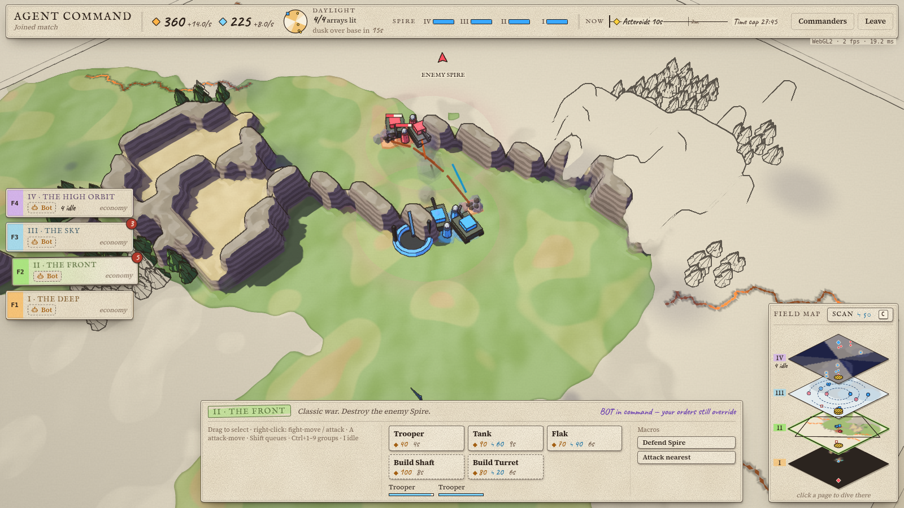 | 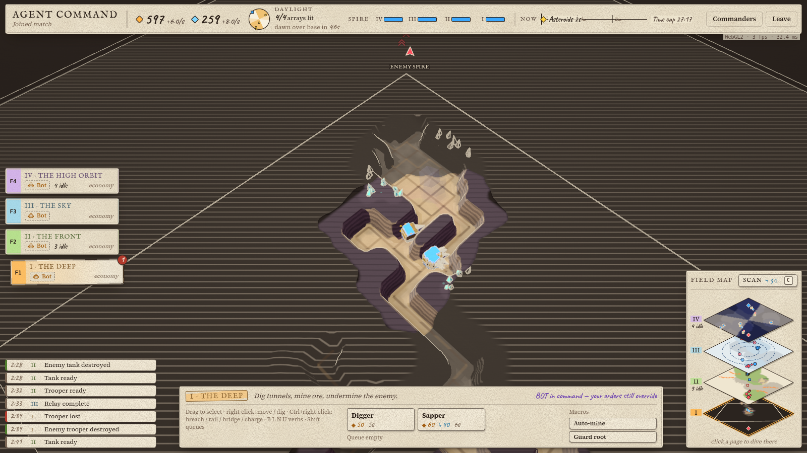 |
| **Sky** | **Orbit** |
| 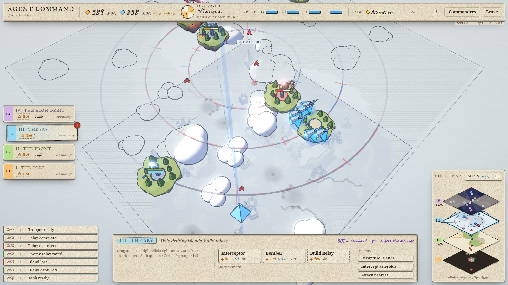 | 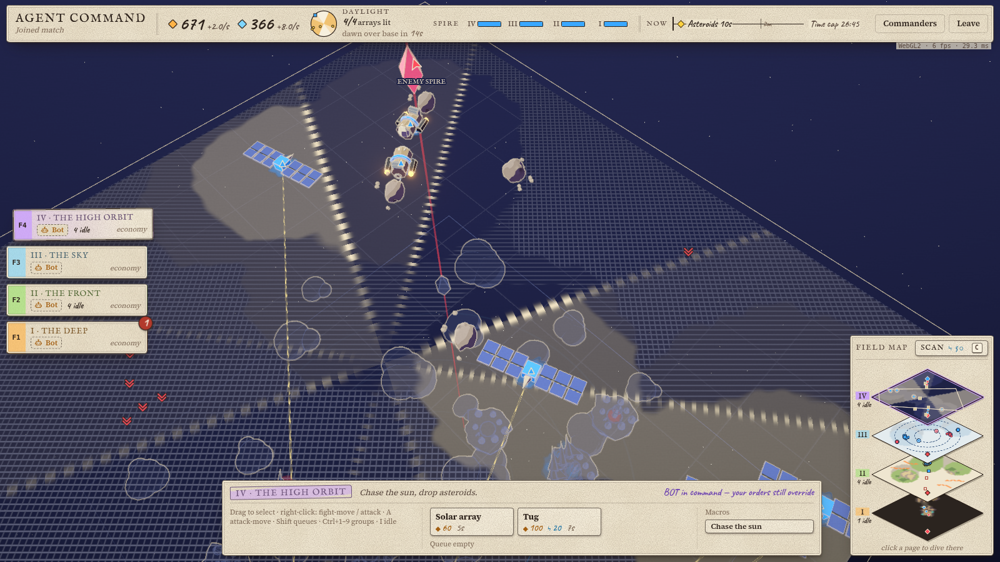 |

Per-plane renderer counters from the final live capture (including the visible ghost plane and rendering passes):

| Plane | Draw calls | Triangles | Sampled FPS | CPU frame EMA, ms |
|---|---:|---:|---:|---:|
| Surface | 46 | 168,057 | 2.11 | 12.57 |
| Depths | 30 | 82,107 | 3.53 | 19.33 |
| Sky | 63 | 136,843 | 2.11 | 18.67 |
| Orbit | 50 | 49,647 | 4.65 | 23.56 |

These are individual live samples, not averages from a controlled benchmark. `CPU frame EMA` is the client's
smoothed time spent submitting its frame, **not GPU time or inverse FPS**. The WSL capture session did **not** meet
the 30 FPS fallback target; the 1440p/60 FPS iGPU target, hardware GPU timings and ≤4 ms dirty-region rebuild budget
remain unverified. Draw/triangle budgets were met in these scenes, not proven for every battle.

The shared final web check passed typechecking, production build and all 32 tests in eight files before the later
facing regression additions. That build reported the main play chunk at **1,242.36 kB / 360.28 kB gzip** and the
connect-page chunk at **7.95 kB / 3.18 kB gzip**. These are emitted chunk sizes, not total download or GPU memory.
The final facing change was subsequently typechecked and built by integration; its additional checks are reported
with the main hand-off rather than counted as part of this capture run.

The media set also includes the lobby, Commanders overview, ready check, in-match commander popover, plane dive,
and a staged victory outcome. Combat and fog examples use real server dev-admin spawning/stepping in isolated data;
the outcome is explicitly forced for UI documentation, not evidence of bot balance.

| Live fight | Visible / explored / never seen |
|---|---|
| 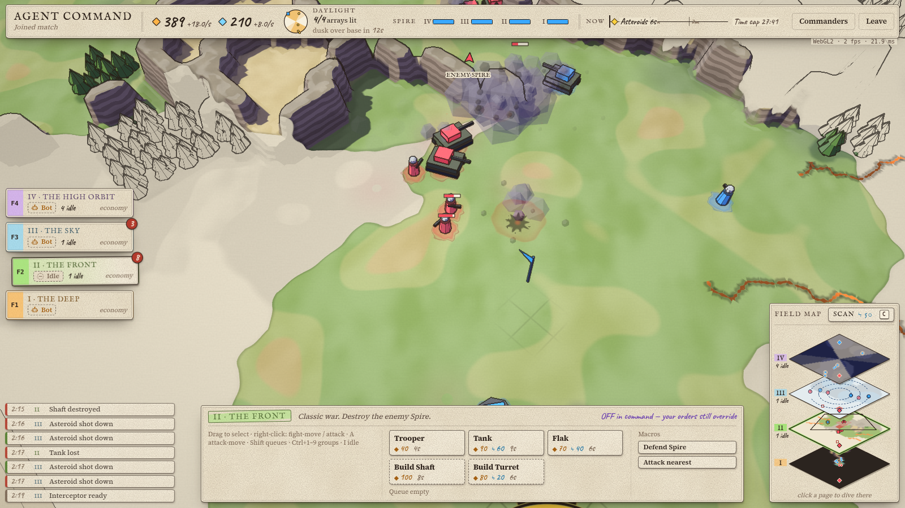 | 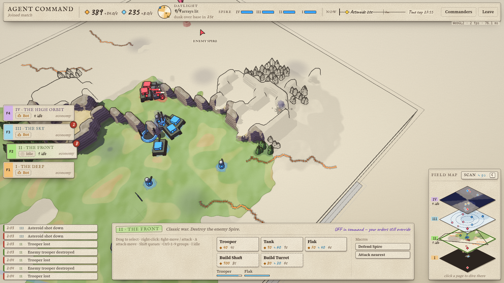 |
| **Live charge stamp** | **Deuteranopia simulation of the same frame** |
| 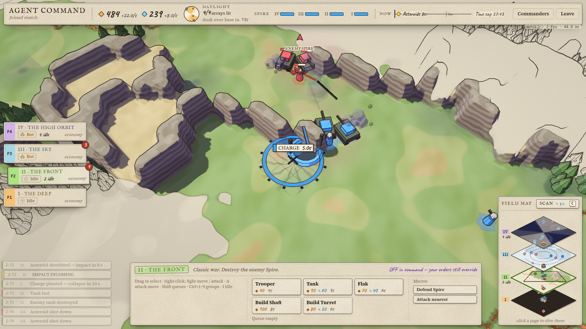 | 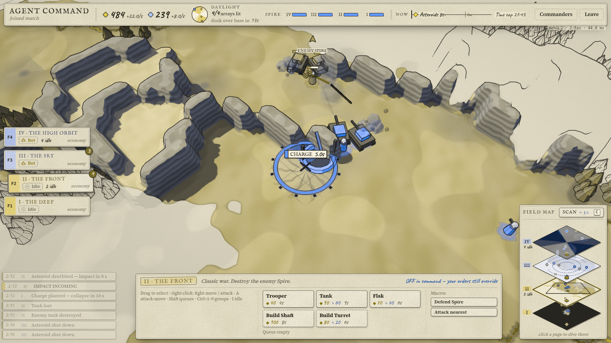 |

The fog pair [`fog-visible.png`](../media/fog-visible.png) → [`fog.png`](../media/fog.png) records a real unit
revealing a patch and then being removed: the final Surface view contains **849 visible, 219 explored-only and
1,236 never-seen cells**. The remembered cliff shading remains a pencil drawing while untouched terrain is blank
paper with outlines. [`telegraph-depths.png`](../media/telegraph-depths.png) shows the same planted charge underground.
The charge uses the owning team's blue stamp; its ring, ticks, cross and countdown label remain distinguishable
from units without relying on red versus amber alone.

The colour-vision image is an explicitly **derived simulation**, not another renderer/backend: the
[Machado–Oliveira–Fernandes full-severity deuteranopia matrix](https://www.inf.ufrgs.br/~oliveira/pubs_files/CVD_Simulation/CVD_Simulation.html)
was applied in linear RGB to the live PNG, then encoded back to sRGB. Its labels and stamp geometry remain readable;
this is a visual check, not a substitute for accessibility user testing.

The live plane and final staged-event runs reported **zero captured browser errors/warnings**. Event frames were
frozen only during PNG readback so a charge would not expire while WSL encoded the screenshot. Renderer counters
reset while a frame is frozen; those zero event counters are deliberately excluded from the performance table.
The complete phase-6 screenshot set and combined measurement record are retained under `/tmp/fieldjournal/phase-6/`;
earlier live phase evidence remains under `/tmp/fieldjournal/phase-3/`, `phase-4/` and `phase-5/`.

### In-match resource strip

The top HUD is a single row of paper chips, not a table: the Agent Command mark, alloy and energy resource
chips, the Spire objective, the time cluster and match actions. Each resource chip combines its icon,
large handwritten stock, small stamped name and income rate. Energy's focusable description explains solar
output and delivery capacity; a dashed lower rule marks capped solar. There is no always-on “Cap/s” table.

Stock widths are computed once, before joining the match, from the loaded handwriting font's six-digit
ink bounds and compact-suffix samples. The reservation includes side bearings and padding, and glyph overflow
is never clipped. Whole handwritten numbers retain their natural spacing; smaller rates/countdowns use tabular
figures. Six-digit stocks remain literal; larger values use compact suffixes. Values never resize their chips.

The time cluster starts with the 36px daylight dial; its dusk/dawn countdown sits top right with the match-limit
stamp beneath it. Four plane chips follow in plane order (Orbit, Sky, Surface, Depths), each a 64px stamp (56px
below 1200px) with the plane icon in its accent, a countdown or count, a stamped label and an accent underline like
the Spire columns. Each shows its plane's most relevant `view.alerts` item (next rocks; the next forecast storm
through growing/peak/breaking; the soonest drop; Depths threats first: enemy digging into our walls, enemy charges,
then breaches/tremors, then magma cooling); the tooltip lists the next few and a click jumps to the plane and spot.
A plane with nothing pending recedes to a dim icon, never a dash. Countdowns under 10 s and breakthrough threats
pulse in the plane accent (a static ring under reduced motion), never brand red. Daylight reads “dusk in 30s” with a
fixed, right-aligned number slot. Extra room expands the Spire, not the time cluster.

The 132px wordmark fills the strip's content height without changing its aspect. Below 1360px it becomes a round
52px badge (24px in the phone's compact first row), with density-aware sources instead of an illegible wordmark.
Orders uses two 22px rows: common actions above, match label and a full-size copy-link button below. The gear is
cap-height sized, not a taller button. Owner tickets with watch credentials expose **Copy spectator link**;
legacy PvP tickets expose **Copy invite link**. Direct joins and already-accepted profile PvP invitations do not
invent or recover sharing credentials. Every share action has a copy icon, explicit label and explanatory tooltip.

Spire columns carry the four plane-accent chapter stamps (IV–I), with separate own/enemy HP rows and pencil
hatching for unobserved enemy segments. Chips share paper tone, restrained ink rules and tight vertical rhythm.
Long labels ellipsize; the renderer/FPS readout is opt-in with `?stats` (on every surface, not only the HUD).

From 1024px, the strip is 76px high with a single 56px main row. Below that boundary the resources remain visible
and **Details** reveals the secondary groups. Escape returns focus; updates retain focused nodes; no animated
layout movement is introduced, including under reduced-motion preferences.

## 8. Orbit — the navigator's star atlas

**Target:** DESIGN §4.4's mini space RTS, not a ground battlefield with spacecraft substituted for tanks.
This is an isolated, animated art study in `apps/lookdev/src/orbit-atlas.ts`; no game-client or simulation
behaviour changes. Skiffs, Bastions, shields and the staged skirmish here are visual proposals, not claims
that their planned gameplay has shipped.

### Brief research → decisions

The useful common thread is a hierarchy: **class first, ownership second, action third, scenery last**.

| Reference and evidence | Application to this study |
|---|---|
| **Homeworld:** art director Karl Gryc explicitly names overall shape, class-specific striping and distinct weapon/impact effects as readability tools in the [carrier redesign interview](https://www.windowscentral.com/gaming/pc-gaming/homeworld-3-art-director-discusses-redesigning-spacecraft-for-a-pc-rts). The original [quick-reference card](https://homeworld.neocities.org/download/pdf/referenc.pdf) separates the movement disk, Sensors Manager and formation controls. | Give each role one dominant silhouette and two signature protrusions at most. Needle = beam frigate; broad shoulder = escort; dart = fighter. Stern glow and a tapering wake explain facing and recent turning without decorating every surface. Keep navigation graphics on a distinct chart layer. |
| **Sins of a Solar Empire II:** the developer's [gameplay-trailer breakdown, “The Empire Builder”](https://www.sinsofasolarempire2.com/article/527795/sins-ii-dev-journal-13---gameplay-trailer-breakdown) describes zooming from local construction out to the larger empire. | The study must survive real camera-distance changes, not only a beauty close-up. Broad masses, team dabs and narrow beams remain useful at distance; panels and PD barrels are secondary. Avoid a permanent full-field explosion of range rings. |
| **Stellaris fleet view:** the [interface reference](https://stellaris.paradoxwikis.com/Main_interface) separates system and galaxy views; the [core-component reference](https://stellaris.paradoxwikis.com/Core_components) treats sensors separately from propulsion. | Separate strategic information from decorative scale: one common navigation plane, ship groups as spatial units, and explicit sensor footprints. Range belongs to information, not to the glow radius of an engine. No fake vertical movement to make a flat battlefield look “space-like.” |
| **FTL:** the [battle-screen guide](https://www.ign.com/wikis/ftl-faster-than-light/Battle_Screen) distinguishes regenerating shields from non-regenerating hull, and describes sensor-dependent enemy information. | A shield hit is a short, hollow ellipse outside the hull; the hull remains readable inside. A continuous beam and tiny discontinuous PD tracers are different shapes, not merely different colours. Reserve strong emission for functional events. |

These are design interpretations, not claims that those games use our shaders or exact range UI.
The Homeworld interview/manual and FTL guide were read directly; the Sins/Paradox pages challenged the reader,
so their narrower zoom/view/sensor references above use their indexed excerpts. In particular, this study's
sensor rings, light/dark ratio and wake implementation are our proposals, not copied game rules.

**Depth on a flat plane:** perspective foreshortening, shallow faceted hull thickness, overlapping silhouettes,
underslung team washes, and chart-anchored rings establish height without confusing playable altitude.
Faint grid/constellation strokes and the atlas's ruled border give scale. The ship layer stays only 0.55 tile
above the chart; rocks have a little decorative height variance. The station alone rises prominently.

### Palette and motifs

- Indigo paper `#171e3a` (a slightly deeper local variation of Orbit's existing `#1e2245`); cream/chalk outlines
  `#e9dcc4`; blue-grey grid and constellation ink. No black void, photographic starfield or realistic metal.
- Nebulae are accumulated translucent pigment blooms, with paper fibres and sparse pinprick stars. They are
  painted once into a deterministic 2048² chart texture. The existing Field Journal post pass adds paper grain.
- Two opposite daylight sectors use a low-alpha gold wash and **dashed gold terminators**, respecting the
  point-symmetric sun design. The fixed study bearing is −0.18 rad and each wedge's half-angle is 0.67 rad.
  This fixed chart is an art fixture, not a second sun clock.
- Hull paint is cream `#dfd6ba`, steel `#9dacc0`, iron `#39435e`: at most three paints, plus team blue
  `#3aa8ff` / red `#ff4f5e` and one functional engine pigment, amber `#ffd59b`.
- Night-side models keep opaque silhouettes, chalk edges and team dabs, but lose luminance and shift cool.
  The selected sensor examples contract from **3.3 to 1.65 tiles** in night. These are illustrative ranges,
  not balance numbers and not server fog; neither team is hidden in this omniscient art fixture.

### Ship kit and staging

All hulls face +X and reuse tapered blocks and eight-sided prisms. No spheres, tori, wheels or smooth metallic
shading. Materials reuse the existing unlit two-tone `cel()` and MRT ink-outline pass. All thin model parts are
at least 0.06 units thick; raised caps/ribs avoid coplanar surfaces.

| Role | Dominant mass / signatures | Team paint sites | Triangles per model |
|---|---|---|---:|
| Skiff | Small dart, cropped wedge wing, stern engine | Cockpit cap + rear band/fin | 60 |
| Lancer | Long narrow frigate, forward beam barrel, raised rear housing | Broad deck cap + stern band | 72 |
| Bastion | Broad chamfered escort, two PD shoulder mounts | Deck cap + stern band | 136 |
| Solar array | Octagonal bus between two flat panel wings | Bus lid + bus band | 116 |
| Tug | Stubby bus, paired engines, stern grapple | Deck cap + stern band | 72 |
| Ascended interceptor | Wider Sky delta, pointed dart nose | Cockpit cap + tail band/fin | 60 |
| Orbit Spire station | Stacked octagonal station core in a ten-segment docking ring | Core cap + docking-ring band | 240 |

The fleet has **28 ships**: seven Skiffs, two Lancers, one Bastion, two arrays, one tug and one ascended
interceptor **per team**. The small dart versus broad delta keeps the two fighter origins distinguishable.
Arrays remain exposed behind the escort line; each tug has a visible grapple tether to one rock. The station
is upper-left in the normal capture. A broken, tilted, unpainted ring identifies the neutral derelict to the
upper-right; 24 faceted asteroids sit below the fleet, with 32 panel shards in a separate wreck-debris field.
Close zoom intentionally crops peripheral props to inspect the combat models; normal and wide show the ensemble.

**Bank and wake contract for later inertia:** fighters bank up to 0.30 rad (~17°), frigates/tugs/escorts only
0.08 rad (~5°); static arrays do not bank. Roll follows the authored turn phase instead of oscillating
independently. Each wake uses 18 progressively thinner samples of **past nozzle positions**, with 0.055 s
sample spacing and rearward exhaust advection. It therefore curves rather than rotating as one rigid stick.
The fixture uses bounded authored sway, not velocity integration, steering, collision or formation simulation.
For the live game, replace that fixture trajectory with interpolated snapshot positions/yaw, keep wake samples
in a fixed ring buffer, and derive bank from smoothed signed turn rate. Do not infer simulation thrust or
turn limits from the artistic sway; large hulls should carry their momentum through a turn rather than snap.

### Effects and scene performance

- Amber engine cores exceed the existing bloom threshold; hull paint never does.
- The Lancer uses a thin ice-blue beam core with a broader, translucent brush stroke. Six short amber PD
  tracers provide a separate dotted rhythm. These are allocated pools with active instance counts, not
  newly constructed meshes during combat.
- On the red Bastion's hit, two expanding ellipses shimmer with a spatial/temporal opacity wave. They disappear
  after the hit window; shields are not permanent opaque bubbles. Thin sensor rings sit on the chart below.
- The four-second art loop stages approach → PD → beam/hit → lingering shield → recovery. It is deterministic
  at arbitrary `t`, including trail history, so sequence frames do not depend on capture timing.
- One merged geometry per ship kind, one instanced draw per kind/team. Static station, rock and debris geometry
  is merged/instanced too. Shader colours retain the model kit's binary accent attribute.
- Runtime updates reuse an `Object3D`, typed scratch arrays and preallocated instance buffers. No per-frame
  JS object/array creation in the scene updater; an unchanged frozen time skips all matrix work. The bounded
  48-tile fixture disables pool frustum culling rather than retaining stale animated bounds. Production should
  use the existing entity instance-record/bounds path, not copy this preview's whole-pool uploads or culling.
- Reuses the existing MRT edges + paper + bloom pipeline, with no lights/shadow maps or compute-only features.
  WebGL2/ANGLE was exercised; WebGPU was not exercised. Draw counts below include postprocessing, not just hulls.

### Captures and measured evidence

```sh
pnpm --filter @agent-command/lookdev dev --host 127.0.0.1 --port 5217
# /?dir=atlas&plane=orbit&renderer=webgl&hud=0&zoom=normal&t=1.35
pnpm --filter @agent-command/lookdev shots:orbit
```

The capture command starts its own strict-port 5217 Vite server and headless Chromium, then closes both in
`finally`. `CHROME` can override the documented Chromium path. Omit `t` for animation; `labels=0` removes
the editorial title/legend independently of `hud=0`. Existing `ink/table/signal` comparison scenes remain.

| Normal: distance 30 | Wide: distance 52 | Close: distance 18 |
|---|---|---|
|  | 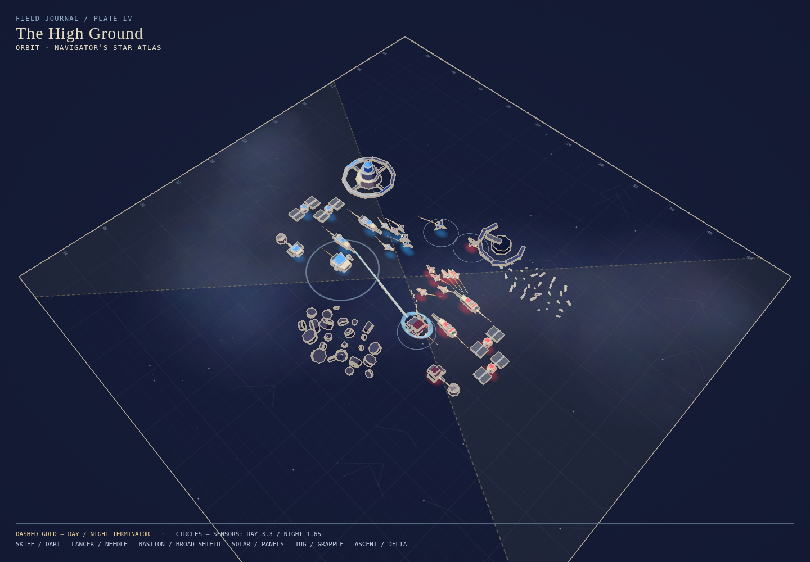 | 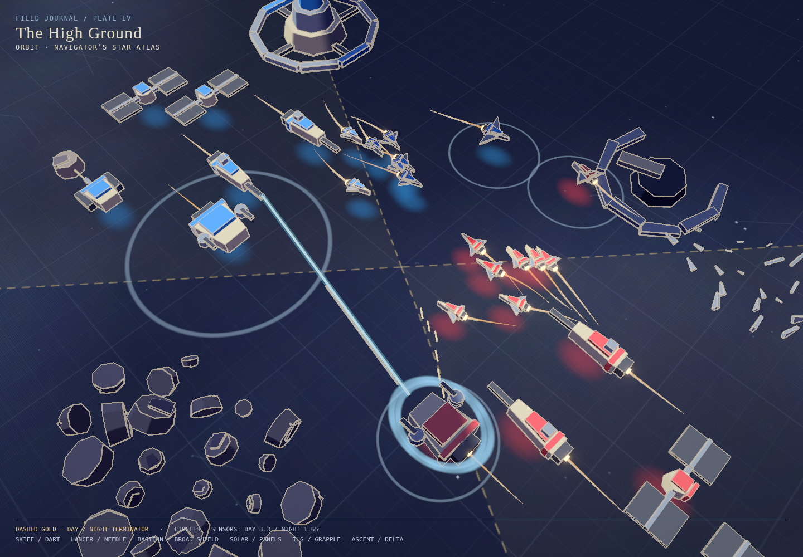 |

All three use the game camera's **50° FOV, 1 rad pitch and 45° yaw**, with no model rescaling between shots.
30 is the game's default distance; 18 and 52 are closer/farther gameplay-distance samples, not zoom clamps.
Capture viewport: **1440×1000**, device scale 1, WebGL2. At `t=1.35`, every camera recorded
**49 draw calls / 16,971 triangles**. Across the skirmish, **43–49 calls / 16,855–16,971 triangles**.
These are scene-complexity counters, not an FPS claim or a 600-unit production benchmark.

| 0.40 s — approach | 0.95 s — PD | 1.15 s — beam/hit |
|---|---|---|
|  | 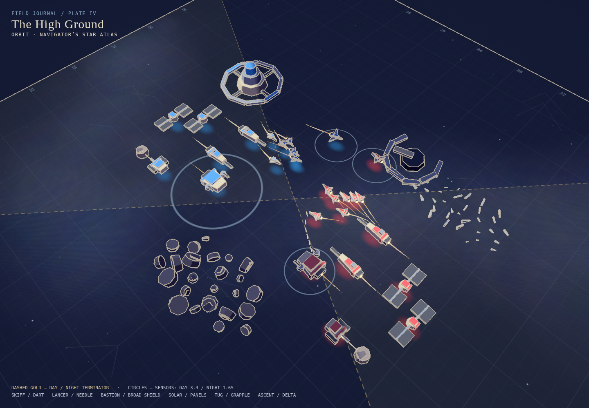 |  |
| **1.45 s — beam/shimmer** | **1.85 s — shield lingers** | **2.80 s — recovery** |
| 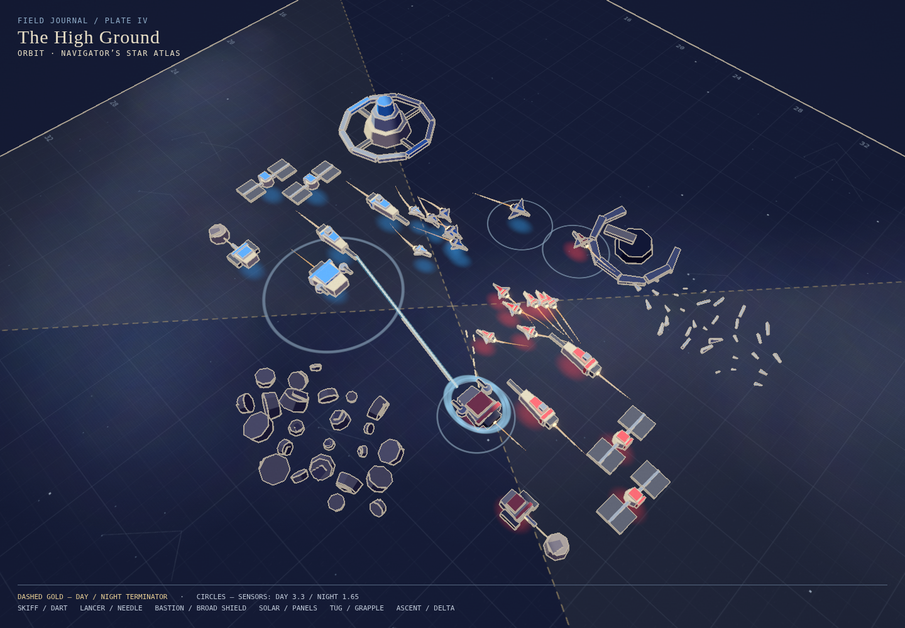 | 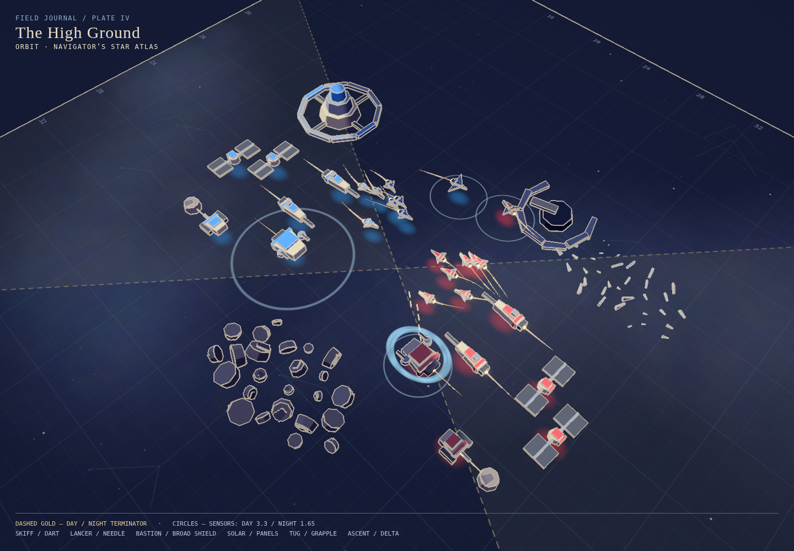 | 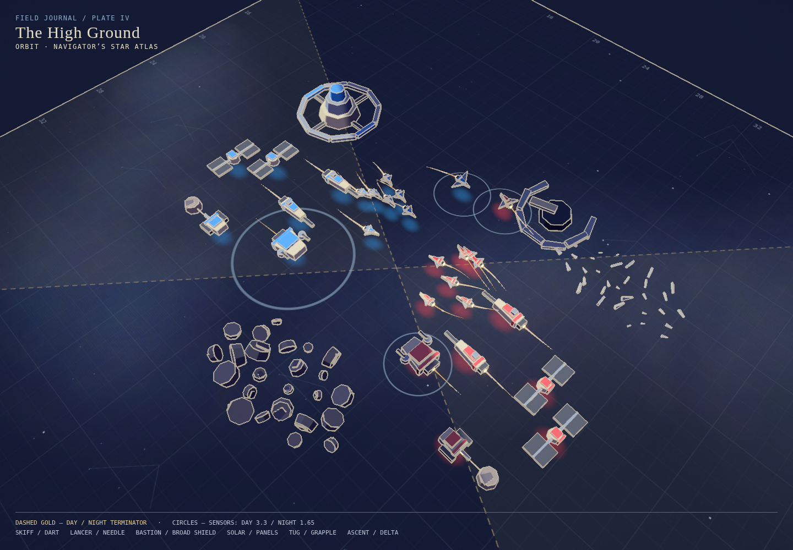 |

Machine-readable counters, exact times and model budgets: [`shots/orbit-evidence.json`](shots/orbit-evidence.json).
The final capture run recorded **zero page/console errors** and also advanced the unfrozen scene beyond
30 frames. `pnpm --filter @agent-command/lookdev typecheck` and `build` both passed.

### Step-by-step game-client migration

1. **Lock visual/readability decisions against these three distances.** Retain all six silhouettes and the
   existing cap/band rule. Confirm the fighter footprint and outline weight before changing live assets;
   keep the screenshot recipe as the comparison fixture.
2. **Move kit definitions into the existing model registry**, not a parallel Orbit renderer. Add Skiff/Bastion
   only alongside their authoritative registry kinds; replace the existing Lancer/solar/tug/Orbit-station
   definitions in place. Preserve `paint`, binary `accent` and rigid-part IDs. Update weapon muzzle anchors
   and their tests with geometry changes. Ascended interceptors reuse the interceptor model/identity.
3. **Move the chart treatment into the existing Orbit environment and palette path.** Keep one persistent
   paper/nebula texture, instance the sparse props and use the existing per-plane ink pipeline. Draw wedges
   and terminators from authoritative `sun.angle/half` on a dynamic shader/decal layer, not from this baked
   fixture texture. Keep the two wedges point-symmetric and remove the replaced Orbit background path.
4. **Integrate model pose with the current rigid-part/instance record.** Read interpolated position, yaw,
   turn rate and speed; bound and smooth bank per class. Trail pools store previous nozzle samples and
   expire them by render time. Reset trails on teleport, plane ascent, death and match reset; never bridge
   missing snapshots or stamp fake simulation velocity into presentation data.
5. **Integrate combat effects through existing combat event pools.** Map real Lancer/PD shot events to beam
   and tracer styles, with endpoints from muzzle/target data. Trigger shield shimmer only from authoritative
   shield-hit data, separately from hull damage. Respect the distinction between forward mounts and turret
   mounts; no visual beam may turn farther than its weapon's real firing arc.
6. **Integrate sensors and night without leaking fog.** Authoritative rules determine reduced night vision;
   the renderer only tints units already present in the fog-filtered view. Display sensor rings for the
   selected/hovered group or a deliberate sensor mode, not every unit. Use the real range values, and clip
   ownership/effects to the existing visibility rules. Scans and daylight transitions must not reveal
   hidden enemy positions through dabs, shields or lingering trails.
7. **Connect stations and resource props to live state.** Dock/repair rings, derelict ownership, debris,
   asteroid composition and tug links must reference actual entities/events; no decorative rock may look
   mineable if it is not. Keep decorative constellations quieter than actionable objects.
8. **Verify the cutover on both render backends**, normal/wide/close, both teams, all four plane transitions,
   night/day/scan boundaries, ascent, death/reset and repeated matches. Exercise the existing large-fleet
   perf scenario with pooled instances and bounds; retain the existing poly budgets and compare calls,
   triangles and frame time. Remove obsolete models/environment/effect paths once their callers migrate.

### Open questions before gameplay integration

- Should sensors show only the selected lead ship, a union of selected footprints, or a dedicated sensor mode?
  Four illustrative rings here are deliberately not a whole-fleet recommendation.
- Is 50% night reach appropriate? The design says “shorter,” not this exact number. Keep visibility penalties
  in authoritative rules; tune visual dimming independently so owned ships remain readable.
- How much station mass and fighter spacing survive a real crowded match? The wide shot preserves role masses,
  but the seven-ship swarms begin to overlap; production formation spacing and selection feedback need testing.
- Does a second shield outline remain legible under many simultaneous hits, or should only the hit-facing arc
  flash? Keep beam, shield, sensor and threat-stamp strokes semantically distinct.
- What inertia/turn-rate data will the snapshot expose? The art fixture establishes bank/wake language only;
  actual overshoot, escort speed and formation steering remain simulation decisions.
